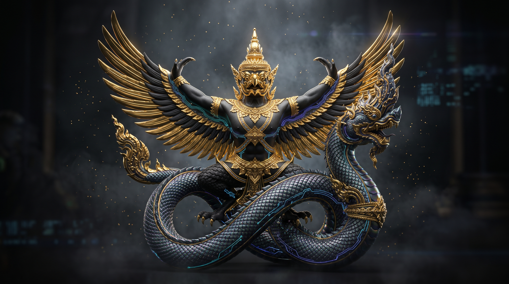
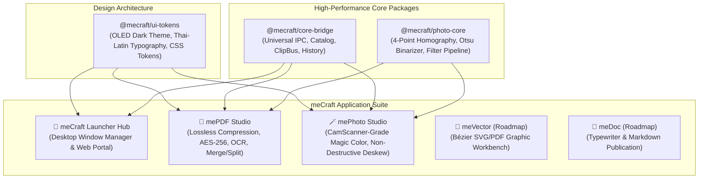

<p align="center">
  
</p>

# 🎨 meCraft Suite — Autonomous Creative & Document Workstation

> **100% Private, Zero-Server-Upload Document & Photo Engineering Ecosystem.**  
> Built with **Tauri v2 (Rust), Vite, TypeScript, Web Workers, Canvas API, and WebAssembly**.

[](https://mecrafts.vercel.app)
[](https://github.com/methastrategy/meCraft/actions/workflows/build-and-release.yml)
[](https://github.com/methastrategy/meCraft/releases)
[](https://github.com/methastrategy/meCraft/stargazers)
[](https://github.com/methastrategy/meCraft/network)
[-ea580c?style=for-the-badge&logo=tauri)](https://tauri.app/)
[](SECURITY.md)
[](https://vitest.dev/)
[](LICENSE)

---

### 🌐 Quick Access
- 🚀 **Official Web Portal (Zero-Install):** [https://mecrafts.vercel.app](https://mecrafts.vercel.app)  
  *(Deployment repository: [methastrategy/meCrafts-web](https://github.com/methastrategy/meCrafts-web))*
- 📄 **mePDF Web Studio:** [https://mecrafts.vercel.app/mepdf/](https://mecrafts.vercel.app/mepdf/)
- 🪄 **mePhoto Web Studio:** [https://mecrafts.vercel.app/mephoto/](https://mecrafts.vercel.app/mephoto/)
- 💾 **Download Desktop Installer (.exe):** [GitHub Releases](https://github.com/methastrategy/meCraft/releases)

---

## 📚 Documentation Index
- 🏗️ **[System Architecture](docs/ARCHITECTURE.md)** — Monorepo Seams, Universal ClipBus, 4-Point Homography, and Worker Pipelines
- 🎨 **[Design System Specification](docs/DESIGN_SYSTEM.md)** — Neue Klasse Luxury Dark Studio, OKLCH Tokens, Thai-Latin Typography
- 🗺️ **[Ecosystem Master Roadmap](docs/ROADMAP.md)** — Work Breakdown Structure, Feature Gates, and Upcoming Apps (`meVector`, `meDoc`)
- 🤝 **[Contributing Guidelines](CONTRIBUTING.md)** — Local Setup, Quality Gates, and Branch Conventions
- 📝 **[Changelog](CHANGELOG.md)** — Semantic Versioning Release Notes
- 🔒 **[Security & Privacy Policy](SECURITY.md)** — 100% In-Browser Privacy Guarantee & Vulnerability Disclosure
- 📄 **[License (MIT)](LICENSE)** — Open Source License

---

## 🌟 The meCraft Ecosystem

**meCraft** is a private-by-design desktop & web software suite that eliminates cloud dependency. All operations—from heavy multi-gigabyte PDF restructuring to sub-pixel document deskewing and OCR text layer injection—execute **100% inside your local CPU/GPU sandbox**. No servers, no subscriptions, no tracking, and zero byte leakage.



---

## ⚖️ Engineering Invariants & Non-Negotiables (กฎเหล็กที่ไม่สามารถประนีประนอมได้)

1. **🛡️ 100% In-Browser & Local Sandbox Invariant:**
   All document processing (PDF parsing, OCR, image deskew, and encryption) MUST execute on the local client device. Never transmit document bytes or images to remote servers.
2. **🪶 Memory Ceiling & LRU Cache Invariant:**
   DOM and JS heap memory must remain below 180MB when working on 100-page documents. The LRU thumbnail cache evicts pages at 120 items to eliminate iOS Safari canvas memory crashes.
3. **🇹🇭 Thai-Latin Mixed-Script Typography Invariant:**
   Latin typefaces MUST precede Thai fonts (`'Plus Jakarta Sans', 'Inter', 'IBM Plex Sans Thai'`). Thai text requires `letter-spacing: 0` and `line-height >= 1.70` to prevent diacritic clipping.
4. **⚡ 120fps Compositor-Only Motion Invariant:**
   All animations must bind to `transform` and `opacity` only. Never animate layout-triggering properties (`width`, `height`, `top`, `left`, `margin`).
5. **👆 Decoupled 44px Hit-Target Invariant:**
   Touch interactive targets on mobile and tablets must provide a minimum bounding hit-box of $\ge 44 \times 44\text{ px}$.
6. **📦 Zero-Defect Monorepo Quality Gate:**
   Every milestone requires 100% test pass rate (`npm test`, 226/226 tests) and zero TypeScript errors (`npm run typecheck`).

---

## 📦 Application Suite Overview

| Application | Workspace | Description | Technology Stack | Deployment | Status |
|:---|:---|:---|:---|:---:|:---:|
| **🚀 meCraft Launcher Hub** | `apps/mecraft-launcher` | Unified command portal, native process spawner (`DETACHED_PROCESS`), universal drag-and-drop auto-routing, and bilingual Thai/EN cockpit. | Tauri v2, Rust, Vite, TypeScript | Web + Windows (.exe) | **Stable** (`v3.2.0`) |
| **📄 mePDF Studio** | `apps/mepdf` | Complete client-side PDF engineering: Merge, Split, Dual-Engine Smart Compression (Lossless & Scanned), 256-bit AES encryption, and searchable OCR injection. | PDF.js, pdf-lib, Web Workers | Web + Windows (.exe) | **Stable** (`v3.2.0`) |
| **🪄 mePhoto Studio** | `apps/mephoto` | CamScanner-grade document lab: 4-point homography perspective warp, adaptive Otsu binarization, Magic Color enhancement, and unsharp text sharpening. | Canvas API, `@mecraft/photo-core` | Web + Windows (.exe) | **Stable** (`v1.0.0`) |
| **📐 meVector** | `apps/mevector` | Precision Bézier vector illustrator, boolean path operations, and infinite-resolution SVG/PDF export. | Vector Canvas Engine | Planned | *Roadmap* |
| **📝 meDoc** | `apps/medoc` | Distraction-free typewriter, live LaTeX formula rendering, bilingual grammar engine, and academic publishing. | Typography Engine | In Development | *Roadmap* |

---

## 🥊 Competitive Advantage: Why meCraft?

| Capability | Adobe Acrobat Pro | CamScanner | Smallpdf / iLovePDF | **meCraft Suite** |
|:---|:---:|:---:|:---:|:---:|
| **Data Privacy** | ⚠️ Cloud Upload | ⚠️ Server Processed | ⚠️ Uploads to Remote Cloud | 🛡️ **100% Local / Zero Upload** |
| **Cost Model** | \$19.99–\$29.99/mo | \$5.99–\$9.99/mo | \$12/mo | 💎 **100% Free & Open Source (MIT)** |
| **Daily File Limits** | Unlimited (Paid) | Daily Cap (Free) | 2–3 tasks/day (Free) | ♾️ **Unlimited (Local CPU Bound)** |
| **Offline Execution** | Requires Sync | Mobile Cloud | Requires Internet | ⚡ **Full Offline (Desktop & PWA)** |
| **Smart Compression** | Basic | N/A | Server-Side | 🚀 **Dual-Engine (Lossless + Scanned)** |
| **Cross-Tool ClipBus** | Proprietary Cloud | Proprietary Cloud | None | ⚡ **Universal Instant In-Memory Bus** |
| **Native RAM Footprint**| ~800MB–1.5GB | Mobile Only | Browser Tab | 🪶 **~30MB Desktop (Tauri v2 / Rust)** |

---

## 💻 Building & Packaging

### Quick Start
```bash
# Clone the repository
git clone https://github.com/methastrategy/meCraft.git
cd meCraft

# Install all workspace dependencies
npm install

# Run automated test suites (226 passing tests across 19 suites)
npm test

# Typecheck across all 6 workspaces (0 errors)
npm run typecheck
```

### Local Development
```bash
# Web development servers
npm run dev:launcher   # Launcher Hub (http://localhost:5175)
npm run dev:pdf        # mePDF Studio (http://localhost:5173)
npm run dev:photo      # mePhoto Studio (http://localhost:5174)
```

### Production Build & Packaging
```bash
# Assemble multi-app web distribution into dist/
npm run build:web

# Generate installer luxury dark bitmaps
npm run generate:bitmaps
```

---

## 📄 License

meCraft Suite is open-source software licensed under the **[MIT License](LICENSE)**.
