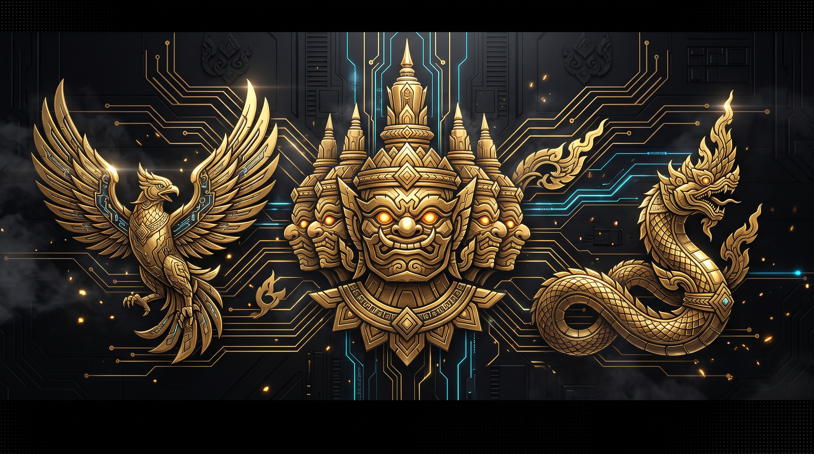
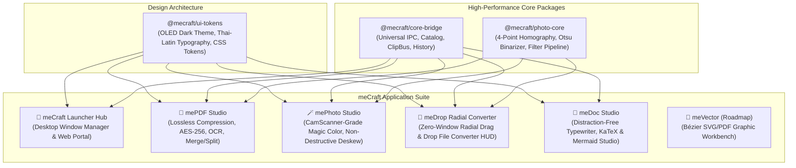
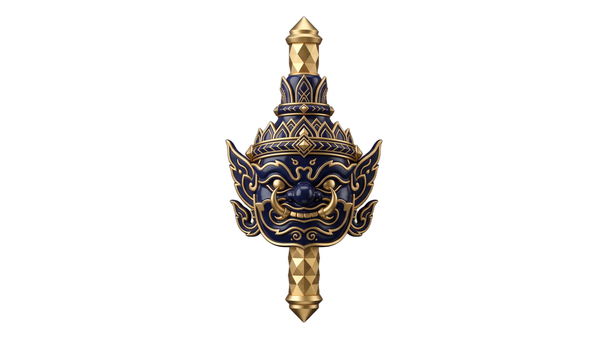
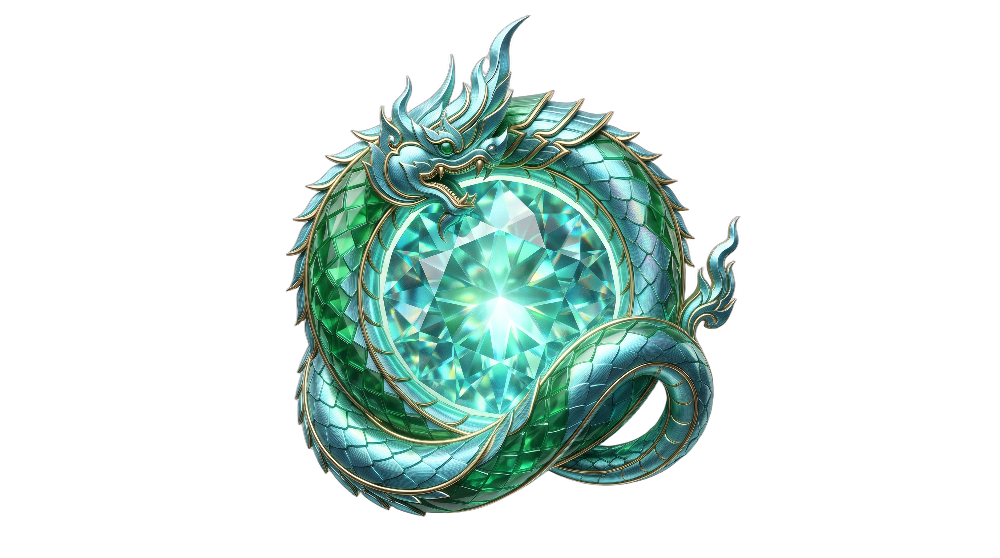
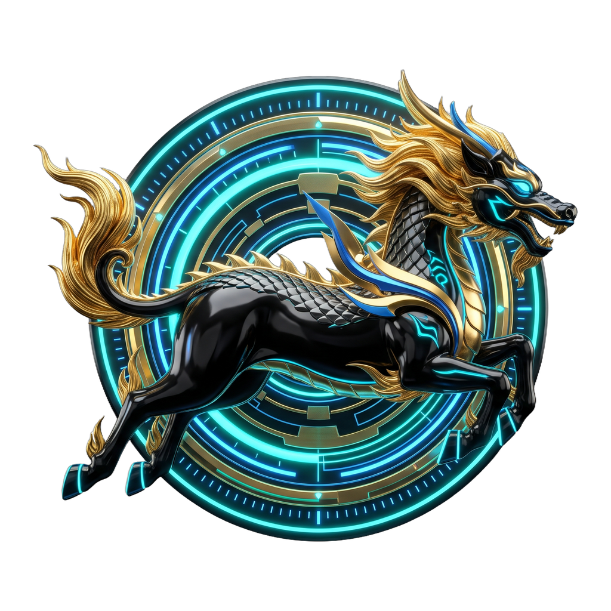
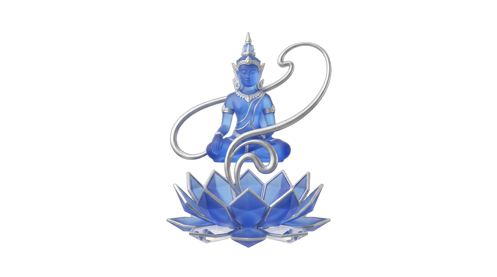
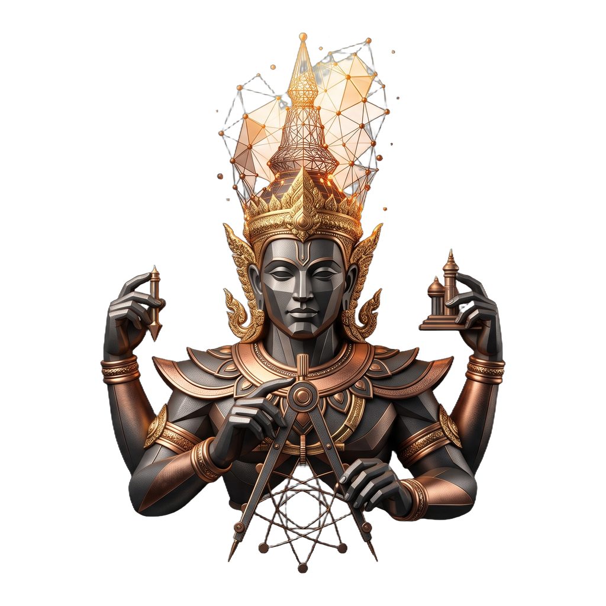
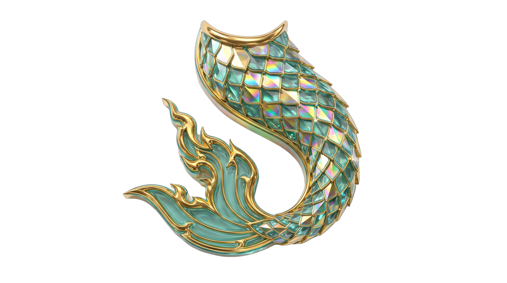
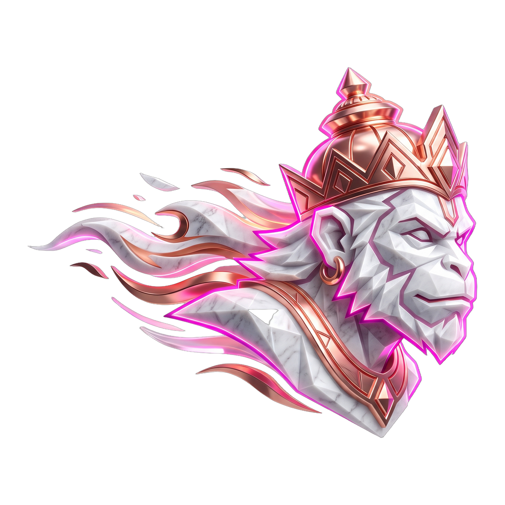
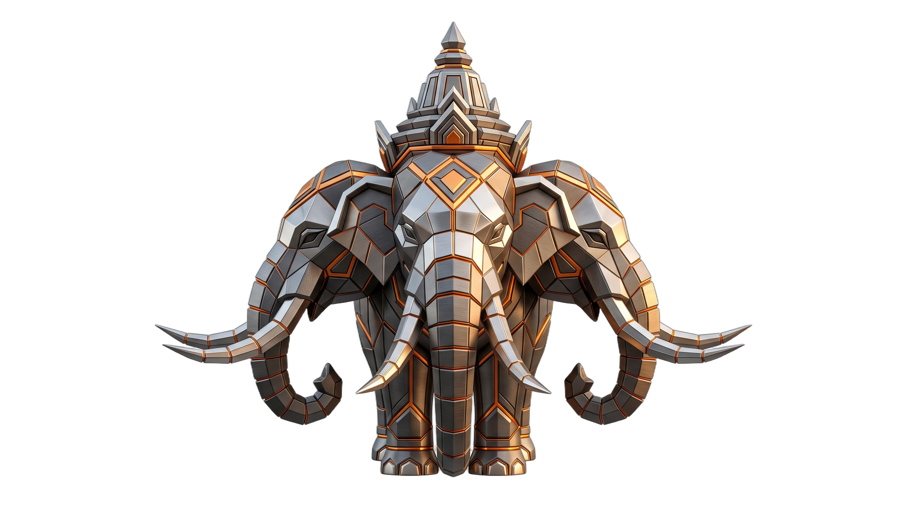

<p align="center">
  
</p>

# 🚀 meCraft — The Private-First AI IDE & 18 Creative Studios Suite for Windows

> **VS Code & Windsurf-grade Next-Gen AI IDE Workspace + 18 Standalone Creative Studios.**  
> Built with **Tauri v2 (Rust), Vite, TypeScript, Web Workers, Canvas API, and WebAssembly**.

[](https://mecrafts.vercel.app)
[](https://github.com/methastrategy/meCraft/actions/workflows/build-and-release.yml)
[](https://github.com/methastrategy/meCraft/releases)
[](https://github.com/methastrategy/meCraft/stargazers)
[](https://github.com/methastrategy/meCraft/network)
[-ea580c?style=for-the-badge&logo=tauri)](https://tauri.app/)
[](SECURITY.md)
[](https://vitest.dev/)
[](LICENSE)

---

### 🌐 Quick Access
- 🚀 **Official Web Portal (Zero-Install):** [https://mecrafts.vercel.app](https://mecrafts.vercel.app)  
  *(Deployment repository: [methastrategy/meCrafts-web](https://github.com/methastrategy/meCrafts-web))*
- 💻 **meCraft AI IDE Workspace:** [https://mecrafts.vercel.app](https://mecrafts.vercel.app) (Default View)
- 📄 **mePDF Web Studio:** [https://mecrafts.vercel.app/mepdf/](https://mecrafts.vercel.app/mepdf/)
- 🪄 **mePhoto Web Studio:** [https://mecrafts.vercel.app/mephoto/](https://mecrafts.vercel.app/mephoto/)
- 🍩 **meDrop Radial Converter (Zero-Window HUD):** [https://mecrafts.vercel.app/medrop/](https://mecrafts.vercel.app/medrop/)
- 📝 **meDoc Markdown Studio:** [https://mecrafts.vercel.app/medoc/](https://mecrafts.vercel.app/medoc/)
- 💾 **Download Desktop Installer (.exe):** [GitHub Releases](https://github.com/methastrategy/meCraft/releases)

---

## ⚡ Keyboard Shortcuts & Quick Navigation

| Action | Shortcut | Description |
| :--- | :--- | :--- |
| **Direct File Save** | `Ctrl + S` | Direct disk write via File System API & dirty state `●` clearing |
| **Open Folder** | `Ctrl + K Ctrl + O` | Opens real local directory into Explorer pane |
| **Open File** | `Ctrl + O` | Open local file into editor |
| **New File** | `Ctrl + N` | Create new file in workspace |
| **Toggle Split Preview** | Click 📖 Preview | Real-time KaTeX math & GitHub-flavored Markdown preview |
| **Toggle AI Copilot** | Click ✨ AI Copilot | 100% In-Device RAM Copilot dock |
| **Toggle Terminal** | Click 💻 Terminal | Integrated terminal and command runner |
| **Switch to Studios** | Click 📦 Studios | Access all 18 Thai Mythology Guardian Studios |

---

## 📚 Documentation Index
- 🏗️ **[System Architecture](docs/ARCHITECTURE.md)** — Monorepo Seams, Universal ClipBus, 4-Point Homography, and Worker Pipelines
- 🎨 **[Design System Specification](docs/DESIGN_SYSTEM.md)** — Neue Klasse Luxury Dark Studio, OKLCH Tokens, Thai-Latin Typography
- 🗺️ **[Ecosystem Master Roadmap](docs/ROADMAP.md)** — Work Breakdown Structure, Feature Gates, and Upcoming Apps (`meVector`, `meDoc`)
- 🤝 **[Contributing Guidelines](CONTRIBUTING.md)** — Local Setup, Quality Gates, and Branch Conventions
- 📝 **[Changelog](CHANGELOG.md)** — Semantic Versioning Release Notes
- 🔒 **[Security & Privacy Policy](SECURITY.md)** — 100% In-Browser Privacy Guarantee & Vulnerability Disclosure
- 📄 **[License (MIT)](LICENSE)** — Open Source License

---

## 🌟 The meCraft Ecosystem

**meCraft** is a private-by-design desktop & web software suite that eliminates cloud dependency. All operations—from heavy multi-gigabyte PDF restructuring to sub-pixel document deskewing and OCR text layer injection—execute **100% inside your local CPU/GPU sandbox**. No servers, no subscriptions, no tracking, and zero byte leakage.



---

## ⚖️ Engineering Invariants & Non-Negotiables (กฎเหล็กที่ไม่สามารถประนีประนอมได้)

1. **🛡️ 100% In-Browser & Local Sandbox Invariant:**
   All document processing (PDF parsing, OCR, image deskew, and encryption) MUST execute on the local client device. Never transmit document bytes or images to remote servers.
2. **🪶 Memory Ceiling & LRU Cache Invariant:**
   DOM and JS heap memory must remain below 180MB when working on 100-page documents. The LRU thumbnail cache evicts pages at 120 items to eliminate iOS Safari canvas memory crashes.
3. **🇹🇭 Thai-Latin Mixed-Script Typography Invariant:**
   Latin typefaces MUST precede Thai fonts (`'Plus Jakarta Sans', 'Inter', 'IBM Plex Sans Thai'`). Thai text requires `letter-spacing: 0` and `line-height >= 1.70` to prevent diacritic clipping.
4. **⚡ 120fps Compositor-Only Motion Invariant:**
   All animations must bind to `transform` and `opacity` only. Never animate layout-triggering properties (`width`, `height`, `top`, `left`, `margin`).
5. **👆 Decoupled 44px Hit-Target Invariant:**
   Touch interactive targets on mobile and tablets must provide a minimum bounding hit-box of $\ge 44 \times 44\text{ px}$.
6. **📦 Zero-Defect Monorepo Quality Gate:**
   Every milestone requires 100% test pass rate (`npm test`, 326/326 tests across 29 test files) and zero TypeScript errors (`npm run typecheck`).

---

## 📦 Application Suite & Thai Mythology Guardian Guardians (18 Studios)

| Emblem | Application | Guardian Deity & Lore | Description | Technology Stack | Status |
|:---:|:---|:---|:---|:---|:---:|
|  | **🚀 meCraft Hub** | **ทศกัณฐ์ (Thotsakan)**<br>Demon King with 10 Heads & 20 Arms | Central Command Hub, window manager, and single-click offline orchestration. | Tauri v2, Rust, Vite, TypeScript | **Stable** (`v1.0.0`) |
|  | **📄 mePDF Studio** | **ท้าวเวสสุวรรณ (Thao Vessuwan)**<br>Guardian of Treasures & Diamond Mace | Complete client-side PDF engineering: Merge, Split, Lossless/Scanned Compression, AES-256, OCR. | PDF.js, pdf-lib, Web Workers | **Stable** (`v1.0.0`) |
|  | **🪄 mePhoto Studio** | **พญานาค (Phraya Naga)**<br>Emerald Serpent with Radiant Gem | CamScanner-grade document lab: 4-point homography deskew, Otsu binarization, Magic Color. | Canvas API, `@mecraft/photo-core` | **Stable** (`v1.0.0`) |
|  | **🍩 meDrop Radial HUD** | **ม้านิลมังกร (Ma Nil Mangkon)**<br>Swift Dragon-Horse & Radial Wheel | Zero-Window Radial Drag & Drop File Converter HUD. Instant local RAM conversion on Ctrl+Drag. | Tauri v2, Rust Hook, SVG Donut | **Stable** (`v1.0.0`) |
|  | **📝 meDoc Studio** | **พระสุนทรีวาณี (Sunthari Vani)**<br>Goddess of Eloquence & Crystal Lotus | Distraction-free typewriter, live KaTeX LaTeX formula rendering, inline Mermaid diagrams, clean PDF export. | marked, KaTeX, Mermaid, pdf-lib | **Stable** (`v1.0.0`) |
|  | **📐 meVector Studio** | **พญาครุฑ (Phraya Garuda)**<br>King of Birds with Feather Splines | Precision Bézier vector illustration, sub-pixel node editor, Boolean geometry, SVG/PDF. | Vector Canvas, `@mecraft/studio-shell` | **Ready** (`v1.0.0`) |
|  | **🧊 me3D Studio** | **พระวิศวกรรม (Vishvakarman)**<br>Celestial Architect & Builder of Worlds | Spatial polyhedral mesh modeling, real-time physically-based rendering (PBR), HDRI lighting. | Three.js / WebGPU PBR | **Ready** (`v1.0.0`) |
|  | **🎬 meFilm Studio** | **นางกินรี (Kinnari Maiden)**<br>Celestial Creature with Golden Wings | Non-linear video timeline, multi-track sequencing, WebCodecs hardware decode, zero-transcode preview. | WebCodecs, WebGL, Canvas | **Ready** (`v1.0.0`) |
|  | **✨ meLight Studio** | **นางสุพรรณมัจฉา (Suphannamatcha)**<br>Golden Mermaid with Iridescent Scales | High-bit-depth non-destructive RAW photo grading, 3D LUT grading, HSL curves, parametric exposure. | WebGPU / WebAssembly | **Ready** (`v1.0.0`) |
|  | **⚡ meMotion Studio** | **หนุมาน (Hanuman)**<br>White Monkey God of Agile Motion | 120fps motion design, keyframe easing curves, particle kinetic bursts, Lottie & WebM hardware export. | WebGPU, Compositor Engine | **Ready** (`v1.0.0`) |
|  | **📐 meDesign Studio** | **ช้างเอราวัณ (Erawan Elephant)**<br>3-Headed Divine Architect Elephant | UI/UX prototyping, design systems, typographic baseline grids, master layout artboards. | Canvas 2D, SVG Engine | **Ready** (`v1.0.0`) |
|  | **🎵 meAudio Studio** | **พระพิราพ (Phra Phirap)**<br>Master Deity of Dramatic Arts & Sound | 32-bit float audio DAW, waveform inspector, spectral de-noise, multi-track podcast mixing. | Web Audio API, AudioWorklets | **Ready** (`v1.0.0`) |
|  | **📊 meDeck Studio** | **พระพิฆเนศ (Ganesha)**<br>Lord of Intellect, Wisdom & High-Impact Arts | High-impact interactive presentation and keynote slide studio with PDF/WebDeck export. | Canvas 2D, Slide Layout Engine | **Ready** (`v1.0.0`) |
|  | **📈 meSheet Studio** | **พระแม่โพสพ (Phra Mae Phosop)**<br>Goddess of Abundance & Financial Balance | Reactive financial modeling & high-volume client-side spreadsheet grid with 400+ formulas. | WASM Calc Engine, High-Density Grid | **Ready** (`v1.0.0`) |
|  | **📐 meCAD Studio** | **พระพรหม (Phra Phrom)**<br>Four-Faced Divine Creator & Universal Blueprint | 2D engineering CAD drafting, clean-room DXF parsing, snap grid, millimeter precision plotter. | 2D Geometry Engine, WebGL | **Active** (`v1.0.0`) |
|  | **🎨 meTexture Studio** | **พาลี (Vali)**<br>Emerald Simian Sovereign with Immeasurable Force | Direct 3D mesh surface painter, texture projection, and real-time UV unwrapping workbench. | WebGL 2.0 / WebGPU Canvas | **Active** (`v1.0.0`) |
|  | **💎 meMaterial Studio** | **สุครีพ (Sugriva)**<br>Solar Simian King of Radiant Light & Refraction | Procedural node-based PBR material synthesis, BRDF microfacet visual shader graph builder. | WebGPU Shader Graph | **Active** (`v1.0.0`) |
|  | **🏃 meAni Studio** | **องคต (Angada)**<br>Peerless Messenger of Velocity & Sovereign Leap | 2D skeletal animation, inverse kinematics (IK) rigging, timeline curve graph, and sprite sheets. | 2D Rigging Engine, Canvas | **Active** (`v1.0.0`) |
|  | **⚡ meREA Studio** | **มัยราพณ์ (Maiyarap)**<br>Lord of the Underworld & Occult Decryption | Deep binary reverse engineering, disassembled control-flow graph (CFG), and clean-room synthesis. | REA Byte Engine, Graphviz Web | **Active** (`v1.0.0`) |

---

## 🥊 Competitive Advantage: Why meCraft?

| Capability | Adobe Acrobat Pro | CamScanner | Smallpdf / iLovePDF | **meCraft Suite** |
|:---|:---:|:---:|:---:|:---:|
| **Data Privacy** | ⚠️ Cloud Upload | ⚠️ Server Processed | ⚠️ Uploads to Remote Cloud | 🛡️ **100% Local / Zero Upload** |
| **Cost Model** | \$19.99–\$29.99/mo | \$5.99–\$9.99/mo | \$12/mo | 💎 **100% Free & Open Source (MIT)** |
| **Daily File Limits** | Unlimited (Paid) | Daily Cap (Free) | 2–3 tasks/day (Free) | ♾️ **Unlimited (Local CPU Bound)** |
| **Offline Execution** | Requires Sync | Mobile Cloud | Requires Internet | ⚡ **Full Offline (Desktop & PWA)** |
| **Smart Compression** | Basic | N/A | Server-Side | 🚀 **Dual-Engine (Lossless + Scanned)** |
| **Cross-Tool ClipBus** | Proprietary Cloud | Proprietary Cloud | None | ⚡ **Universal Instant In-Memory Bus** |
| **Native RAM Footprint**| ~800MB–1.5GB | Mobile Only | Browser Tab | 🪶 **~30MB Desktop (Tauri v2 / Rust)** |

---

## 💻 Building & Packaging

### Quick Start
```bash
# Clone the repository
git clone https://github.com/methastrategy/meCraft.git
cd meCraft

# Install all workspace dependencies
npm install

# Run automated test suites (332+ passing tests across 29 test suites)
npm test

# Typecheck across all 6 workspaces (0 errors)
npm run typecheck
```

### Local Development
```bash
# Web development servers
npm run dev:launcher   # Launcher Hub (http://localhost:5175)
npm run dev:pdf        # mePDF Studio (http://localhost:5173)
npm run dev:photo      # mePhoto Studio (http://localhost:5174)
```

### Production Build & Packaging
```bash
# Assemble multi-app web distribution into dist/
npm run build:web

# Generate installer luxury dark bitmaps
npm run generate:bitmaps
```

---

## 📄 License

meCraft Suite is open-source software licensed under the **[MIT License](LICENSE)**.
