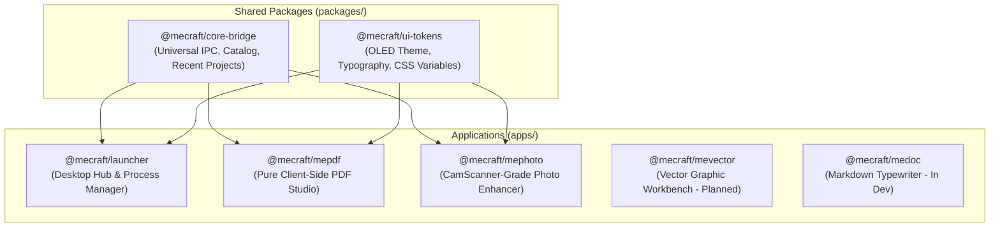

# 🎨 meCraft — Creative & Document Engineering Monorepo

> **100% Private, Zero-Server-Upload Document & Photo Workstation Ecosystem.**  
> Built with **Tauri v2 (Rust), Vite, TypeScript, PDF.js, pdf-lib, and Web Workers**.

[](https://www.typescriptlang.org/)
[](https://tauri.app/)
[](https://vitejs.dev/)
[](https://vitest.dev/)
[](LICENSE)

---

## 🌟 The meCraft Ecosystem

meCraft is a modular monorepo combining native desktop performance with pure client-side web privacy. It houses an ecosystem of creative and document applications managed via a centralized desktop hub.



### 📦 Applications Overview

| Application | Workspace | Description | Stack | Status |
|:---|:---|:---|:---|:---:|
| **🚀 meCraft Launcher** | `apps/mecraft-launcher` | Desktop Ecosystem Hub, binary auto-installer, process manager & universal recent projects | Tauri v2, Rust, Vite, TS | **Stable** (`v1.0.0`) |
| **📄 mePDF Studio** | `apps/mepdf` | Pure client-side PDF workstation: Merge, Split, Lossless Compression, AES-256 Encryption | PDF.js, pdf-lib, Web Worker | **Stable** (`v3.1.0`) |
| **🪄 mePhoto Studio** | `apps/mephoto` | CamScanner-grade document binarization, Magic Color, deskew straightening & photo workbench | Canvas API, Otsu Algorithm | **Stable** (`v1.0.0`) |
| **📐 meVector** | *Coming Soon* | Vector illustration, Bézier path manipulation & resolution-independent SVG/PDF workbench | Vector Engine | *Planned* |
| **📝 meDoc** | *In Dev* | Distraction-free typewriter, live LaTeX equations & Markdown publication suite | Typography Engine | *In Development* |

### 🧩 Shared Packages

| Package | Workspace | Description |
|:---|:---|:---|
| **`@mecraft/core-bridge`** | `packages/core-bridge` | Cross-app IPC contracts, application catalog, recent projects history manager, and dual-mode fallback (Tauri desktop / Web localStorage). |
| **`@mecraft/ui-tokens`** | `packages/ui-tokens` | Unified design tokens, Dark OLED color palette, mixed Thai-Latin typography, optical touch targets, and CSS variables. |

---

## ✨ Key Capabilities

### 1. 🚀 meCraft Launcher (Ecosystem Hub)
- **App Catalog & Release Downloader:** Browse ecosystem apps and download official releases directly from GitHub Releases.
- **Background Process Spawner:** Launches native executables (`.exe`) in isolated background process groups (`DETACHED_PROCESS`).
- **Path Traversal Security Guard:** Strict whitelist protection in Rust backend (`["mepdf", "mephoto", "mevector", "medoc"]`) preventing directory traversal attacks.
- **Universal Recent Projects:** Cross-application history tracking with 1-click relaunch.
- **Accessible & Selectable UI:** Full WAI-ARIA compliance (`role="tablist"`, `role="menu"`), keyboard shortcuts (`Enter`/`Space`), and selectable text/paths.

### 2. 📄 mePDF Studio
- **100% In-Browser Privacy:** All PDF rendering, merging, reordering, and compression happen entirely inside the browser sandbox. Zero byte uploads to external servers.
- **Dual-Engine Smart Compression:** Lossless stream deflation (preserving 100% text vectors and `Ctrl+F` searchability) alongside scanned image canvas downsampling.
- **Security & Pro Tools:** 256-bit AES password encryption, custom text/image watermarks, automated page numbering, and 1-click personal metadata sanitizer.
- **Web Worker Offloading:** Heavy PDF crunching runs in dedicated Web Workers without freezing the UI thread (60–120 fps).
- **Cloud Library Integration:** Optional Supabase integration for encrypted cloud backup and cross-device sync.

### 3. 🪄 mePhoto Studio
- **CamScanner-Grade Magic Color:** Automatic document background whitening and contrast boosting for paper scans.
- **Adaptive Otsu Binarization:** Converts scanned receipts and forms into high-contrast, printer-ready black & white documents.
- **Precision Straighten & Deskew:** Sub-degree rotation and perspective deskew ($-45^\circ \dots +45^\circ$).
- **Unsharp Mask Filter:** Edge enhancement for text legibility.
- **Multi-Format Export:** Batch export to PNG, JPG, WebP, or direct conversion into standardized A4 PDFs.

---

## 🛡️ Core Engineering Invariants

1. **Zero-Server-Upload Privacy:** User documents, photos, and personal data never leave the local machine.
2. **Dual-Deployment Architecture:** Operates as a zero-install static Single Page Application (PWA Offline) or as a native Windows Desktop application (~30MB RAM footprint).
3. **Memory Ceiling Guarantee:** JS heap stays strictly managed under large workloads using decoupled IndexedDB storage and LRU thumbnail caching.
4. **Thai-Latin Mixed Typography:** Latin fonts precede Thai fonts in typography stacks (`"Inter", "IBM Plex Sans Thai"`), ensuring non-colliding diacritics and optical vertical alignment.

---

## 🚀 Quick Start & Development

### Prerequisites
- [Node.js](https://nodejs.org/) `>= 20.x`
- [Rust](https://www.rust-lang.org/) `>= 1.78` (only required for building native desktop apps)

### 1. Installation
Clone the repository and install all workspace dependencies:
```bash
git clone https://github.com/methastrategy/meCraft.git
cd meCraft
npm install
```

### 2. Running Web Development
Start development servers for individual apps:
```bash
# Launch meCraft Launcher Hub (Web mode)
npm run dev:launcher

# Launch mePDF Studio
npm run dev:pdf

# Launch mePhoto Studio
npm run dev:photo
```

### 3. Running Native Desktop (Tauri v2)
Launch native desktop developer windows with Rust hot-reload:
```bash
# Native Desktop meCraft Launcher
npm run desktop:launcher

# Native Desktop mePDF Studio
npm run desktop:pdf

# Native Desktop mePhoto Studio
npm run desktop:photo
```

### 4. Verification & Testing
Run automated quality gates across all packages:
```bash
# TypeScript Typecheck (0 Errors across all workspaces)
npm run typecheck

# Automated Test Suite (370 passing tests across 26 suites)
npm test
```

### 5. Production Builds
```bash
# Build all web assets into their respective dist/ folders
npm run build:all

# Package native Windows installer (.exe / .msi) via Tauri
npm run desktop:build
```

---

## 📂 Repository Structure

```text
meCraft/
├── apps/
│   ├── mecraft-launcher/     # Desktop Ecosystem Hub (Tauri v2 + Vite + TS)
│   ├── mepdf/                # Pure Client-Side PDF Engineering Studio
│   └── mephoto/              # CamScanner-Grade Document Enhancer
├── packages/
│   ├── core-bridge/          # Shared IPC contracts, catalog & recent projects
│   └── ui-tokens/            # Shared design tokens & OLED theme styles
├── public/                   # Static assets, icons, and hero illustrations
├── tests/                    # Workspace-level end-to-end and regression tests
├── ENGINEERING_MASTER_PLAN.md# WBS Engineering Plan & Inspection Gates
├── DESIGN.md                 # UI/UX Specifications & Token Architecture
└── package.json              # Monorepo root workspace configuration
```

---

## 📄 License

This project is licensed under the MIT License — see the [LICENSE](LICENSE) file for details.
