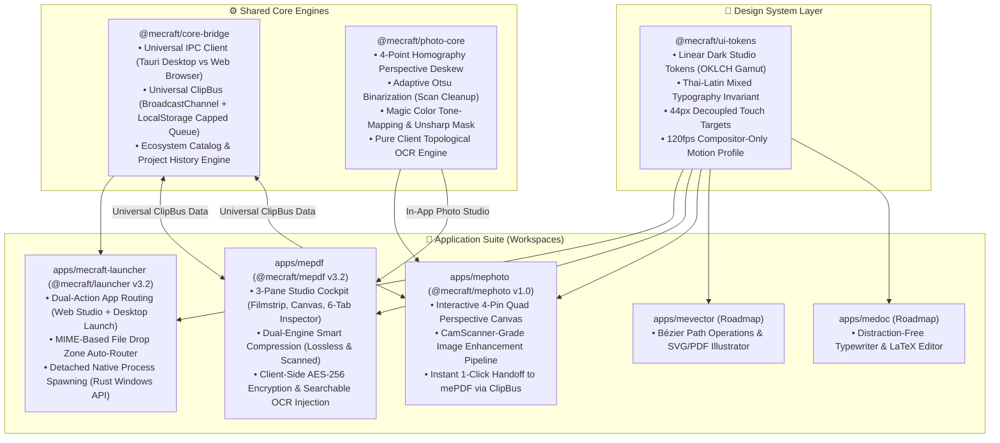

# 🏗️ meCraft Ecosystem — Architecture Specification

> **Ecosystem Overview:** 100% Private, Zero-Cloud Document & Photo Engineering Ecosystem.  
> **Core Technologies:** Tauri v2 (Rust), Vite, TypeScript, Canvas API, Web Workers, and WebAssembly.

---

## 1. System Topology & Seams

---

## 2. Key Engineering Subsystems

### 2.1 Universal ClipBus (`@mecraft/core-bridge`)
- **Purpose:** Cross-application in-memory message and asset bus for instant handoffs (e.g. sending a deskewed receipt from mePhoto into an active mePDF document).
- **Mechanism:**
  1. **Live Tab Routing:** Uses native `BroadcastChannel('mecraft-clipbus')` for instant zero-latency pub/sub between browser tabs.
  2. **Cold-Start Buffer:** Persists the latest 3 items in `localStorage` under `mecraft:clipbus:<appId>` with automatic quota-overflow protection.
  3. **Message Deduplication:** Every payload carries a unique ID and timestamp (`clip_${Date.now()}_${random}`); consumers maintain a `processedClipBusIds` set to eliminate duplicate imports.

### 2.2 4-Point Homography & Bilinear Interpolation (`@mecraft/photo-core`)
- **Mathematical Model:** Calculates $3 \times 3$ perspective transformation matrix $H$ mapping arbitrary quad coordinates $(x_i, y_i)$ to standard rectangular bounds $(u_i, v_i)$.
- **Singular Protection:** Implements Gaussian elimination with singular-matrix detection. If all four corners become collinear or degenerate, the engine safely falls back to the unwarped source image without crashing the UI thread.
- **Sub-Pixel Sampling:** Bilinear interpolation samples surrounding pixel values with fractional weights to eliminate aliasing and jagged edges.

### 2.3 Dual-Engine PDF Compression (`apps/mepdf`)
1. **Lossless Vector Mode:**
   - Optimizes PDF stream dictionaries and recompresses embedded vector streams using Flate compression.
   - Retains 100% vector fidelity, font definitions, and `Ctrl+F` searchability.
2. **Scanned Document Mode:**
   - Downsamples raster images to configurable DPI targets (150 DPI / 72 DPI).
   - Re-encodes bitmaps using adaptive JPEG/WebP quality tiers with significant size reduction for mobile transmission.

### 2.4 Decoupled IndexedDB Storage (`apps/mepdf`)
- **Problem Solved:** Storing complete 50MB+ PDF documents in single state keys causes browser UI freezing (Jank) and crashes iOS Safari memory limits.
- **Decoupled Architecture:**
  - `documents` store: Holds raw immutable Uint8Array bytes once.
  - `workspace_state` store: Holds only lightweight page references, rotation angles, and layout indices ($\le 5\text{ KB}$ per save).
