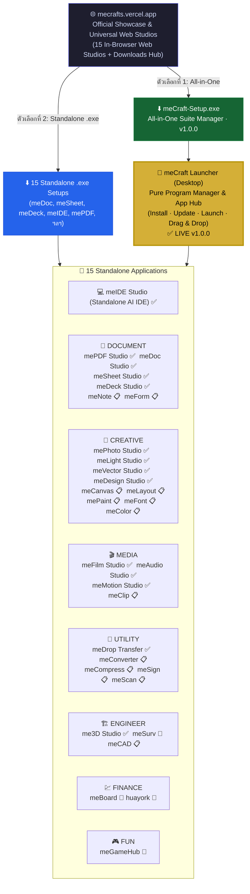

# meCrafts Ecosystem — Full Architecture Blueprint v1.1.0

> **กลยุทธ์หลัก (Dual-Distribution Model):**  
> 1. **All-in-One Suite Hub:** ดาวน์โหลด `meCraft-Setup.exe` สำหรับจัดการ/อัปเดต/เปิดโปรแกรมทั้งหมดในตัวเดียว  
> 2. **Standalone Studio Installers:** ดาวน์โหลดตัวติดตั้งเดี่ยว (`.exe`) แยกตามโปรแกรมได้ทันทีที่หน้า `downloads.html` และ GitHub Releases  
> 3. **Universal Web Studios:** ตัวเว็บ Official Portal (`mecrafts.vercel.app`) ให้บริการทั้ง Hub Catalog และสตูดิโอบนเว็บพร้อมใช้งานทันที (Zero-Install Web Studios) ทุกตัวรัน 100% In-Device Memory ไม่ส่งข้อมูลขึ้นคลาวด์

> [!CAUTION]
> **GPL-3.0 License Warning (Browser-Verified จาก GitHub จริง)**  
> ArtCraft / `storytold` org ใช้ **GPL-3.0** ทุก repo — ไม่ใช่ MIT/Apache  
> หาก Fork มาแล้วแจกจ่าย → ต้อง Open-Source โค้ดทั้งหมดภายใต้ GPL-3.0 ด้วย  
> **Strategy:** ใช้เป็น "Reference / Study Only" + เขียน meCraft core เองแยก (Clean-Room Approach 100% ภายใต้สัญญาอนุญาต MIT)

---

## แผนผังโครงสร้างระบบ (System Architecture Map)



**Legend:** ✅ Live (มีทั้ง Web และ Standalone Windows .exe) · 🔨 In-Dev / Sister-Suite · 📋 Planned

---

## Registry โปรแกรมทั้งหมด พร้อมแหล่งอ้างอิง OSS (Browser-Verified)

### 📄 Category 1 — DOCUMENT

| App | ชื่อเต็ม | แรงบันดาลใจ / Inspired By | OSS Reference (GitHub · Stars) | License | สถานะ |
|---|---|---|---|---|---|
| `mepdf` | **mePDF Studio Pro** | Adobe Acrobat Pro, PdfCraft | [storytold/pdfcraft](https://github.com/storytold/pdfcraft) ⭐22k<br>[Stirling-Tools/Stirling-PDF](https://github.com/Stirling-Tools/Stirling-PDF) ⭐97k | MIT (Clean-Room) | ✅ Live v1.0 |
| `medoc` | **meDoc Studio** | Microsoft Word, WordCraft | [storytold/wordcraft](https://github.com/storytold/wordcraft) ⭐18k<br>[ONLYOFFICE/DesktopEditors](https://github.com/ONLYOFFICE/DesktopEditors) ⭐5.8k | MIT (Clean-Room) | ✅ Live v1.0 (Thai Sarabun) |
| `mesheet` | **meSheet Studio** | Microsoft Excel, GridCraft | [storytold/gridcraft](https://github.com/storytold/gridcraft) ⭐7.8k<br>[genspark-ai/genoffice](https://github.com/genspark-ai/genoffice) ⭐12.8k | MIT (Clean-Room) | ✅ Live v1.0 (=BAHTTEXT) |
| `medeck` | **meDeck Studio** | PowerPoint, DeckCraft | [storytold/deckcraft](https://github.com/storytold/deckcraft) ⭐4.9k<br>[slidevjs/slidev](https://github.com/slidevjs/slidev) ⭐33k | MIT (Clean-Room) | ✅ Live v1.0 (Sarabun Slides) |
| `menote` | **meNote** | OneNote, Obsidian, Notion | [laurent22/joplin](https://github.com/laurent22/joplin) ⭐47k<br>[obsidianmd/obsidian-releases](https://github.com/obsidianmd) | MIT | 📋 Planned |
| `meform` | **meForm** | Google Forms, MS Forms | [formbricks/formbricks](https://github.com/formbricks/formbricks) ⭐12k | AGPL-3.0 | 📋 Planned |

**Windows Shell File Associations:**
```
.pdf           → mePDF Studio (%LOCALAPPDATA%\meCraft\apps\mepdf\mepdf.exe)
.docx .doc     → meDoc (%LOCALAPPDATA%\meCraft\apps\medoc\medoc.exe)
.xlsx .xls     → meSheet
.pptx .ppt     → meDeck
.txt .md       → meNote
```

---

### 🎨 Category 2 — CREATIVE

| App | ชื่อเต็ม | แรงบันดาลใจ / Inspired By | OSS Reference (GitHub · Stars) | License | สถานะ |
|---|---|---|---|---|---|
| `mephoto` | **mePhoto Studio** | Photoshop, PhotoCraft | [storytold/photocraft](https://github.com/storytold/photocraft) ⭐81.7k | MIT (Clean-Room) | ✅ Live v1.0 |
| `melight` | **meLight Studio** | Lightroom, LightCraft | [storytold/lightcraft](https://github.com/storytold/lightcraft) ⭐16.2k | MIT (Clean-Room) | ✅ Live v1.0 |
| `mevector` | **meVector** | Illustrator, VectorCraft | [storytold/vectorcraft](https://github.com/storytold/vectorcraft) ⭐12k<br>[inkscape/inkscape](https://github.com/inkscape/inkscape) ⭐4.1k | MIT (Clean-Room) | ✅ Live v1.0 |
| `medesign` | **meDesign Studio** | Figma, Penpot | [penpot/penpot](https://github.com/penpot/penpot) ⭐62.7k | MIT (Clean-Room) | ✅ Live v1.0 |
| `mecanvas` | **meCanvas** | Figma, FigCraft, Penpot | [penpot/penpot](https://github.com/penpot/penpot) ⭐62.7k<br>[storytold/figcraft](https://github.com/storytold/figcraft) | MPL-2.0 | 📋 Planned |
| `mewhiteboard` | **meWhiteboard** | Miro, FigJam, tldraw | [tldraw/tldraw](https://github.com/tldraw/tldraw) ⭐42.4k | Apache-2.0 | 📋 Planned |
| `melayout` | **meLayout** | InDesign, DesignCraft, Scribus | [storytold/designcraft](https://github.com/storytold/designcraft)<br>[scribusproject/scribus](https://github.com/scribusproject/scribus) | GPL-3.0 | 📋 Planned |
| `mepaint` | **mePaint** | Procreate, Krita, ArtCraft | [storytold/artcraft](https://github.com/storytold/artcraft) ⭐42.4k<br>[KDE/krita](https://github.com/KDE/krita) ⭐8k | GPL-3.0 | 📋 Planned |
| `mefont` | **meFont** | FontForge, Glyphs | [fontforge/fontforge](https://github.com/fontforge/fontforge) ⭐6.1k | GPL-3.0 | 📋 Planned |
| `mecolor` | **meColor** | Adobe Color, Coolors | [bgrins/TinyColor](https://github.com/bgrins/TinyColor) ⭐6k | MIT | 📋 Planned |

**Windows Shell File Associations:**
```
.jpg .jpeg .png .webp .avif .bmp  → mePhoto Studio
.raw .cr2 .nef .arw .dng          → meLight Studio
.svg .ai .eps                     → meVector
.fig                              → meCanvas
.kra .psd                         → mePaint
```

---

### 🎬 Category 3 — MEDIA

| App | ชื่อเต็ม | แรงบันดาลใจ / Inspired By | OSS Reference (GitHub · Stars) | License | สถานะ |
|---|---|---|---|---|---|
| `mefilm` | **meFilm Studio** | Premiere Pro, FilmCraft | [storytold/filmcraft](https://github.com/storytold/filmcraft) ⭐19.4k<br>[mltframework/shotcut](https://github.com/mltframework/shotcut) ⭐15.8k<br>[KDE/kdenlive](https://github.com/KDE/kdenlive) ⭐6.2k | MIT (Clean-Room) | ✅ Live v1.0 |
| `meaudio` | **meAudio Studio** | Audition, SoundCraft, Audacity | [storytold/soundcraft](https://github.com/storytold/soundcraft) ⭐4.5k<br>[audacity/audacity](https://github.com/audacity/audacity) ⭐19.1k<br>[LMMS/lmms](https://github.com/LMMS/lmms) ⭐10.7k | MIT (Clean-Room) | ✅ Live v1.0 |
| `memotion` | **meMotion Studio** | After Effects, EffectCraft, Natron | [storytold/effectcraft](https://github.com/storytold/effectcraft)<br>[NatronGitHub/Natron](https://github.com/NatronGitHub/Natron) ⭐3.9k | MIT (Clean-Room) | ✅ Live v1.0 |
| `meclip` | **meClip** | Clipchamp, Premiere Rush | [OpenShot/openshot-qt](https://github.com/OpenShot/openshot-qt) ⭐6.8k | GPL-3.0 | 📋 Planned |

**Windows Shell File Associations:**
```
.mp4 .mov .avi .mkv .webm  → meFilm
.mp3 .wav .flac .aac .ogg  → meAudio
```

---

### 🔧 Category 4 — UTILITY (Fresh Windows Install Essentials)

| App | ชื่อเต็ม | แรงบันดาลใจ / Inspired By | OSS Reference (GitHub · Stars) | License | สถานะ |
|---|---|---|---|---|---|
| `medrop` | **meDrop Transfer** | AirDrop, DropZone | Radial HUD File Converter & Drop | MIT (Clean-Room) | ✅ Live v1.0 |
| `meconvert` | **meConverter** | iLovePDF, SmallPDF | [Stirling-Tools/Stirling-PDF](https://github.com/Stirling-Tools/Stirling-PDF) ⭐97k | GPL-3.0 | 📋 Planned |
| `mecompress` | **meCompress** | WinRAR, 7-Zip | [ip7z/7zip](https://github.com/ip7z/7zip)<br>[libarchive/libarchive](https://github.com/libarchive/libarchive) ⭐3k | LGPL | 📋 Planned |
| `mesign` | **meSign** | DocuSign, Adobe Sign | [OpenSignLabs/OpenSign](https://github.com/OpenSignLabs/OpenSign) ⭐3.7k | AGPL-3.0 | 📋 Planned |
| `mescan` | **meScan** | CamScanner, Adobe Scan | (Native Document Scanner Engine) | — | 📋 Planned |

---

### 🏗️ Category 5 — ENGINEERING

| App | ชื่อเต็ม | แรงบันดาลใจ / Inspired By | OSS Reference (GitHub · Stars) | License | สถานะ |
|---|---|---|---|---|---|
| `me3d` | **me3D Studio** | 3D Viewer, Three.js | WebGL / 3D Geometry Studio | MIT (Clean-Room) | ✅ Live v1.0 |
| `mesurv` | **meSurv** | Survey Pro, Total Station, QGIS | [qgis/QGIS](https://github.com/qgis/QGIS) ⭐11k | GPL-2.0 | 🔨 Sister-Suite |
| `mecad` | **meCAD** | AutoCAD LT, LibreCAD, CADCraft | [storytold/cadcraft](https://github.com/storytold/cadcraft)<br>[FreeCAD/FreeCAD](https://github.com/FreeCAD/FreeCAD) ⭐35.7k<br>[LibreCAD/LibreCAD](https://github.com/LibreCAD/LibreCAD) ⭐4.8k | GPL-3.0 | 📋 Planned |

---

### 💹 Category 6 — FINANCE & ANALYTICS

| App | ชื่อเต็ม | แรงบันดาลใจ / Inspired By | OSS Reference (GitHub · Stars) | License | สถานะ |
|---|---|---|---|---|---|
| `meboard` | **meBoard** | Bloomberg, TradingView, OpenBB | [OpenBB-finance/OpenBBTerminal](https://github.com/OpenBB-finance/OpenBBTerminal) ⭐36k<br>[freqtrade/freqtrade](https://github.com/freqtrade/freqtrade) ⭐36k | MIT / GPL | 🔨 Sister-Suite |
| `huayork` | **huayork** | Statistical Distribution Engine | — | — | 🔨 Sister-Suite |

---

### 🎮 Category 7 — INTERACTIVE & FUN

| App | ชื่อเต็ม | แรงบันดาลใจ / Inspired By | OSS Reference | สถานะ |
|---|---|---|---|---|
| `megamehub` | **meGameHub** | itch.io, Arcade Archives | [godotengine/godot](https://github.com/godotengine/godot) ⭐96k | 🔨 Sister-Suite |

---

## Naming Convention (ชื่อโปรแกรมทั้งหมด)

```
me + [Function] (ทุกชื่อขึ้นต้นด้วย "me")

DOCUMENT  │ mePDF · meDoc · meSheet · meDeck · meNote · meForm
CREATIVE  │ mePhoto · meLight · meVector · meCanvas · meWhiteboard · meLayout · mePaint · meFont · meColor
MEDIA     │ meFilm · meSound · meMotion · meClip
UTILITY   │ meConverter · meCompress · meSign · meScan
ENGINEER  │ meSurv · meCAD
FINANCE   │ meBoard · huayork (special brand)
FUN       │ meGameHub
──────────────────────────────────────────────────────
HUB       │ meCraft Launcher  (Pure Program Manager · Gateway สู่ทุกโปรแกรม)

รวม: 27 Apps · 7 Categories · Full Fresh Windows Coverage
```

---

## OSS Inspiration Map

```mermaid
flowchart LR
    subgraph ADOBE["Adobe Creative Cloud"]
        A1[Acrobat Pro] --> mePDF
        A2[Photoshop] --> mePhoto
        A3[Lightroom] --> meLight
        A4[Illustrator] --> meVector
        A5[InDesign] --> meLayout
        A6[Premiere Pro] --> meFilm
        A7[Audition] --> meSound
        A8[After Effects] --> meMotion
    end

    subgraph MS["Microsoft 365"]
        M1[Word] --> meDoc
        M2[Excel] --> meSheet
        M3[PowerPoint] --> meDeck
        M4[OneNote] --> meNote
        M5[Whiteboard] --> meWhiteboard
    end

    subgraph ARTCRAFT["storytold / ArtCraft (GPL-3.0) ⭐"]
        AC1[pdfcraft ⭐22k] --> mePDF
        AC2[photocraft ⭐81.7k] --> mePhoto
        AC3[lightcraft ⭐16.2k] --> meLight
        AC4[artcraft ⭐42.4k] --> mePaint
        AC5[vectorcraft ⭐12k] --> meVector
        AC6[wordcraft ⭐18k] --> meDoc
        AC7[gridcraft ⭐7.8k] --> meSheet
        AC8[deckcraft ⭐4.9k] --> meDeck
        AC9[filmcraft ⭐19.4k] --> meFilm
        AC10[soundcraft ⭐4.5k] --> meSound
        AC11[effectcraft] --> meMotion
        AC12[figcraft] --> meCanvas
        AC13[cadcraft] --> meCAD
    end

    subgraph OSS["Major OSS Projects"]
        O1[Stirling-PDF ⭐97k] --> mePDF & meConverter
        O2[Penpot ⭐62.7k] --> meCanvas
        O3[tldraw ⭐42.4k] --> meWhiteboard
        O4[Joplin ⭐47k] --> meNote
        O5[Shotcut ⭐15.8k] --> meFilm
        O6[Audacity ⭐19.1k] --> meSound
        O7[FreeCAD ⭐35.7k] --> meCAD
        O8[OpenBB ⭐36k] --> meBoard
        O9[OpenSign ⭐3.7k] --> meSign
        O10[Slidev ⭐33k] --> meDeck
        O11[GenOffice ⭐12.8k] --> meSheet
    end
```



---

## Priority Roadmap & Release Fleet

```
── Phase 1  LIVE & STABLE v1.0.0 / v1.1.0 ✅ ─────────────────────────
  🚀 meCraft Launcher Hub    │  💻 meIDE Studio (AI IDE)
  📄 mePDF Studio Pro        │  🪄 mePhoto Studio (Scan/Homography)
  📝 meDoc Studio (Sarabun)  │  📊 meSheet Studio (=BAHTTEXT)
  📽️ meDeck Studio (Slides)  │  🍩 meDrop Transfer
  🧊 me3D Studio             │  🎵 meAudio Studio
  📐 meDesign Studio         │  🎬 meFilm Studio
  💡 meLight Studio          │  🎞️ meMotion Studio
  ✒️ meVector Studio
  (All 15 Studios available on Web + Standalone Windows .exe Installers)

── Phase 2  EXPANSION FLEET (Q1-Q2 2027) ─────────────────────────────
  meCanvas (Figma/Vector)   │  meWhiteboard (Miro/tldraw)
  meNote (Obsidian/Notion)  │  meSign (Digital Signature)
  meCompress (7-Zip)        │  meConverter (Batch Conversion)

── Phase 3  SPECIALIZED ECOSYSTEM (Q3-Q4 2027) ────────────────────────
  meCAD (2D/3D CAD)         │  mePaint (Digital Art)
  meFont (Typography Forge) │  meColor (Color Palette Lab)
  meLayout (InDesign)       │  meForm (Form Builder)
```

---

## Legal Strategy: GPL-3.0 Handling

> [!IMPORTANT]
> **ArtCraft/storytold ใช้ GPL-3.0 ทุก repo — ต้องวางแผนอย่างระมัดระวัง**

| Approach | ผลลัพธ์ | แนะนำ? |
|---|---|---|
| **Fork โดยตรง + แจกจ่าย** | ต้อง Open-Source meCraft ทั้งหมดด้วย GPL-3.0 | ⚠️ ถ้ายอมรับได้ |
| **Clean-Room Reference** | ศึกษา UX/Feature เท่านั้น เขียน Core ใหม่เองทั้งหมด | ✅ **แนะนำ (แนวทางปัจจุบัน)** |
| **Dual-Track: Web = MIT, Desktop = Proprietary/Clean** | แยก Web (Browser) ไม่กระทบ / Desktop app ตัดสินใจแยก | ✅ Flexible |
| **ติดต่อขอ Commercial License** | ถ้า storytold เปิดทาง | 📋 Option |

> [!TIP]
> **mePDF และ mePhoto ที่ Live แล้ว** เขียนใหม่ทั้งหมดด้วย TypeScript/Vite/Rust (100% Client-Side Privacy)  
> → ไม่ได้ Fork ArtCraft → ไม่มีปัญหา GPL ✅  
> ใช้ ArtCraft เป็น **"Feature Reference"** เท่านั้น = Clean Strategy

---

## Desktop Hub vs Web Portal Invariant

| รายการ | Desktop: meCraft Launcher (`meCraft.exe`) | Web: Official Portal (`mecrafts.vercel.app`) |
|---|---|---|
| **บทบาทหลัก** | Pure Program Manager (App Store & Runner) | Showcase & Information Catalog |
| **หน้าที่** | ดาวน์โหลด, ติดตั้ง, ตรวจสอบอัปเดต, เปิดโปรแกรมย่อย | ค้นหาข้อมูลฟีเจอร์, ดูเอกสาร, กดปุ่มดาวน์โหลดตัวติดตั้ง |
| **การประมวลผลไฟล์** | เปิดไฟล์ผ่านโปรแกรมย่อยที่ติดตั้งแล้วในเครื่อง | **ไม่มี (Zero in-browser heavy editor)** |
| **Download Target** | ดึง Asset จาก GitHub Releases เข้า `%LOCALAPPDATA%\meCraft\apps` | มีลิงก์เดียว: `meCraft-Setup.exe` (14.8MB) |

---

## File-Type Router — Windows Shell Associations

| รูปแบบไฟล์ | โปรแกรมที่เปิดใน meCraft Suite | ช่องทางติดตั้ง / อัปเดต |
|---|---|---|
| `.pdf` | mePDF Studio | ผ่าน meCraft Launcher |
| `.docx` `.doc` | meDoc | ผ่าน meCraft Launcher |
| `.xlsx` `.xls` | meSheet | ผ่าน meCraft Launcher |
| `.pptx` `.ppt` | meDeck | ผ่าน meCraft Launcher |
| `.jpg` `.png` `.webp` | mePhoto Studio | ผ่าน meCraft Launcher |
| `.raw` `.cr2` `.dng` | meLight Studio | ผ่าน meCraft Launcher |
| `.svg` `.ai` | meVector | ผ่าน meCraft Launcher |
| `.mp4` `.mov` | meFilm | ผ่าน meCraft Launcher |
| `.mp3` `.wav` | meSound | ผ่าน meCraft Launcher |
| `.zip` `.rar` `.7z` | meCompress | ผ่าน meCraft Launcher |
| `.dwg` `.dxf` | meCAD | ผ่าน meCraft Launcher |
| `.md` `.txt` | meNote | ผ่าน meCraft Launcher |

> [!IMPORTANT]
> **กฎเหล็ก meCraft-First Gate:**  
> 1. เว็บ `mecrafts.vercel.app` แสดง Download Link เดียวเท่านั้น → `meCraft-Setup.exe`  
> 2. โปรแกรมย่อยทั้งหมด ดาวน์โหลดและอัปเดตภายใน Launcher ไม่มี Direct Link บนเว็บ  
> 3. Launcher ทำหน้าที่เป็น Program Manager บริสุทธิ์ ปราศจากเครื่องมือหรือตัวแก้ไขไฟล์ภายในหน้าต่าง Launcher

---

*Blueprint v1.0.0 · Browser-Verified from GitHub · 2026-11-23*  
*ArtCraft org: [github.com/storytold](https://github.com/storytold) · 73.1k followers · License: GPL-3.0*
