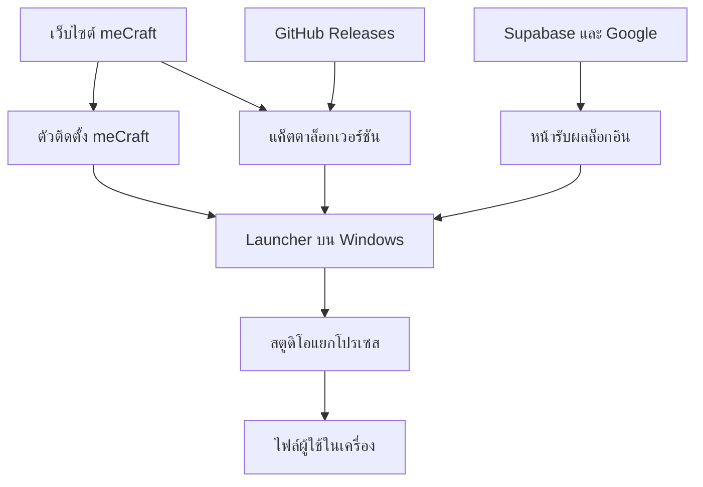
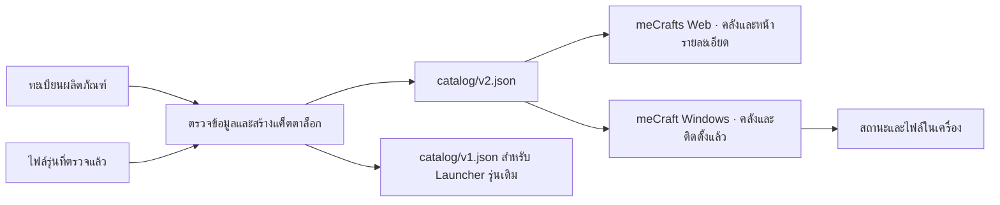
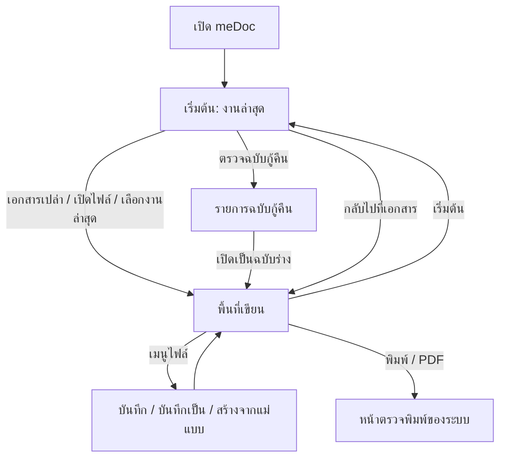

# meCraft Blueprint

แผนหลักสำหรับเว็บไซต์ Launcher ระบบบัญชี ระบบออกเวอร์ชัน และสตูดิโอทั้ง 38 รายการ รวม Launcher รายชื่อเป็นขอบเขตผลิตภัณฑ์ แต่ละรายการขึ้นสถานะพร้อมใช้จากผลทดสอบของรุ่นที่จะเผยแพร่

## ภาพรวมระบบ

ซอร์ส Launcher และสตูดิโออยู่ใน `apps/` ของ monorepo ใช้ `packages/core-bridge` สำหรับรอยต่อเดสก์ท็อปและบริการที่มีอยู่ ใช้ `packages/ui-tokens` สำหรับหน้าตาร่วม และ `packages/studio-shell` เฉพาะแอปที่ใช้ shell เดียวกัน ใช้ `packages/photo-core` สำหรับงานปรับภาพในเครื่องตามความเหมาะสม สตูดิโอที่ฟอร์กด้วยเทคโนโลยีอื่น build และติดตั้งเป็นแพ็กเกจของตัวเอง ภายใต้สัญญาการติดตั้งของ Launcher เว็บไซต์ที่ build แล้วส่งเข้ารีโพ meCrafts-web เพื่อ deploy

## ผังเว็บไซต์และสิ่งที่แสดง

| หน้า | เนื้อหาและการใช้งาน |
|---|---|
| `/` หน้าแรกและคลัง | ค้นหาตามชื่อและกรองหมวด แพลตฟอร์ม และสถานะ การ์ดเชื่อมไปยังรายละเอียด คงทางเข้าดาวน์โหลด meCraft และคู่มือ |
| `/apps/<id>/` รายละเอียด | ภาพหน้าจอ ฟีเจอร์ ข้อจำกัด รุ่นล่าสุด และช่องทางที่เผยแพร่จริง คง URL เดิมที่ใช้งานอยู่หรือส่งต่อไปยังหน้าที่ตรงกัน |
| `/downloads/` ดาวน์โหลด | แสดง `mecraft-hub.msi` รุ่นที่เลือก แพลตฟอร์ม ขนาด ลายเซ็นหรือ SHA-256 คู่มือติดตั้ง และลิงก์รุ่นก่อน ช่องทางดาวน์โหลดรายแอปอยู่ในหน้ารายละเอียด |
| `/help/` ช่วยเหลือ | คู่มือครั้งแรก วิธีแก้ล็อกอินและดาวน์โหลด ข้อจำกัด ความเป็นส่วนตัว เครดิตโอเพนซอร์ส และทางแจ้งปัญหา |
| `/auth` รับผลเข้าระบบ | แสดงกำลังส่งกลับแอป สำเร็จ หมดเวลา หรือให้ลองใหม่ รับสถานะสำเร็จจากแอปจริง |
| `/catalog/v2.json` และ `/catalog/v1.json` | v2 เป็นคลังร่วมสำหรับเว็บและ Launcher รุ่นใหม่ ส่วน v1 รักษารูปแบบที่ Launcher รุ่นเดิมอ่านได้ เผยแพร่ feed หลังแพ็กเกจเข้าถึงได้ |

เส้นทางในตารางเป็นสเปกเป้าหมาย ตรวจหน้าเดิมและ URL ที่ใช้งานอยู่ก่อนเปลี่ยนเส้นทาง ให้หน้าเว็บอ่านง่ายทั้งมือถือและเดสก์ท็อป มีปุ่มที่ใช้งานด้วยคีย์บอร์ดได้และข้อความเมื่อโหลดไม่ได้ ข้อมูลจากแอป เช่น ไฟล์ผู้ใช้และสถานะติดตั้งในเครื่อง ไม่ต้องส่งให้เว็บไซต์เพื่อแสดงรายการ

## ใบงาน AGY: คลังผลิตภัณฑ์ร่วมของ meCraft และ meCrafts Web

หัวข้อนี้เป็นแผนปัจจุบันสำหรับหน้าคลัง หน้ารายละเอียด และการเผยแพร่ข้ามแพลตฟอร์ม ใช้แทนข้อเดิมที่ให้เข้าถึงแอปย่อยผ่าน Launcher เพียงทางเดียว โดยหน้ารายละเอียดเว็บแสดงช่องทางที่เปิดจริงเป็นรายผลิตภัณฑ์ งานเฉพาะตัวเขียนเอกสารอยู่ในหัวข้อ meDoc ด้านล่าง

### เป้าหมายและฐานที่มี

เว็บและ Windows ใช้ชื่อ ไอคอน หมวด ป้ายสถานะ ตัวกรอง และลำดับข้อมูลเดียวกัน เว็บเหมาะกับการค้นหา แชร์ และดาวน์โหลด ส่วน Windows เพิ่มข้อมูลเฉพาะเครื่อง เช่น ติดตั้งแล้ว เปิดได้ หรือมีอัปเดต เปิดคลังดูได้โดยไม่ต้องลงชื่อเข้าใช้

ฐานปัจจุบันมี `mecrafts-website/catalog/v1.json` และตัวอ่าน meDoc ใน `apps/mecraft-launcher/src/medoc-package.ts` รวมถึงหน้าแจก `mecraft-hub.msi` ให้ตรวจ endpoint และเส้นทางจริงก่อนเปลี่ยน รุ่นเดิมของ Launcher ต้องอ่าน v1 ต่อได้ ให้เริ่มงานเว็บจาก branch `feature/shared-product-library` หากยังมีอยู่ และใช้ branch แยกใน monorepo โดยรักษางาน meDoc ที่ค้างในเครื่อง

### โครงหน้าและสัญญาข้อมูล

| ส่วน | ข้อกำหนด |
|---|---|
| หน้าแรกเว็บ | ใช้คลังเป็นทางเข้าหลัก มีค้นหาชื่อ/คำอธิบายและกรองหมวด แพลตฟอร์ม และสถานะ แสดงการ์ดหนึ่งใบต่อผลิตภัณฑ์ รองรับมือถือและคีย์บอร์ด ปุ่มดาวน์โหลด meCraft ยังหาได้จากทางเข้าเดิม |
| รายละเอียด | ใช้ URL คงที่ `/apps/<id>/` แสดงรูป ชื่อ คำอธิบาย แพลตฟอร์ม รุ่น สถานะ และช่องทางที่ใช้ได้จริง เบราว์เซอร์แนะนำตัวเลือกตามอุปกรณ์และยังเลือกดูแพลตฟอร์มอื่นได้ |
| Launcher | ใช้การ์ดและข้อมูลชุดเดียวกับเว็บ มีมุมมอง **ติดตั้งแล้ว** แยกออกมา คำสั่ง **เปิด / ติดตั้ง / อัปเดต / ถอน** ใช้ตัวจัดการ Windows เดิมเฉพาะผลิตภัณฑ์ที่เชื่อมจริง รายการเว็บเปิดผ่าน URL และรายการกำลังพัฒนาไม่มีปุ่มติดตั้ง |
| ระบบหน้าตา | ใช้สี ฟอนต์ ระยะ ไอคอน และน้ำหนักป้ายร่วมกัน หน้าเว็บปรับหนึ่งคอลัมน์บนมือถือ Windows คงพื้นที่และคำสั่งของแอปเดสก์ท็อป จัดคำสั่งหลักไว้ตำแหน่งเดียวกันในการ์ดหรือหน้ารายละเอียด |
| ข้อมูลกลาง | แหล่งแก้ไขอยู่ใน monorepo ให้ขั้นตอน build สร้าง `catalog/v2.json` และส่งไปยังเว็บ มี `schemaVersion: 2`, รายการ `products` และรหัส `id` คงที่ต่อผลิตภัณฑ์ พร้อมชื่อ/คำอธิบายไทยและอังกฤษ หมวด สถานะ ไอคอน ภาพ และ `channels` |
| ช่องทาง | แต่ละช่องทางระบุแพลตฟอร์ม ประเภท รุ่น และระดับ stable/preview ตามที่ใช้ ช่องทางรองรับ web, Windows MSI/EXE, App Store, TestFlight, Google Play และ Android APK ช่องดาวน์โหลดโดยตรงต้องมีขนาด SHA-256 และสถาปัตยกรรมเมื่อเกี่ยวข้อง แยกรุ่นทดลองออกจากปุ่มหลัก |

ตรวจ schema ตั้งแต่ build ปฏิเสธรหัสซ้ำ ลิงก์ที่ผิดรูปแบบ หรือข้อมูลแพ็กเกจที่ไม่ครบ ใช้ HTTPS และตรวจแหล่งดาวน์โหลดก่อนให้ Launcher ส่งต่อให้ตัวติดตั้ง เก็บแค็ตตาล็อกฉบับที่ตรวจแล้วล่าสุดสำหรับตอนเน็ตขาด ถ้ายังไม่มีแคช ให้แสดงข้อความลองใหม่และให้ Windows เปิดแอปที่ติดตั้งไว้ได้ สถานะติดตั้งและตำแหน่งไฟล์อยู่ในเครื่อง

### ช่องทางเผยแพร่ตามแพลตฟอร์ม

- **Windows:** คง `mecraft-hub.msi` เป็นตัวติดตั้งหลักของ meCraft รองรับ MSI/EXE รายแอปตามไฟล์ที่ปล่อยจริง เชื่อมกลไกติดตั้งและแจ้งอัปเดตเดิม ตรวจ payload ก่อนติดตั้งเสมอ
- **เว็บและหน้าจอโฮม:** เพิ่ม manifest ไอคอนและคู่มือเพิ่มจาก Safari ให้คลังเปิดเป็นเว็บแอปได้ ใช้แคชสำหรับหน้าและข้อมูลที่ตรวจแล้ว หากเว็บแอปใดต้องการไอคอนแยกให้เพิ่มจากหน้าของแอปนั้น ทดสอบลิงก์ดาวน์โหลดและเส้นทางเข้าบัญชีให้ใช้ข้อมูลสดตามที่ระบบต้องการ
- **iOS:** ในไทยให้เริ่มจากเว็บแอป แล้วเพิ่ม App Store สำหรับแอปเนทีฟที่เผยแพร่จริง และ TestFlight สำหรับรุ่นทดสอบ การเพิ่มคลังบนหน้าจอโฮมไม่ได้ให้สิทธิ์ติดตั้ง IPA การแจกทางเลือกขึ้นกับภูมิภาคและการอนุมัติจาก Apple ตรวจเงื่อนไขล่าสุดก่อนเพิ่มช่องทาง [คู่มือเว็บแอป iPhone](https://support.apple.com/en-my/guide/iphone/iphea86e5236/27/ios/27) · [การแจกทางเลือกของ Apple](https://developer.apple.com/help/app-store-connect/managing-alternative-distribution/create-a-marketplace-app/)
- **Android:** เพิ่ม Google Play เมื่อมีรุ่นจริง ใช้ APK เฉพาะเมื่อมีแพ็กเกจ release ที่ลงลายเซ็น มีแผนอัปเดตจากคีย์เดิม และตรวจข้อกำหนดการยืนยันผู้พัฒนาแล้ว ผู้ใช้เป็นผู้ยืนยันการติดตั้งเอง [คู่มือแจก APK](https://developer.android.com/distribute/marketing-tools/alternative-distribution?hl=en)

### ลำดับส่งมอบให้ AGY

1. **ตรวจรายการจริง:** สำรวจทะเบียนทั้งชุด ระบุผลิตภัณฑ์ที่พร้อมใช้ ทดลอง หรือกำลังพัฒนา เริ่มเชื่อม meCraft, meDoc และเว็บแอปที่เปิดได้จริง ตรวจ URL เวอร์ชันและไฟล์ก่อนแสดงปุ่ม รายการที่ยังไม่พร้อมแสดงรายละเอียดได้
2. **ทำข้อมูลกลางก่อน UI:** สร้าง schema ตัวตรวจและตัวสร้างไฟล์จากแหล่งเดียว เก็บ v1 และทดสอบกับตัวอ่านเดิมให้ผ่าน ปล่อยไฟล์แพ็กเกจเข้าถึงได้ก่อนเปลี่ยนรายการใน feed
3. **ทำเว็บและ Windows ควบคู่กัน:** สร้างหน้าคลัง หน้ารายละเอียด และสถานะว่าง โหลดล้มเหลว และออฟไลน์ เชื่อม Launcher Preview เข้ากับ feed ทดสอบก่อน แล้วตรวจว่าเว็บกับ Windows แสดงรายละเอียดผลิตภัณฑ์และช่องทางตรงกัน
4. **เพิ่มเว็บแอปบนมือถือ:** ตรวจเพิ่มไอคอนผ่าน Safari บน iPhone และเปิดผ่าน Chrome บน Android เพิ่มช่องทาง native เมื่อมีรุ่นจริงและสิทธิ์เผยแพร่
5. **ส่งงานตรวจ:** ส่งรายการเปลี่ยนแปลง URL ทดสอบ ตัวเปิด Windows Preview ภาพหน้าคลัง/รายละเอียดทั้งสองฝั่ง ผลทดสอบ และวิธีย้อนกลับไปหน้าเว็บและ feed รุ่นก่อน แยกสถานะผ่าน ไม่ผ่าน และยังไม่ได้ทดสอบก่อนสลับหน้าและ feed สาธารณะ

**เกณฑ์ตรวจรับ:** ค้นและกรองเจอผลิตภัณฑ์เดียวกันทั้งสองฝั่ง ลิงก์รายละเอียดเปิดตรงได้ แสดงช่องทางตามแพลตฟอร์มโดยไม่ซ่อนตัวเลือกอื่น Windows รุ่นเดิมยังอ่าน v1 ได้ ติดตั้ง/เปิด/อัปเดต meDoc ผ่าน Preview ได้ตามช่องทางจริง แพ็กเกจผิดขนาดหรือ SHA ถูกปฏิเสธ เน็ตขาดแล้วยังเปิดแอปที่ติดตั้งแล้วได้ iPhone เปิดคลังจากไอคอนหน้าจอโฮมได้ และหน้าเว็บใช้ได้ทั้งจอมือถือ เดสก์ท็อป และคีย์บอร์ด

**ข้อค้นพบจากโค้ดจริง (28 พ.ย. 2026):**
- ระบบติดตั้งที่ตรวจขนาดและ SHA-256 (`install_verified_medoc` ใน `apps/mecraft-launcher/src-tauri/src/medoc.rs`) รองรับเฉพาะ `medoc` ส่วนไบนารีอื่น (`mepdf.exe`, `mephoto.exe`, `meide.exe` ใน `v1.0.4`) ยังใช้ `download_and_install_app` ที่ไม่ตรวจ SHA-256 จึงกำหนด `launcherManaged: true` เฉพาะ `medoc` ใน `catalog/v2.json` และให้ตัวอื่นแสดงช่องทางเว็บ/ดาวน์โหลดตรงตามจริง
- `SHOWCASE_APPS` เดิมกำหนดทุกแอปเป็น `active` ทั้งหมด ทั้งที่ 5 ตัว (`mecad`, `metexture`, `mematerial`, `meani`, `merea`) ยังเป็นโครงสร้างเบาและไม่มีแพ็กเกจ จึงแยกสถานะเป็น `active` / `preview` / `in-dev` ใน `catalog/registry.json` โดยรายการ `in-dev` ไม่มีช่องทางติดตั้ง
- ไดรฟ์ `D:` มีพื้นที่ว่างเหลือ ~0.03 GB ทำให้ `npm run build:web` (15 workspaces) และ `cargo` บน `D:` ติด `ENOSPC`; แก้ทางปฏิบัติด้วยการ build `@mecraft/launcher` + `build-catalog.js` + `/apps/<id>/` และใช้ `CARGO_TARGET_DIR` บน `C:` สำหรับทดสอบ/build ฝั่ง Windows Preview

## ลำดับแก้รุ่นทดสอบ

| งาน | การเปลี่ยนแปลง | เกณฑ์ผ่าน |
|---|---|---|
| Google Sign-In บน Windows | อนุญาต Supabase เฉพาะโดเมนที่ตั้งค่า ตรวจ redirect ที่ลงทะเบียนและเส้นทางจากเว็บกลับแอป ใช้ตัวรับ loopback อายุสั้นและตรวจสถานะต่อคำขอ ให้เว็บแสดงผลตามการตอบรับจากแอป | เลือกบัญชีแล้วกลับเข้าคลัง แอปลงชื่อออกได้ ลองใหม่ได้หลังยกเลิกหรือหมดเวลา ไม่มีข้อมูลเซสชันใน URL ที่บันทึกหรือในล็อก |
| คลัง meDoc | สร้างแค็ตตาล็อกสาธารณะจากขั้นตอนปล่อยรุ่นผ่านเว็บของโครงการ เก็บฉบับตรวจสอบแล้วสำหรับแสดงสถานะออฟไลน์ และใช้ GitHub Releases เป็นที่เก็บแพ็กเกจ | ทดสอบเมื่อ GitHub จำกัดคำขอ เน็ตหลุด ไม่เคยเปิดแอปมาก่อน และมีแอปติดตั้งแล้ว เปิดแอปที่มีอยู่ได้ในเครื่อง |
| การติดตั้งและอัปเดต | ตรวจรหัสแอป รุ่น สถาปัตยกรรม ขนาด SHA-256 และแหล่งดาวน์โหลด แยกตัวโปรแกรมจากไฟล์ผู้ใช้ เปลี่ยนรุ่นหลังแพ็กเกจผ่านการตรวจ | ติดตั้ง อัปเดต และถอน meDoc จาก Windows เครื่องสะอาดได้ เมื่ออัปเดตเสีย แอปรุ่นเดิมและเอกสารยังเปิดได้ |

ผลตรวจจากคลิปแสดงว่าเว็บล็อกอินแล้ว แอปยังค้างที่ Sign in พบข้อจำกัดการเชื่อมต่อในแอป และพบการจำกัดคำขอ GitHub แยกกัน ยังต้องยืนยันรอยต่อ OAuth ด้วยการทดสอบจริง

## ขอบเขตส่วนกลางและรายสตูดิโอ

- เว็บไซต์แจก Launcher และแค็ตตาล็อกมีสคีมาแบบระบุเวอร์ชัน ข้อมูลรายแพ็กเกจประกอบด้วยรหัสแอป ช่องทาง รุ่น แพลตฟอร์ม URL ขนาด และ SHA-256
- Launcher จัดการแพ็กเกจ สถานะติดตั้ง และเปิดแอปด้วยสิทธิ์ผู้ใช้ทั่วไป คลังรองรับผู้เยี่ยมชม สิทธิ์ติดตั้งและใช้งานกำหนดเป็นรายแอปตามนโยบายผลิตภัณฑ์
- แต่ละสตูดิโอมีรหัสคงที่ รูปแบบไฟล์ที่รองรับ ฐานโค้ดต้นทางและ revision คำสั่ง build ข้อจำกัดออนไลน์ เส้นทางเก็บและย้ายข้อมูล และตัวอย่างไฟล์สำหรับทดสอบก่อนปล่อย
- เริ่มที่ meCraft และ meDoc จากนั้น mePDF/mePhoto, meSheet/meDeck แล้วจึงเพิ่มแอปสร้างสรรค์และวิศวกรรมตามผลจริง แอปที่ยังมีเพียงตัวอย่างแสดงสถานะทดลอง

## เกณฑ์เปลี่ยนฐานและถอดโปรแกรมเดิม

- **meDoc** ใช้เอกสารไทยชุดเดียวกันเทียบ WriterApp เดิม, WordCraft และ Everything Documents วัดการพิมพ์และการจัดหน้า Sarabun, Markdown เดิม, DOCX เปิดซ้ำ และ PDF ไทยที่อ่านและเลือกข้อความได้ สถานะปัจจุบัน PDF เดิมแทนอักขระไทยด้วยเครื่องหมายคำถาม
- **mePDF** อนุญาตให้เปลี่ยนโปรแกรมทั้งตัว ถ้า PdfCraft หรือตัวเลือกอื่นผ่านงานจริงดีกว่า ทดสอบเปิดเอกสารเก่า รวมและแยกหน้า เข้ารหัส OCR ไทย การแก้ภาพสแกนจาก mePhoto และการทำงานออฟไลน์ ข้อมูลและไฟล์ผู้ใช้ต้องอยู่ครบหลังย้าย เก็บรุ่นเดิมให้ย้อนกลับได้จนตรวจรุ่นใหม่ผ่าน แล้วจึงถอดตัวเก่าจากคลังและซอร์สที่ใช้งาน
- **ทุกแอป** ใช้เกณฑ์เดียวกันในการตัดสิน เก็บเดิม ใช้เฉพาะเอนจิน ฟอร์กทั้งตัว หรือเชื่อมแอปแยก ทะเบียนด้านล่างกำหนดงานประเมินรายตัว การอนุมัติใช้จริงเกิดจากผลทดสอบ ความเข้ากันได้ของไฟล์ เงื่อนไขไลเซนส์ และภาระดูแล

### meDoc — แผนยกระดับเป็นโปรแกรมเอกสาร (ตรวจ 28 พ.ย. 2026)

**เป้าหมาย:** ผู้ใช้เปิด สร้าง แก้ไข บันทึก และส่งเอกสาร `.docx` และ PDF ภาษาไทยได้จากหน้ากระดาษแบบเห็นผลทันที; `.md` เดิมยังเปิดและส่งออกได้ งานทั่วไปต้องทำได้โดยไม่ต้องเห็น Markdown syntax. Microsoft Word ใช้เป็นเกณฑ์ความคุ้นเคยของงาน ไม่คัดลอกชื่อ โลโก้ ไอคอน หรือหน้าตาเฉพาะของ Microsoft.

**หลักฐานฐานปัจจุบัน:** `apps/medoc/src/components/WriterApp.ts` ใช้ `<textarea>` เขียน Markdown แยกจาก preview; `VaultManager.ts` เก็บเอกสารหลักใน `localStorage` และ `importFile()` อ่านทุกไฟล์เป็นข้อความ; `PdfExporter.ts` แปลงอักขระนอก WinAnsi เป็น `?` ก่อนวาดด้วย Helvetica. ดังนั้นตัวติดตั้งปัจจุบันยังไม่ใช่ตัวแก้เอกสาร Word และส่ง PDF ไทยอย่างถูกต้องไม่ได้ แม้ `apps/medoc/README.md` จะกล่าวถึง DOCX synchronization. ต้องแก้คำอธิบายผลิตภัณฑ์เมื่อทำรุ่นใหม่.

| ตัวเลือกที่ตรวจ | จุดแข็งที่ใช้ได้ | ข้อจำกัด/ภาระ | การตัดสิน |
|---|---|---|---|
| [WordCraft](https://github.com/storytold/wordcraft) `72ca96a` / portable v0.19.1 | Native Rust/egui, DOCX อ่านเขียน, หน้ากระดาษ, สไตล์, ตาราง, ความเห็น/ติดตามแก้ไข, PDF เลือกข้อความได้; MIT หรือ Apache-2.0 | ยังเป็น alpha; เอกสารจริงและ IME ไทยยังต้องทดสอบ; เทคสแต็กต่างจาก Tauri เดิม; โลโก้/แบรนด์ ArtCraft แยกไลเซนส์ | **ฐานนำร่องอันดับหนึ่ง:** ทดลองฟอร์กเป็นแอปแยกก่อนรวมเข้าคลัง |
| [Everything Documents](https://github.com/HeyPuter/everything/tree/main/src/documents) `00fc570` | Canvas editor ในเว็บ, local playground, DOCX/PDF, โมเดลและทดสอบ browser; repo ระบุ MIT เว้นข้อยกเว้น | README เรียก restricted prototype และปฏิเสธโครงสร้าง DOCX ที่ไม่รองรับ; การจัดหน้าไม่เทียบเท่า Word | ตัวเปรียบเทียบสำรอง ถ้า WordCraft ไม่ผ่านภาษาไทย |
| [Tiptap core](https://tiptap.dev/docs/editor/getting-started/overview) / ProseMirror | MIT core, ฝังใน Tauri เดิมได้, ออกแบบ UI เอง | Page layout และฟีเจอร์ขั้นสูงบางส่วนเป็น Pro; ต้องสร้างและทดสอบ DOCX round-trip/PDF เอง | ทางเลือกเมื่อการฟอร์กทั้งแอปแพงเกินผลที่ได้ |
| [LibreOffice](https://github.com/LibreOffice/core) / [ONLYOFFICE DesktopEditors](https://github.com/ONLYOFFICE/DesktopEditors) | โปรแกรมเอกสารเต็มรูปแบบสำหรับเทียบคุณภาพไฟล์ | โค้ดและส่วนประกอบขนาดใหญ่; ONLYOFFICE เป็น AGPL-3.0 พร้อมเงื่อนไขเพิ่มและแบรนด์แยก; การฝัง/ฟอร์กต้องตรวจเงื่อนไขละเอียด | ใช้เป็นตัวเทียบ ไม่ใช่ฐานรุ่นแรก |

**สถาปัตยกรรมเป้าหมาย:** meCraft เป็นศูนย์ติดตั้ง/เปิด/อัปเดตตาม manifest เดิม; meDoc เป็น executable แยกและทำงานออฟไลน์ได้โดยไม่ต้องล็อกอิน. ชั้น `DocumentCore` เก็บเอกสารและคำสั่งแก้ไข, `FileIO` จัดการ DOCX/MD/PDF, `Workspace` จัดการไฟล์ล่าสุด/กู้คืน, `UI` แสดงหน้ากระดาษและเครื่องมือ. ใช้ไฟล์ในโฟลเดอร์ผู้ใช้เป็นแหล่งจริง; autosave/recovery เก็บสำเนาแยก, เขียนไฟล์แบบ atomic, ไม่ถือ `localStorage` เป็นที่เก็บงานหลัก. การเชื่อมบัญชี/คลาวด์เป็นส่วนเสริมภายหลัง ไม่บังคับกับงานออฟไลน์.

**โครงหน้าตา:** หน้าแรกมี `เอกสารเปล่า`, แม่แบบไทย, เปิดไฟล์ และรายการล่าสุด. หน้าแก้ไขมีแถบชื่อไฟล์+สถานะบันทึก, คำสั่งหลัก (`หน้าแรก`, `แทรก`, `เค้าโครง`, `ตรวจทาน`, `มุมมอง`), แถบเครื่องมือสั้นตามแท็บ, หน้ากระดาษ A4 กลางจอ, แถบโครงเอกสาร/ค้นหาที่พับได้ และแถบล่างสำหรับหน้า/คำ/ภาษา/ซูม. ปุ่มหลักใช้คำที่เข้าใจทันที (`บันทึก`, `ส่งออก PDF`, `ย้อนกลับ`) มีคีย์บอร์ดชอร์ตคัตและ tooltip; ไม่เปิดสอง pane ของ Markdown/preview โดยค่าเริ่มต้น. แม่แบบไทยให้ค่า A4, ฟอนต์และระยะขอบที่ผู้ใช้เปลี่ยนได้; ไม่กล่าวอ้างว่าเป็นแบบราชการมาตรฐานจนตรวจข้อกำหนดจริง.

**ขอบเขตฟังก์ชัน:** รุ่นแรกต้องมีพิมพ์ไทย/IME, undo/redo, เลือกข้อความ, ฟอนต์/ขนาด/ตัวหนา, ย่อหน้า/หัวเรื่อง/รายการ, ตาราง, รูป, ค้นหาแทนที่, A4/ระยะขอบ/หัวท้าย/เลขหน้า, DOCX เปิด-แก้-บันทึก-เปิดซ้ำ, PDF ภาษาไทยเลือกข้อความได้, พิมพ์ และกู้คืนงานหลังปิดผิดปกติ. รุ่นหลังจึงเพิ่มความคิดเห็น/ติดตามแก้ไข, ตรวจสะกดไทย, อ้างอิง, ทำงานร่วมกัน และฟีเจอร์ AI; ปุ่มของรุ่นหลังไม่ควรแสดงเหมือนพร้อมใช้.

**ผลทดลองสั้น:** ดาวน์โหลด portable Windows v0.19.1 จาก GitHub Releases, SHA-256 ตรงกับ `SHA256SUMS.txt`, CLI รายงาน 0.19.1 และแปลง Markdown ไทยเป็น PDF ได้ แต่ `pypdf` สกัดข้อความ PDF แล้วสระ/วรรณยุกต์บางตำแหน่งกลายเป็น control character; **เกณฑ์ค้น/คัดลอกไทยจึงยังไม่ยืนยันว่าผ่าน** ต้องเทียบกับตัวอ่าน PDF อีกตัวและตรวจภาพหน้า. ยังไม่ได้ตรวจพิมพ์ไทยใน GUI หรือ DOCX.

**ลำดับงานและด่านตัดสิน:** (1) สำรองข้อมูล meDoc เดิมและเก็บตัวติดตั้งเดิมไว้; เตรียมชุดไฟล์ทดสอบที่เปิดเผยสิทธิ์ได้: บันทึกข้อความไทย, ตารางหลายหน้า, ไทยปนอังกฤษ/ตัวเลข, รูปและหัวท้าย, Markdown เดิม, DOCX ที่สร้างด้วย Word/LibreOffice. (2) ใช้ WordCraft portable ในพื้นที่วิจัยแยก ตรวจภาพ PDF, คัดลอก/ค้นข้อความไทยด้วยหลายตัวอ่าน, พิมพ์/วาง/ลบภาษาไทยและสระวรรณยุกต์, A4/Sarabun, เปิด-บันทึก DOCX สองรอบ, ทดสอบพิมพ์และ recovery; บันทึกภาพหน้า/ผลต่าง/ข้อบกพร่อง. (3) หากผ่านงานหลักและช่องว่างแก้ได้โดยไม่ทำลายไฟล์ จึงฟอร์กที่ revision ตรึงไว้, ถอดแบรนด์/โลโก้ต้นทางตามข้อกำหนด, เก็บ LICENSE/NOTICE/ATTRIBUTION, ทำ meDoc UI ภาษาไทยและแม่แบบ. (4) ทำตัวแปลง `.md` เดิมเป็นไฟล์งานใหม่แบบมี preview/backup; ทดสอบผู้ใช้จริงก่อนสลับแพ็กเกจใน meCraft. (5) หากขั้น 2 ไม่ผ่าน ให้เปรียบ Everything Documents ด้วยชุดเดียวกัน; ค่อยตัดสินเอนจินส่วนประกอบ. **ห้ามลบแอปเดิมหรือข้อมูลเดิมก่อนด่าน 4 ผ่าน.**

**เกณฑ์รับรุ่นทดลอง:** ไฟล์ DOCX 10 ชุดเปิด-บันทึก-เปิดซ้ำโดยข้อความ/ตาราง/รูปสำคัญไม่หาย; PDF ทุกชุดค้นและคัดลอกข้อความไทยได้; พิมพ์ไทยต่อเนื่อง 30 นาทีโดย IME ไม่ทำอักขระตก; ปิดโปรแกรมระหว่างแก้แล้วกู้เอกสารได้; ผู้ใช้ใหม่ 3 คนสร้างเอกสารจากแม่แบบและส่ง PDF โดยไม่ต้องมีคำแนะนำ. เก็บผลเป็น PASS/FAIL และรายการความเสียหายต่อไฟล์; ต้องไม่อ้างว่าเทียบ Word ได้ครบจาก README ต้นทางอย่างเดียว.

#### ใบงานส่งต่อ AGY: สร้าง meDoc รุ่นทดลองให้ครบก่อนตรวจดีไซน์รอบสอง

**เป้าหมายส่งมอบ:** meDoc ที่สร้างและแก้เอกสารบนหน้ากระดาษ ใช้งานออฟไลน์โดยไม่ต้องล็อกอิน เปิด/บันทึก DOCX และส่ง PDF ภาษาไทยได้จริง พร้อมแพ็กเกจทดลองแยกจากรุ่นที่ผู้ใช้ติดตั้งอยู่. ให้ AGY ทำหน้าตาและระบบรุ่นแรกได้เลย; ผู้ใช้จะทดลอง แล้ว Codex จะตรวจและ redesign ภายหลัง. อย่ารอภาพดีไซน์จาก Codex ก่อนเริ่มงาน.

**ขอบเขตที่ AGY ทำ:**

1. อ่านซอร์ส meDoc และงานที่แก้ค้างทั้งหมดก่อนเปลี่ยนไฟล์; สำรองข้อมูลและตัวติดตั้งเดิม. ตรึง revision ของ WordCraft และบันทึกไลเซนส์ของโค้ด ฟอนต์ ไอคอน และทรัพยากรที่ใช้. ถ้าฟอร์ก ให้ถอดชื่อ/โลโก้ ArtCraft และ WordCraft ออกจากผลิตภัณฑ์ meDoc โดยคง LICENSE, NOTICE และ ATTRIBUTION ตามเงื่อนไข.
2. สร้างชุดเอกสารทดสอบที่ใช้ซ้ำได้: ข้อความไทยปนอังกฤษและเลขไทย, ฟอนต์ Sarabun, ตารางหลายหน้า, รูป, หัวท้ายและเลขหน้า, แม่แบบบันทึกข้อความ/จดหมาย/รายงานประชุม, DOCX จาก Word และ LibreOffice, และ Markdown ที่ meDoc เดิมสร้าง. เก็บไฟล์ต้นฉบับและผลที่คาดไว้แยกจากข้อมูลส่วนตัวของผู้ใช้.
3. ทดสอบ WordCraft portable ใน Windows จริง ทั้ง IME ไทย, การพิมพ์/วาง/ลบ/undo, การจัดหน้า A4, DOCX เปิด-บันทึก-เปิดซ้ำสองรอบ, การพิมพ์, การกู้ไฟล์ และ PDF ที่ตรวจด้วยทั้งภาพหน้าและการค้น/คัดลอกข้อความไทย. ผล smoke test ของ `pypdf` ในแผนนี้พบข้อความไทยผิดบางตำแหน่ง; ต้องพิสูจน์สาเหตุและแก้ก่อนถือว่าผ่าน. หาก WordCraft ไม่ผ่านเกณฑ์และซ่อมไม่ได้โดยไม่ทำไฟล์เสีย ให้ทดสอบ Everything Documents ด้วยชุดเดียวกัน; ถ้ายังไม่ผ่าน ให้รายงาน BLOCKED พร้อมหลักฐานก่อนเปลี่ยนฐาน.
4. สร้างหน้าตารุ่นแรก: หน้าเริ่มต้นสำหรับเอกสารเปล่า แม่แบบ เปิดไฟล์ และไฟล์ล่าสุด; หน้าแก้ไขมีกระดาษกลางจอ แถบชื่อไฟล์และสถานะบันทึก แท็บเครื่องมือหน้าแรก/แทรก/เค้าโครง/ตรวจทาน/มุมมอง แถบโครงเอกสารที่พับได้ และแถบสถานะหน้า/คำ/ภาษา/ซูม. ใช้คำสั่งไทยที่ชัดและคีย์ลัดมาตรฐาน; ไม่แสดงปุ่มของฟีเจอร์ที่ยังทำงานไม่ได้. Microsoft Word เป็นเกณฑ์ workflow เท่านั้น ไม่คัดลอกแบรนด์หรือรูปลักษณ์เฉพาะ.
5. ทำงานไฟล์จริงให้ปลอดภัย: บันทึกในพื้นที่ผู้ใช้แบบ atomic พร้อม autosave/recovery แยก; นำเข้า `.md` เดิมโดย preview และสำเนาสำรองก่อนแปลง; ออกจากแอปหรืออัปเดตแล้วงานไม่หาย. ให้ meCraft เปิดแอปทดลองแยกจาก meDoc ปัจจุบัน และเก็บทางย้อนกลับจนการย้ายข้อมูลผ่าน.
6. ส่งมอบซอร์สที่ build ได้ แพ็กเกจทดลอง ภาพหน้าจอทุกหน้าหลัก บันทึก revision/ไลเซนส์ ผลทดสอบ PASS/FAIL/BLOCKED พร้อมไฟล์ตัวอย่างและขั้นตอนทำซ้ำ รายการช่องว่างที่ยังไม่เสร็จ และวิธีถอน/ย้อนกลับ. อย่าเปลี่ยนแพ็กเกจ meDoc ที่เผยแพร่หรือถอนตัวเดิมจนผู้ใช้ทดลองและผลรับงานผ่าน.

**งานหลัง AGY ส่งมอบ:** ผู้ใช้ลองสร้าง แก้ และส่งเอกสารของตน แล้วระบุส่วนที่ชอบ/ไม่ชอบ; Codex ตรวจความถูกต้องของพฤติกรรมและ UI จากแพ็กเกจจริง จากนั้นปรับดีไซน์และการใช้งานโดยไม่ทำ DOCX, PDF, ภาษาไทย และไฟล์เดิมที่ผ่านเกณฑ์เสีย.

#### แผนลงมือ redesign meDoc ทั้งโปรแกรม

แผนนี้ใช้กำกับงาน redesign จาก meDoc Preview บน Windows ส่วนใบงาน AGY ด้านบนบันทึกที่มาของรุ่นทดลอง เริ่มจากตรวจ checkout จริงและเก็บงานที่ค้างอยู่ จากนั้นทำการจัดวางทุกหน้าด้วยระบบเดียวกัน ส่งมอบเป็น Preview ที่เปิดได้โดยตรงเพื่อทดสอบก่อนเปลี่ยนรุ่นบน meCraft

##### เป้าหมายและหลักฐาน

- กลุ่มหลักคือผู้เขียนเอกสารไทยในสำนักงาน นักศึกษา และผู้ใช้ DOCX ทั่วไป งานหลักคือเปิดงานเดิม สร้างเอกสาร จัดรูปแบบ บันทึก และตรวจ PDF โดยใช้คีย์บอร์ดหรือเมาส์ได้
- หน้าเริ่มต้นปัจจุบันอยู่ใน `openStartHub()` ของ `apps/medoc/src/components/WriterApp.ts` และยังใช้โครงหน้าต่างย่อย ภาพจาก Windows แสดงรายการล่าสุดที่เลื่อนในกรอบซ้อนกับปุ่มปิดสองตำแหน่ง แก้ด้วยหน้าเริ่มต้นในพื้นที่หลักและใช้การเลื่อนเพียงชั้นเดียว
- `createDocument()` ใน `apps/medoc/src/engines/VaultManager.ts` เติม `.md` ตามชื่อ และ `importFile()` กำหนดรูปแบบหลังสร้างรายการ จึงต้องให้ชนิดเอกสารเป็นข้อมูลตั้งแต่เริ่มสร้าง เพื่อให้ชื่อ ป้ายชนิด และผลบันทึกสอดคล้องกัน
- การจัดวางปัจจุบันอยู่ใน `apps/medoc/src/styles/workspace.css` และ stylesheet เดิม ให้ย้ายกฎที่ซ้ำกันเฉพาะส่วนที่แตะมาไว้ด้วยกัน รักษา Tauri ตัวแก้เอกสาร และเอนจิน DOCX/PDF เดิม แล้วตรวจข้อจำกัดของไฟล์จริงก่อนตัดสินใจเพิ่มความสามารถของเอนจิน

##### แผนผังการเดินทาง

##### ข้อกำหนดหน้าจอและคำสั่ง

| ส่วน | การจัดวางและพฤติกรรม |
|---|---|
| หน้าเริ่มต้น | แถบเดียวมีชื่อ meDoc ทางกลับไปยังเอกสารเมื่อมีงานเปิด และคำสั่ง **เปิดไฟล์** กับ **เอกสารเปล่า** ใช้งานล่าสุดเป็นพื้นที่หลักเต็มความกว้าง ค้นหาตามชื่อ กดได้ทั้งแถว เรียงตามกิจกรรมล่าสุด ใช้ชื่อชนิดไฟล์ โฟลเดอร์ย่อ และเวลาเพื่อแยกชื่อซ้ำ รายการภายในแอปใช้ป้าย **ฉบับร่างใน meDoc** แสดงสถานะว่าง ผลค้นหาไม่พบ และทางเลือกเมื่อไฟล์หาไม่เจอ |
| เมนูไฟล์ | รวม เปิดไฟล์ บันทึก บันทึกเป็น ส่งออก Word พิมพ์/PDF และ **สร้างจากแม่แบบ** ย้ายแม่แบบไทยทั้งสามออกจากหน้าเริ่มต้น การเลือกแม่แบบสร้างงานใหม่และโฟกัสที่หน้าเขียน ปุ่มบันทึกและ Ctrl+S เรียกคำสั่งเดียวกัน |
| แถบบนหน้าเขียน | วางทางกลับหน้าเริ่มต้น เมนูไฟล์ ชื่อเอกสาร และสถานะบันทึกในกลุ่มเดียว ช่องชื่อย่อได้แต่เปิดดูชื่อเต็มได้ แสดงสถานะบันทึกหลักใกล้ชื่อเอกสาร ใช้ปุ่ม **บันทึก** เป็นคำสั่งหลัก มีข้อความแจ้งผลเมื่อบันทึกสำเร็จ ล้มเหลว หรือยังมีการแก้ไข |
| Ribbon | ใช้แท็บ จัดรูปแบบ แทรก จัดหน้า ตรวจทาน และมุมมอง คงตำแหน่งของคำสั่งที่ใช้บ่อย จัดกลุ่มด้วยเส้นแบ่งและชื่อกลุ่ม รักษาความสูงให้คงที่ระหว่างแท็บ เมื่อพื้นที่แคบย้ายกลุ่มรองเข้า **เพิ่มเติม** โดยใช้ตัวควบคุมชุดเดิมและรักษาสถานะ เช่น สถานะตัวหนา |
| แถบข้าง | ใช้แผงเดียวสำหรับโครงร่างและค้นหาในเอกสาร โครงร่างนำไปยังหัวข้อ ค้นหาแสดงจำนวนผลและปุ่มก่อนหน้า/ถัดไป ค้นหาจากข้อความเอกสารโดยไม่แก้เนื้อหา ค่าเริ่มต้นจอแคบให้พับไว้และเปิดเป็นแผงชั่วคราว |
| กระดาษและสถานะ | เปิดด้วย **พอดีความกว้าง** ใช้มาตราส่วนเดียวกันกับไม้บรรทัด ให้กระดาษกว้างและแนวนอนเลื่อนได้ในพื้นที่เขียน แถบล่างแสดงขนาดกระดาษ จำนวนคำ และซูม แสดงจำนวนหน้าเมื่อได้จากการจัดหน้าจริง ระดับซูมบนจอไม่เปลี่ยนขนาดตอนพิมพ์ |
| หน้าต่างย่อย | ใช้หน้าต่างย่อยทีละอันสำหรับยืนยันนำเข้า กู้คืน และข้อผิดพลาด มีปุ่มที่บอกผล เช่น **เปิดสำเนา** หรือ **กู้เป็นฉบับร่าง** โฟกัสเริ่มในหน้าต่าง Tab อยู่ภายใน Esc ปิดและคืนโฟกัสให้ตัวเปิด ยกเลิกการเลือกไฟล์แล้วคงหน้าและรายการเดิม |
| ตรวจพิมพ์ | รวมเส้นทางไว้ที่ **พิมพ์ / PDF** ใช้หน้าตรวจพิมพ์ของระบบ แสดงข้อจำกัดของฟอนต์หรือองค์ประกอบที่ตรวจพบก่อนส่งงาน รักษาเนื้อหา หัวท้าย และระยะขอบตามที่เอนจินรองรับ |

**ตำแหน่งเครื่องมือ:** จัดรูปแบบมี Undo/Redo ฟอนต์ ขนาด ตัวหนา ตัวเอียง หัวข้อ รายการ และจัดแนว; แทรกมีตาราง รูป และตัวแบ่งหน้า; จัดหน้ามีแนวกระดาษ ระยะขอบ และหัวท้าย; ตรวจทานมีค้นหาและจำนวนคำ; มุมมองมีซูม พอดีความกว้าง ไม้บรรทัด โหมดโฟกัส และ Markdown ในเครื่องมือเสริม แสดงเฉพาะคำสั่งที่เชื่อมการทำงานจริง

**ระบบหน้าตา:** พื้นขาวและเทาอมฟ้า สีน้ำเงินสำหรับคำสั่งหลัก ใช้ไอคอนชุดเดียวพร้อมชื่อที่อ่านได้ด้วยโปรแกรมอ่านหน้าจอ แยกฟอนต์ UI ไทยจากฟอนต์ในเอกสาร กำหนดระยะเป็นชุด 4/8/12/16/24/32 px แถบบน 52–56 px แถบข้างราว 220 px เนื้อหาหน้าเริ่มต้นกว้างไม่เกิน 1,080 px และระยะขอบ 16 px ในหน้าต่างแคบ ปุ่มหลักสูงอย่างน้อย 44 px สถานะเลือกและโฟกัสต้องมองเห็นได้ ใช้การเคลื่อนไหวสั้นและเคารพการตั้งค่าลดการเคลื่อนไหว

##### ลำดับทำงานและสัญญาข้อมูล

1. **ตั้งฐานและตรวจข้อมูล:** บันทึกผลเทสต์ปัจจุบันและภาพหน้าเดิม ทดสอบชื่อไฟล์กับชนิดจริง กำหนดชนิดและชื่อเริ่มต้นสำหรับงานใหม่ก่อนบันทึก สร้าง DOCX ใหม่โดยมีนามสกุลเดียว เปิดข้อมูลเก่ารวมถึงชื่อ `.docx.md` ตามชนิดที่จัดเก็บ รักษาชื่อและไฟล์เดิมบนดิสก์จนผู้ใช้เลือกบันทึกเป็น
2. **ทำทางเข้าและคำสั่งไฟล์:** ให้หน้าเริ่มต้นและหน้าเขียนเป็นสองสถานะของหน้าต่างเดียว เก็บตัวระบุเอกสารที่เปิดไว้เมื่อกลับหน้าเริ่มต้น แหล่งข้อมูลล่าสุดต้องแยกงานบนดิสก์จากฉบับร่าง หากไฟล์ที่มีตำแหน่งหายให้เลือกใหม่หรือเปิดสำเนาฉบับร่างโดยระบุให้ชัด ห้ามเปลี่ยนต้นฉบับเมื่อกู้คืนหรือเปิด DOCX ที่แปลงได้ไม่ครบ ให้เสนอชื่อสำเนาและเตือนสิ่งที่อาจสูญหาย
3. **จัดหน้าเขียนทั้งชุด:** ใช้คำสั่งร่วมจากปุ่ม เมนู และคีย์ลัด จำกัดคีย์ลัดจัดรูปแบบให้อยู่ในตัวแก้เอกสาร รักษา caret และ selection เมื่อกด Ribbon แยกความรับผิดชอบของหน้าเริ่มต้น Ribbon แถบข้าง และหน้าต่างย่อยตามขอบเขตงาน ให้ WriterApp เชื่อมสถานะเอกสารกับส่วนแสดงผล รวมกฎ responsive และโฟกัสในรอบเดียว
4. **ตรวจการบันทึกและส่งงาน:** การบันทึกต้องรอผลเขียนจริงแล้วจึงอัปเดตตำแหน่งและสถานะ เมื่อยกเลิกหรือเขียนล้มเหลวให้คงงานที่ยังแก้และฉบับกู้คืน รองรับการแก้ต่อระหว่างรอผลโดยไม่ประกาศว่าการแก้ล่าสุดถูกบันทึกแล้ว
5. **ส่ง Preview ให้ตรวจ:** สร้างตัวเปิด Windows แบบ release ที่ฝังหน้าแอป ใช้รหัส Preview และพื้นที่ข้อมูลแยก ตรวจว่าเปิดได้โดยไม่ต้องมี localhost ส่งพาธไฟล์ วิธีเปิด ภาพหน้าเริ่มต้นและหน้าเขียน และผลตรวจจริงไว้ในบันทึกส่งมอบ การเปลี่ยนแพ็กเกจที่แจกผ่าน meCraft ทำหลังตรวจรับและผู้ใช้ลองแล้ว

##### ตารางตรวจรับ

| งานทดสอบ | ผลที่ต้องได้ |
|---|---|
| เปิดครั้งแรก / มีงานล่าสุด / ชื่อยาวและชื่อซ้ำ / ค้นไม่พบ | เห็นคำสั่งหลักทันที รายการเปิดถูกเอกสาร แยกชนิดและตำแหน่งได้ หน้าเลื่อนชั้นเดียว |
| เปิด DOCX/MD / ยกเลิก / ไฟล์ย้ายหรือเสีย / กู้คืน | กลับมาหน้าเดิมได้ มีทางไปต่อที่ชัดเจน กู้เป็นฉบับร่างแล้วต้นฉบับอยู่ครบ |
| บันทึกครั้งแรก / ซ้ำ / บันทึกเป็น / เขียนไม่สำเร็จ | ตรวจไฟล์จริงบนดิสก์และสถานะตรงกับผล เปิดฉบับที่บันทึกแล้วได้ และฉบับร่างยังอยู่เมื่อบันทึกไม่สำเร็จ |
| Ribbon / ค้นหา / โครงร่าง / หน้าต่างย่อย | คำสั่งรองเข้าถึงได้เมื่อย่อหน้าต่าง การค้นหาไม่แก้เอกสาร Tab และ Esc ทำงานตามบริบทและคืนโฟกัส |
| 880×640, 1280×800, 1920×1080 และ scaling 125% | ปุ่มหลักไม่หลุดขอบ กระดาษยังเขียนได้ แผงข้างเปิดและปิดได้ สลับแท็บแล้วพื้นที่เขียนไม่กระโดด ตรวจภาพหน้าจอจริง |
| งานไทยตั้งแต่ต้นจนจบ | พิมพ์ไทยด้วย IME จากแม่แบบ เปิด–บันทึก–เปิด DOCX ซ้ำด้วยชุดอย่างน้อย 10 ไฟล์ ตรวจ PDF ไทยด้วยการดู ค้นหา และคัดลอกข้อความ แยกข้อจำกัดเอนจินที่พบไว้ในผลทดสอบ |

ใช้ผลเทสต์อัตโนมัติควบคู่กับการตรวจใน Windows ระบุ **ผ่าน / ไม่ผ่าน / ยังไม่ได้ทดสอบ** พร้อมรุ่นไฟล์และหลักฐานสำหรับแต่ละงาน

## แผนอัปเดต meCraft Launcher อัตโนมัติ

### การเปลี่ยนเป็น Windows Installer MSI — 27 พ.ย. 2026

**ชุดทดสอบ MSI แยก:** `tauri.msi-preview.conf.json` ใช้ชื่อ `meCraft MSI Preview`, identifier `com.mecraft.launcher.msi.preview`, UpgradeCode `574cd39e-3ca0-438f-a42a-04979d3a3c5a` และ loopback port 18978 สร้างด้วย feature `private-msi-preview` ซึ่งตรวจ identity ก่อนอัปเดต ยกเว้น Authenticode เฉพาะ build ทดลอง แต่ยังบังคับตรวจ manifest signature, installer signature, channel และ SHA-256 ค่าชุดนี้ไม่ใช่ config ของผลิตภัณฑ์เผยแพร่ ห้ามเปิด feature นี้ในงาน release จริง

**ผลติดตั้งและอัปเกรด MSI แยกจริง:** ติดตั้ง meCraft MSI Preview 1.0.10 ที่ `C:\Program Files\meCraft MSI Preview` จากนั้นเปิดแอปและอัปเกรดผ่าน feed เฉพาะเครื่องเป็น 1.0.11 สำเร็จเมื่อ 27 พ.ย. 2026 เวลา 20:13 น. MSI log ระบุ `Installation success or error status: 0`; ProductVersion ของ exe เป็น 1.0.11 และ process รุ่นใหม่ทำงานอยู่ ไฟล์ marker `update-preservation-check.txt` ใน app data ยังมีข้อความเดิม สคริปต์เปรียบเทียบ registry version กับ SHA-256 ของ meCraft หลัก 1.0.7 และ NSIS Preview 1.0.9 แล้วยังตรงกับ baseline ก่อนติดตั้ง เก็บ MSI log ที่ `%LOCALAPPDATA%\com.mecraft.launcher.msi.preview\launcher-msi-update.log`

**ข้อบกพร่องจากการทดสอบจริง:** MSI เก็บ InstallLocation พร้อมเครื่องหมาย `\` ท้ายพาธ ทำให้ worker เปรียบเทียบกับ directory ของ exe แล้วปฏิเสธการติดตั้ง ปรับ normalize พาธก่อนเปรียบเทียบแล้ว และเพิ่มพาธแบบ MSI ในชุดทดสอบ worker ซึ่งผ่านทั้งสำเร็จ/rollback ติดตั้งซ่อม MSI Preview 1.0.10 ที่รวมตัวแก้แล้วและอัปเกรดเป็น 1.0.11 ผ่านจริง รอบแรกที่พบข้อบกพร่องยังคงเป็น FAIL ตามประวัติ 1.0.11 สร้างก่อนการแก้พาธ จึงต้องทดสอบอัปเกรดรอบต่อไปจาก 1.0.11 ให้ผ่านก่อนถือว่าบั๊กไม่ย้อนกลับมา

ผู้ใช้เปิดเซิร์ฟเวอร์ทดสอบ MSI ด้วย `python -m http.server 18978 --bind 127.0.0.1 --directory "$env:LOCALAPPDATA\meCraft-dev\msi-preview-feed"` ค้างหน้าต่างไว้ ใช้ feed เดียวกันทดสอบลำดับ 1.0.10→1.0.11, 1.0.12→1.0.13 และ 1.0.13→1.0.14 พบไฟล์รหัสผ่านกุญแจ Preview เดิมในพื้นที่พัฒนาของเครื่องและใช้ลงลายเซ็นโดยไม่แสดงค่าใน log ทุกครั้ง หยุดเซิร์ฟเวอร์ด้วย Ctrl+C เมื่อทดสอบเสร็จ ไม่เผยแพร่ loopback feed สู่ผู้ใช้ทั่วไป

สคริปต์ `scripts/sign-private-msi-preview.ps1` อ่านไฟล์รหัสผ่านเฉพาะเครื่องจาก `%LOCALAPPDATA%\meCraft-dev\signing\launcher-preview.password` หากมี มิฉะนั้นถามแบบซ่อนตัวอักษร ตั้ง environment ชั่วคราวเพื่อลงลายเซ็น/ทดสอบ แล้วลบ environment เสมอ ห้ามนำไฟล์กุญแจหรือรหัสผ่านเข้า Git หรือส่งทางแชต หากไฟล์สูญหายและจำรหัสไม่ได้ ต้องวางแผนหมุนกุญแจพร้อม migration; ห้ามสร้าง feed ที่ไม่มีลายเซ็น

**ผลรอบที่พบข้อบกพร่อง:** การกดตรวจอัปเดตจาก 1.0.11 ไป 1.0.12 ทำให้แอปเปิดใหม่ แต่ ProductVersion ยัง 1.0.11 และ MSI log ไม่เปลี่ยน โดยมี backup directory ใหม่ จึงถือว่า FAIL สำหรับรอบนี้; สอดคล้องกับ worker 1.0.11 ที่ยังมีบั๊กพาธ (ไม่ใช่หลักฐานว่าไฟล์ที่ลงลายเซ็นผิด) ติดตั้ง MSI Preview 1.0.12 ทับเฉพาะ Preview ด้วย helper สำเร็จ และตรวจ meCraft หลัก 1.0.7 กับ NSIS Preview 1.0.9 ว่าทั้งรุ่นกับ hash ยังตรง baseline ปรับ startup ให้กรณีเพิ่งติดตั้งเสร็จแล้วยังมีรุ่นใหม่ใน feed ตรวจต่อได้แทนการ return ทันที ผลหลังแก้ดูด้านล่าง

**ผลยืนยัน 1.0.12→1.0.13:** ผู้ใช้เปิด MSI Preview และกด Check for updates จากนั้นไฟล์ติดตั้งจริงเป็น 1.0.13, Windows Installer log แสดง Product Version 1.0.13 และ status 0, marker ใน app data ยังอยู่ และ hash/registry ของ meCraft หลัก 1.0.7 กับ NSIS Preview 1.0.9 ตรง baseline ผลนี้เป็น PASS สำหรับการอัปเดตที่เริ่มด้วยปุ่ม; ยังไม่ถือว่า PASS สำหรับการตรวจอัปเดตอัตโนมัติทันทีที่เปิดโปรแกรม

**ผล Auto Update ตอนเปิดโปรแกรม — PASS เฉพาะ Preview ส่วนตัว:** สร้าง MSI Preview 1.0.14 และลงลายเซ็น installer/manifest ด้วยกุญแจ Preview เดิม ทดสอบการตรวจลายเซ็นและการปฏิเสธไฟล์ถูกแก้ไขผ่าน feed ท้องถิ่นพอร์ต 18978 ตอบ version 1.0.14 ผู้ใช้เปิด MSI Preview 1.0.13 โดยไม่กด Check for updates แล้วโปรแกรมตรวจ ดาวน์โหลดและติดตั้ง 1.0.14 เอง MSI log วันที่ 27 พ.ย. 2026 เวลา 20:36 ระบุ ProductVersion 1.0.14 และ Installation status 0 ไฟล์ exe ที่ติดตั้งเป็น 1.0.14 และ process รุ่นใหม่เปิดอยู่ marker ใน app data ยังมีข้อความเดิม ส่วน registry version กับ SHA-256 ของ meCraft หลัก 1.0.7 และ NSIS Preview 1.0.9 ตรง baseline ทั้งคู่ ผลนี้พิสูจน์วงจรจริงบนเครื่องนี้ผ่าน loopback feed ส่วนการปล่อยจริงผ่าน HTTPS, Authenticode, เครื่องสะอาด, สถานการณ์เน็ตหลุด/ไฟดับ และช่องทาง stable ยังไม่ผ่านการรับรอง

ตรวจแพ็กเกจแบบอ่านอย่างเดียวด้วย `powershell -NoProfile -File scripts/test-msi-preview.ps1` และทดสอบติดตั้งแยกด้วย `powershell -NoProfile -File scripts/test-msi-preview.ps1 -Install` โดย Windows อาจขอ UAC สคริปต์ตรวจชื่อ/UpgradeCode ของแพ็กเกจก่อนติดตั้ง และตรวจรุ่นกับ hash ของ meCraft/Preview เดิมหลังติดตั้ง เก็บ baseline และ log ไว้ใน `%LOCALAPPDATA%\meCraft-dev\msi-preview-test` การอัปเดตจาก MSI รุ่นเก่าไปรุ่นใหม่ยังต้องทดสอบแยกจากการติดตั้งครั้งแรก

รุ่นพัฒนา 1.0.10 เปลี่ยนแพ็กเกจหลักเป็น WiX MSI แบบ per-machine (x64, en-US) ตามคำขอผู้ใช้ โดยตรึง UpgradeCode เพื่อให้อัปเกรด MSI รุ่นถัดไปเป็นผลิตภัณฑ์เดิม ตัวติดตั้งลงข้อมูล InstallLocation/InstallerType ใน HKLM แยกตาม ProductName ตัวช่วยอัปเดตเรียก `msiexec /i ... /qn /norestart` พร้อม log และขอสิทธิ์ผู้ดูแลผ่าน Windows เมื่อจำเป็น รับ exit code 0/3010 และตรวจ ProductVersion หลังติดตั้ง ยังต้องทดสอบ reboot-required จริง

สร้าง `meCraft_1.0.10_x64_en-US.msi` สำเร็จ ตรวจฐานข้อมูล MSI พบ ProductVersion 1.0.10, ALLUSERS=1, UpgradeCode ที่ตรึงไว้และ registry component ตามกำหนด เทสต์รวมผ่าน 440 รายการ และการตรวจลายเซ็น updater ของ MSI จริงพร้อมทดสอบไฟล์ถูกดัดแปลงผ่านแล้ว ยังไม่ได้ลงนาม Authenticode และยังไม่ได้ทดสอบติดตั้ง/อัปเกรด MSI บนเครื่องสะอาดหรือเปลี่ยน NSIS Preview ที่ติดตั้งอยู่เป็น MSI

สคริปต์สร้าง signed package, manifest, ตรวจ artifact และ CI ใช้ไฟล์ `.msi` แล้ว การรับรอง Preview 1.0.8→1.0.9 ด้านล่างเป็นผลของ NSIS เดิม ไม่ใช่การรับรอง MSI การเปลี่ยนจาก NSIS เป็น MSI ต้องทดสอบ migration แยก และยังไม่มีการถอน/แก้ไข meCraft หลัก 1.0.7 บนเครื่อง การ copy backup กลับ Program Files อาจต้องให้ผู้ดูแลช่วย หาก Windows Installer rollback ไม่สำเร็จ จึงยังห้ามอ้างว่า recovery ของ MSI ผ่านครบแล้ว

หน้า Downloads ในซอร์สเปลี่ยนจากลิงก์ EXE เก่าเป็นการตรวจ asset MSI จริงแล้ว การเผยแพร่เว็บไซต์จริงต้องรอให้ MSI ที่ผ่านเกณฑ์ปล่อยรุ่นมีบน GitHub ก่อน เพื่อไม่เปิดปุ่มที่พาไปไฟล์ไม่มีอยู่

**ชื่อไฟล์แจก meCraft ที่ตกลงใช้:** `mecraft-hub.msi` ไฟล์เดียวสำหรับ Launcher บน Windows; โปรแกรมย่อยยังเป็นแพ็กเกจที่ Library จัดการภายใน ไม่เปลี่ยนชื่อหรือรูปแบบแพ็กเกจย่อยในรอบนี้ Workflow คัดลอก MSI จากชื่อที่ Tauri สร้าง (`meCraft_<version>_x64_en-US.msi`) เป็นชื่อสาธารณะนี้ ไม่แนบ `meCraft-Portable.exe` ใน release ใหม่ ตัวตรวจ release เลือกเฉพาะ asset ชื่อ `mecraft-hub.msi` หน้า Downloads ทั้ง monorepo และเว็บไซต์แยกจะแสดงปุ่มเมื่อ GitHub Release รุ่นปกติมีไฟล์นี้จริงเท่านั้น; หากยังไม่มีก็แสดงสถานะรอ ไม่ชี้ไป EXE เก่า ลิงก์ `/downloads/meCraft-Setup.exe` ถูกตั้ง redirect กลับหน้า Downloads ใน config Vercel แต่ไฟล์ EXE เดิมใน checkout เว็บไซต์ยังอยู่เพราะ automatic approval review ปฏิเสธการลบโดยระบุเพียงว่า blocked by policy

**ผลเตรียมไฟล์ท้องถิ่น 27 พ.ย. 2026:** สร้าง MSI ปกติจากซอร์สล่าสุดและคัดลอกเป็น `dist-artifacts/mecraft-hub.msi`; ฐานข้อมูล MSI ระบุ ProductName `meCraft`, ProductVersion `1.0.10`, UpgradeCode `{46B03E80-AA56-5262-81DF-4B718DBA8CD6}` ขนาด 96,907,264 bytes และ SHA-256 `B6842A23154AA4CD13153EBB982796D123EF38BC8495259EE85571B3972C7386` ไฟล์นี้ **ยังไม่มี Windows Authenticode** (`NotSigned`) และยังไม่ผ่าน migration จากตัวติดตั้ง NSIS 1.0.7 จึงเป็น artifact สำหรับตรวจทานในเครื่อง ไม่เผยแพร่เป็น production ปัจจุบัน GitHub Release ล่าสุดยังเป็น v1.0.4 ที่มี meCraft-Setup.exe และ meCraft-Portable.exe แต่ไม่มี MSI ใหม่ GitHub Actions ของ repo ยังไม่มี secrets/variables สำหรับใบรับรอง Windows และ updater key จึงยังผ่านเกณฑ์ tagged release ไม่ได้ ต้องตั้งค่าการลงลายเซ็น ทดสอบ NSIS→MSI บนเครื่องแยก และตรวจ GitHub Release จริงก่อนเปิดปุ่มดาวน์โหลด

### ตรวจสถานะจริงและทดลอง Preview ส่วนตัว

- **ตัวที่ติดตั้ง:** meCraft 1.0.7 อยู่ที่ `%LOCALAPPDATA%\meCraft`; meCraft Preview 1.0.8 อยู่ที่ `%LOCALAPPDATA%\meCraft Preview` แยกทะเบียนติดตั้งกันแล้ว Preview 1.0.9 เตรียมไว้สำหรับทดลอง แต่ยังไม่ได้พิสูจน์การอัปเดตของชุด Preview นี้ตั้งแต่ต้นจนจบ
- **เทคโนโลยี:** Tauri 2.12.6 และ `tauri-plugin-updater` 2.14.1 ตาม Cargo.lock ตัว launcher ตรวจ manifest และ signature แยก แล้วใช้ updater เปรียบเทียบเวอร์ชันและตรวจลายเซ็นไฟล์ แพ็กเกจ Windows เป็น NSIS `.exe` มีข้อมูลขนาด SHA-256 ลายเซ็น และ publisher ใน manifest การดาวน์โหลดส่ง progress กลับหน้าโปรแกรม
- **ตัวตนและช่องทาง:** ซอร์ส Launcher ระบุ `com.mecraft.launcher` และ endpoint HTTPS `/updates/launcher/preview.json` ซึ่งขณะตรวจยังเป็น 404; ชุดทดลองเฉพาะเครื่องระบุ `com.mecraft.launcher.preview` และ `http://127.0.0.1:18977/preview.json` ซึ่งไม่ใช่ production feed ตัวตน แอปดาต้า และตำแหน่งติดตั้งของชุดทดลองแยกกันตาม config/registry ซอร์สล่าสุดตรวจ `channel: preview` ใน manifest ที่ลงลายเซ็นแล้ว แต่ Preview ที่ติดตั้งไว้ก่อนแก้ยังไม่มีการตรวจนี้ และยังไม่มี stable feed แยก จึง **ยังไม่ถือว่าป้องกันข้าม channel ครบถ้วน**
- **ความปลอดภัย:** ตัวจริงตรวจลายเซ็น manifest และตัวติดตั้ง รวมขนาด SHA-256 และ Authenticode ชุดทดลองส่วนตัวข้ามเฉพาะ Authenticode และยอมรับ HTTP เฉพาะ loopback ในสำเนาโค้ดทดลอง แต่ยังตรวจลายเซ็นและ hash; Windows Code Signing เป็นคนละเรื่องกับ updater signature และยังไม่ต้องซื้อใบรับรองเพื่อทดสอบส่วนตัว ห้ามนำค่าทดลองไปปล่อยสาธารณะ
- **ข้อจำกัดการแยกกุญแจ:** config ของ Preview ทดลองและซอร์ส Launcher ปัจจุบันใช้ public key เดียวกัน จึงยังไม่ใช่การแยกช่องทางด้วยกุญแจ ต้องตัดสินใจและทดสอบการแยกกุญแจ/การย้ายกุญแจและการตรวจ channel ก่อนเผยแพร่จริง
- **การทำงานเมื่อมีปัญหา:** มี timeout การตรวจ metadata 10 วินาทีและดาวน์โหลด 120 วินาที ไม่พบ automatic retry ที่ตรวจยืนยันได้ UI ให้ตรวจซ้ำในการตั้งค่า มีสำเนากู้คืนและทดสอบ worker สำเร็จ/ล้มเหลวใน fixture แต่การดับเครื่องจริงยังไม่ทดสอบ ขณะนี้ไม่มีหน้าหรือข้อความ release notes ที่ตรวจยืนยันได้ และยังไม่มีระบบ log แยก channel ที่ครบถ้วน
- **CI/CD:** workflow signed preview สร้าง artifacts เมื่อมี secrets/variables แต่ยังไม่เผยแพร่ feed; release workflow มีกฎตรวจผู้ลงนามก่อน tagged Launcher release ยังต้องสร้างและตรวจขั้นตอน promote preview เป็น stable และทดสอบ workflow จริง ห้ามปล่อย stable โดยไม่มีคำสั่งจากผู้ใช้
- **ข้อจำกัดการทดสอบ:** สภาพแวดล้อมที่รายงานให้ Codex คือ filesystem sandbox disabled/full access, network enabled และ approval policy never แต่คำสั่ง PowerShell ที่เรียก `Start-Process pythonw.exe -m http.server 18977 --bind 127.0.0.1 --directory <private-preview>` โดยซ่อนหน้าต่างถูก automatic review ปฏิเสธว่า blocked by policy โดยไม่มีรายละเอียดสาเหตุ จึงสรุปไม่ได้ว่าเป็นปัญหา firewall, Python หรือระบบ updater

**คู่มือทดสอบด้วยตนเอง:** เปิด PowerShell ใน directory ใดก็ได้แล้วรัน `python -m http.server 18977 --bind 127.0.0.1 --directory "$env:LOCALAPPDATA\meCraft-dev\private-preview"` ค้างหน้าต่างไว้ ในเบราว์เซอร์เปิด `http://127.0.0.1:18977/preview.json` ควรเห็น JSON ของรุ่น 1.0.9 จากนั้นเปิด meCraft Preview (ไม่ใช่ meCraft หลัก) และสังเกตการตรวจ ดาวน์โหลด ติดตั้งและเปิดใหม่ ตรวจ ProductVersion ของ `%LOCALAPPDATA%\meCraft Preview\mecraft-launcher.exe` และ DisplayVersion ของรายการติดตั้ง พร้อมตรวจว่า meCraft หลักยังเป็น 1.0.7 หากต้องหยุดเซิร์ฟเวอร์กด Ctrl+C ที่ PowerShell ห้ามส่ง URL ที่มีข้อมูลล็อกอินหรือกุญแจส่วนตัวมาในแชต

**ผลทดสอบ Preview ที่ติดตั้งจริง 27 พ.ย. 2026:** ผู้ใช้เปิดเซิร์ฟเวอร์เฉพาะเครื่องที่พอร์ต 18977 และ feed ตอบรุ่น 1.0.9 จากนั้นเปิด Preview 1.0.8 พบ journal ระหว่างติดตั้ง และตรวจพบ registry กับ ProductVersion เปลี่ยนเป็น 1.0.9 พร้อมมี process ของ Preview รุ่นใหม่ทำงาน ไฟล์ marker ที่สร้างใน app data ของ Preview ยังอยู่ และ registry กับ ProductVersion ของ meCraft หลักยังเป็น 1.0.7 ผลนี้ยืนยันการอัปเดตส่วนตัวด้วย feed loopback และไฟล์ที่ตรวจลายเซ็น updater; ยังไม่ยืนยันการเก็บค่าตั้งค่าจริงของผู้ใช้ หรือการอัปเดตรุ่น production ผ่าน HTTPS และ Authenticode

**ผลรับรองแยกตามหลักฐาน:** PASS: manifest และ signature ของ Preview 1.0.9, checksum/ขนาด, การปฏิเสธไฟล์แก้ไข, fixture ของ worker รวม rollback, และติดตั้ง Preview 1.0.8→1.0.9 ผ่าน feed เฉพาะเครื่อง; NOT TESTED: release notes, การเก็บค่าตั้งค่าจริงก่อน/หลังอัปเดต, การตัดเน็ตจริง, การปฏิเสธข้าม channel กับตัวติดตั้งที่ใช้อยู่, ไฟดับจริง และเครื่อง Windows สะอาด แยกผล fixture ออกจากการทดสอบติดตั้งจริงเสมอ

**ผลทดสอบ 27 พ.ย. 2026:** ติดตั้ง Launcher ชุดทดลองแยกชื่อและข้อมูลรุ่น 1.0.8 บนเครื่องพัฒนา แล้วเปิดให้ตรวจ manifest ที่ลงลายเซ็นผ่านเซิร์ฟเวอร์ในเครื่อง ผลคือดาวน์โหลด ติดตั้งรุ่น 1.0.9 และเปิดโปรเซสรุ่นใหม่ได้จริง ตรวจเลขรุ่นทั้งไฟล์และทะเบียน Windows แล้วถอนชุดทดลองออก การทดลองนี้ใช้ HTTP เฉพาะ loopback และข้าม Authenticode ในสำเนาโค้ดทดลองเท่านั้น จึงยังไม่ยืนยันการอัปเดตด้วยตัวติดตั้งที่ลงนาม Windows หรือการทดสอบบนเครื่องสะอาด

**ขอบเขต** เป็นแผนพัฒนา Launcher บน Windows งานนี้ไม่เปลี่ยนระบบอัปเดตของแอปย่อย

**สถานะงานในสาขาพัฒนา** เชื่อม Tauri updater เข้าขั้นตอนเริ่มต้นและ Settings แล้ว ตั้งช่องทาง preview เฉพาะและบังคับให้ลายเซ็นผูกกับเวอร์ชัน ฝั่ง native ตรวจลายเซ็น manifest ทั้งฉบับ จำกัดขนาดระหว่างดาวน์โหลด ตรวจ URL, ขนาด, SHA-256 และลายเซ็นแพ็กเกจ รวมทั้งตรวจ Authenticode และ publisher ที่ระบุใน manifest ที่ลงลายเซ็นก่อนติดตั้ง ตัวช่วยอัปเดตสำรองรุ่นเดิมและกู้คืนเมื่อตัวติดตั้งล้มเหลวหรือได้รุ่นผิด มีการล็อกข้ามโปรเซสและหลีกเลี่ยงการติดตั้งเมื่อผู้ใช้เปิด Launcher ขึ้นมาระหว่างเริ่มอัปเดต ก่อนติดตั้งสร้างทางลัดกู้คืนและบันทึก checksum สำเนา หากถูกขัดจังหวะ ผู้ใช้เปิดรุ่นสำรองผ่านทางลัดได้ และเมื่อยืนยันจาก uptime ได้ว่า Windows เริ่มระบบใหม่แล้ว รุ่นสำรองตรวจ checksum ก่อนคืนไฟล์หลักแบบ atomic การตรวจ uptime อาจไม่ยืนยันการรีสตาร์ตหากเวลาหลังบูตใหม่มากกว่า uptime ก่อนหน้า จึงแสดงสถานะให้กู้คืนด้วยตนเองในกรณีนั้น ทดสอบการหยุดโปรเซสตัวช่วยและจำลอง uptime แล้ว ยังต้องทดสอบเครื่องดับจริงและการติดตั้งด้วยตัวติดตั้ง meCraft ที่ลงนาม รวมถึงจัดการทางลัด ไฟล์สำรองและไฟล์ชั่วคราวหลังอัปเดต ช่องทาง preview บนเซิร์ฟเวอร์ยังไม่มี manifest และยังไม่ถือว่าพร้อมเผยแพร่ กุญแจ preview อยู่ในเครื่องพัฒนา ต้องจัดการกุญแจเผยแพร่และระบบสำรองก่อนใช้จริง

**ประสบการณ์ที่ต้องการ** ผู้ใช้เปิด meCraft แล้วเห็นสถานะตรวจรุ่น หากมีรุ่นที่ใหม่กว่าสำหรับช่องทางและสถาปัตยกรรมของเครื่อง ให้ดาวน์โหลด ตรวจสอบ ติดตั้ง และเปิด Launcher รุ่นใหม่ต่อโดยอัตโนมัติ หากตรวจไม่ได้หรืออัปเดตล้มเหลว ให้บอกสาเหตุที่เข้าใจได้และเปิดรุ่นเดิมต่อเมื่อยังใช้งานได้ มีปุ่มตรวจอีกครั้งในการตั้งค่า สถานะรุ่นต้องตรงกับไฟล์ที่รันจริง

**แนวทางทางเทคนิค**

1. กำหนด manifest อัปเดต Launcher แยกจากแค็ตตาล็อกสตูดิโอ ระบุ schema, product, channel, platform, architecture, version, URL, ขนาด, SHA-256 และลายเซ็นที่ตรวจด้วย public key ที่ฝังใน Launcher การเปลี่ยน key ต้องมีแผนรองรับก่อนใช้งานจริง
2. ขั้นตอนปล่อยรุ่นสร้างตัวติดตั้งจากซอร์สที่กำหนด ลงนามไฟล์ Windows ด้วย Authenticode ตรวจไฟล์และ publisher สร้างและลงนาม manifest จาก artifact เดียวกัน แล้วเผยแพร่ manifest หลังตรวจว่าดาวน์โหลดไฟล์ได้ แยก stable กับ preview ชัดเจนและไม่ให้รุ่นเก่าแทนรุ่นใหม่
3. ตอนเริ่ม Launcher ตรวจ manifest ผ่าน HTTPS ภายใต้ช่องทางที่กำหนดและมี timeout ตรวจลายเซ็น manifest ก่อนเชื่อข้อมูล ตรวจ version, แพลตฟอร์ม, ขนาด และ URL แล้วดาวน์โหลดลงไฟล์ชั่วคราวแบบจำกัดขนาด ตรวจขนาดและ SHA-256 พร้อมตรวจ Authenticode และ publisher ก่อนรัน ห้ามใช้ URL ท้องถิ่นในรุ่นเผยแพร่
4. ให้ตัวติดตั้งที่ตรวจแล้วทำงานผ่านตัวช่วยอัปเดตหลัง Launcher ปิด ตรวจ exit code และตรวจรุ่นที่ติดตั้งก่อนเปิดต่อ ใช้สิทธิ์ผู้ใช้ทั่วไปตามการติดตั้งเดิม กรณีติดตั้งล้มเหลวต้องเปิดรุ่นก่อนหน้าหรือมีวิธีกู้คืนที่ทดสอบแล้ว เก็บข้อมูลบัญชี การตั้งค่า และไฟล์ผู้ใช้ไว้ ป้องกันการอัปเดตซ้อนและไฟล์ชั่วคราวตกค้าง
5. เชื่อมสถานะตรวจ ดาวน์โหลด ติดตั้ง เปิดใหม่ และข้อผิดพลาดเข้าหน้าเริ่มต้นกับ Settings ลบข้อความแสดงการตรวจลายเซ็นหรือความปลอดภัยที่ยังไม่ได้ตรวจจริง เชื่อม UI กับผลตรวจจริงเท่านั้น

**ลำดับดำเนินงาน** ตรวจข้อจำกัดและเลือกกลไก updater สำหรับ Tauri กับ NSIS ที่ใช้อยู่ → กำหนด manifest และการลงนาม → ทำตัวตรวจและติดตั้งพร้อมกู้คืน → เชื่อมหน้าเริ่มต้นและ Settings → สร้าง pipeline ปล่อยรุ่น → ทดสอบจากตัวติดตั้งรุ่นเก่าถึงรุ่นใหม่บน Windows เครื่องสะอาด ก่อนเผยแพร่

**เกณฑ์รับงาน** ทดสอบเปิดครั้งแรกและเปิดซ้ำทั้งกรณีมีรุ่นใหม่ ไม่มีรุ่นใหม่ และออฟไลน์ ทดสอบเน็ตหลุด ไฟล์เสีย ขนาดผิด ลายเซ็นผิด manifest ถูกแก้ URL ไม่อนุญาต ช่องทางผิด รุ่นเก่ากว่า พื้นที่ไม่พอ โปรแกรมเปิดซ้ำระหว่างอัปเดต ตัวติดตั้งล้มเหลว และการเริ่มระบบใหม่ระหว่างติดตั้ง ต้องเห็นผลสำเร็จหรือข้อผิดพลาดตรงจริง รุ่นเก่าและข้อมูลผู้ใช้ยังเข้าถึงได้เมื่อกู้คืน และทดสอบการเปิด Launcher รุ่นใหม่หลังติดตั้งจริง

**การส่งต่อจากรุ่นปัจจุบัน** รุ่นที่ติดตั้งอยู่ก่อนเพิ่มระบบนี้ยังไม่ได้ตรวจ Launcher ตอนเริ่มต้น จึงต้องติดตั้งรุ่นแรกที่มี updater ผ่านตัวติดตั้งหรือวิธีอัปเกรดที่รองรับก่อน แล้วทดสอบการอัปเดตอัตโนมัติจากรุ่นดังกล่าวไปยังรุ่นถัดไป แยกหมายเลขรุ่นทดสอบจากรุ่นเผยแพร่เพื่อหลีกเลี่ยงไฟล์ต่างกันที่ใช้เลขเดียวกัน

**งานสร้างรุ่นทดสอบที่ลงนาม** workflow `launcher-signed-preview.yml` สร้างไฟล์สำหรับตรวจใน GitHub Actions หลังมี updater key และใบรับรอง Windows ใน secrets รวมถึง thumbprint และ timestamp URL ใน variables งานนี้เก็บ artifact ใน Actions และยังไม่เผยแพร่ไฟล์หรือ manifest ไปยังเว็บไซต์ ส่วน workflow เผยแพร่เดิมตรวจ Authenticode ของตัวติดตั้ง Launcher ก่อนยอมปล่อย tag ต้องทดสอบ workflow จริงหลังตั้งค่าข้อมูลลงนามให้ครบ

หลังสร้าง artifact ให้ตรวจไฟล์ตัวติดตั้ง `mecraft-hub.msi`, ลายเซ็นของตัวติดตั้ง, `preview.json` และ `preview.json.sig` เป็นชุดเดียวกัน โดยสคริปต์สร้างจะทดสอบดาวน์โหลดและตรวจลายเซ็นกับ hash ก่อนส่งต่อ จากนั้นจึงเผยแพร่ตัวติดตั้งที่ URL ตาม manifest ตรวจว่าโหลดได้และตรงกับไฟล์ที่ตรวจแล้ว ก่อนนำ manifest กับลายเซ็นที่ตรงกันขึ้น `public/updates/launcher/` เพื่อให้เว็บเผยแพร่ทั้งคู่ในการ deploy เดียว ตรวจ endpoint จริงและทดลองจากรุ่นก่อนหน้าอีกครั้ง ห้ามใช้ลายเซ็นจากการ build ก่อนหน้ากับตัวติดตั้งที่สร้างใหม่

หลัง deploy ใช้ `node scripts/check-launcher-publication.mjs <path-to-signed-preview.json>` เพื่อตรวจลายเซ็น manifest ในเครื่อง แล้วเทียบ manifest, signature และ hash ของตัวติดตั้งที่ดาวน์โหลดจาก URL จริง เครื่องมือนี้ตรวจการเผยแพร่ ไม่ได้ติดตั้งโปรแกรมหรือทดแทนการทดลองอัปเดตจริงบน Windows

**ตรวจร่วมล่าสุด 27 พ.ย. 2026:** `npm test` ผ่าน 439 รายการ และ typecheck ของ Launcher ผ่าน ตรวจ GitHub repository แล้วไม่พบ secrets หรือ variables สำหรับการลงนาม จึงยังไม่ได้รัน workflow สร้างตัวติดตั้งที่ลงนามจริงหรือเผยแพร่ endpoint

ทดสอบตัวช่วยอัปเดตเพิ่มเติมเมื่อรุ่นที่ติดตั้งเท่ากับหรือใหม่กว่ารุ่นที่เตรียมไว้: ข้ามการติดตั้งและเปิด Launcher ที่มีอยู่ต่อได้ โดยไม่ติดตั้งรุ่นเก่าทับ

ตัวช่วยลบไฟล์ติดตั้งที่จัดเตรียมไว้หลังทำงานเสร็จ หากตรวจได้ว่าตำแหน่งและ checksum ตรงกับไฟล์ของงานนั้น โดยเก็บสำเนากู้คืนแยกไว้ การล้างไฟล์หลังโปรเซสถูกขัดจังหวะและนโยบายเก็บสำเนาเก่ายังต้องดำเนินการ

## สิทธิ์ใช้งานแอปย่อยในอนาคต

วางนโยบายเป็นรายแอป โดยรองรับทั้งแอปที่ดาวน์โหลดและใช้แบบออฟไลน์โดยไม่ต้องลงชื่อเข้าใช้ แอปที่ต้องมีบัญชี และแอปที่ต้องมีสมาชิกเพื่อดาวน์โหลดหรือใช้งาน สำหรับแอปที่จำกัดสิทธิ์เมื่อสมาชิกหมดอายุ ต้องออกแบบการตรวจสิทธิ์ การหมดอายุ และพฤติกรรมเมื่อออฟไลน์แยกเป็นงานภายหลัง รวมถึงให้ผู้ใช้เข้าถึงไฟล์ของตนได้ รายละเอียดระยะผ่อนผันและแอปที่ใช้แต่ละนโยบายยังไม่ได้ตัดสินใจ

## ด่านก่อนเปิดให้คนทั่วไปใช้

1. แก้ Google Sign-In และการอ่านแพ็กเกจของ Launcher ตามแผนด้านบน
2. ติดตั้ง meCraft บน Windows เครื่องสะอาด แล้วทดสอบติดตั้ง เปิด อัปเดต และถอน meDoc จากคลัง ทดสอบเน็ตขาด แพ็กเกจเสีย และการเปิดงานเดิมหลังอัปเดต
3. ทดสอบเอกสารไทยจริงผ่านฐาน meDoc ที่เลือก ให้อาสาสมัครลองด้วยตัวติดตั้งเดียวกับที่จะเผยแพร่ ก่อนอัปเดตสถานะบนเว็บ
4. เพิ่มสตูดิโอเป็นรอบตามทะเบียน เริ่มจากงานเอกสารและภาพ ตรวจ build ตัวติดตั้ง คู่มือ และผลทดสอบของแต่ละแอปก่อนแสดงปุ่มดาวน์โหลด

### การเตรียมเบต้า Launcher รุ่น 1.0.6

- Launcher ใช้ Supabase PKCE สำหรับ Google บน Windows เว็บส่งรหัสครั้งเดียวจาก `/desktop-auth/` กลับทาง loopback แล้วแสดงผลตามการตอบกลับของ Launcher ลงทะเบียน URL ของหน้านี้ใน Supabase Redirect URLs และตรวจด้วยบัญชีจริงก่อนเปิดเบต้า
- แอปอ่าน `/catalog/v1.json` จากเว็บไซต์และเก็บสำเนาที่ผ่านการตรวจในเครื่อง หลังเผยแพร่แพ็กเกจ งาน release สร้าง artifact `mecraft-package-catalog` จากข้อมูลบน GitHub เผยแพร่ไฟล์นั้นที่ path เดิมในรีโพเว็บไซต์หลังตรวจแพ็กเกจ พร้อมทดสอบ HTTP และ CORS จาก WebView
- สร้างตัวติดตั้งจากสาขาทดสอบและทดสอบด้วย Windows เครื่องสะอาด เบต้าสาธารณะเผยแพร่เป็น GitHub prerelease ในกลุ่ม tag `preview-launcher-*` หลังตรวจลายเซ็น Authenticode และ publisher ของไฟล์เดียวกัน หากยังไม่มีผู้ลงนาม เก็บไฟล์เป็นตัวทดสอบส่วนตัว

## การคัดเลือกโอเพนซอร์ส

ทุกตัวเลือกเริ่มจากรีโพต้นทางและ revision ที่ตรวจสอบได้ ตรวจไลเซนส์ระดับแอปและ dependency แยกจากไลเซนส์ของรีโพรวม จากนั้นทดสอบงานจริงแบบออฟไลน์ การนำเข้าและเปิดไฟล์เดิม และเวลาในการผสาน เลือกใช้ได้ตั้งแต่ศึกษาวิธีทำ ใช้เฉพาะเอนจิน ไปจนถึงฟอร์กหรือเชื่อมแอปแยก บันทึกเครดิตและขอบเขตการเปลี่ยนแปลงก่อนแจก

## ผลตรวจ The Everything Project

ตรวจพบ 51 โฟลเดอร์ระดับแรกใน `src` ของ revision ที่ตรวจ รวมโฟลเดอร์ทรัพยากรด้วย ตัวเลขจึงบอกขนาดรีโพ ส่วนความพร้อมวัดจาก build และงานรายแอป รีโพหลักระบุ MIT ขณะที่หลายแอปมี LICENSE แบบ AGPL-3.0 ของตัวเอง ผลด้านล่างมาจากซอร์ส เอกสาร และไฟล์ไลเซนส์ต้นทาง ยังไม่ได้ build หรือรันแอป upstream

| เป้าหมาย meCraft | ส่วนที่ควรนำมาทดลอง | ข้อจำกัดและเกณฑ์เลือก |
|---|---|---|
| meDoc | Documents มีเอนจิน canvas, DOCX และ playground แบบ local เป็นตัวเทียบกับ WordCraft และ WriterApp เดิม | README ระบุ MIT ตามไลเซนส์หลัก เว้นส่วนที่ระบุเป็นอย่างอื่น ทดสอบ Sarabun การวางวรรณยุกต์ แบ่งหน้า DOCX เปิดซ้ำ และ PDF ไทย ก่อนเลือกว่าจะใช้เอนจินหรือฟอร์ก [Documents](https://github.com/HeyPuter/everything/tree/d8247a3eeeeb61ad6210e8be7e9ccaeaecfd310c/src/documents) |
| meSheet | Spreadsheet มีโฟลว์เปิดและบันทึก XLSX กับสูตรวันที่และวันทำงาน ใช้เป็นกรณีเทียบกับ GridCraft | AGPL-3.0 และการบันทึกหลักผูก Puter cloud เช็กสูตรไทย วันที่ และนำเข้า–ส่งออก XLSX โดยไม่ใช้บัญชี [Spreadsheet](https://github.com/HeyPuter/everything/tree/d8247a3eeeeb61ad6210e8be7e9ccaeaecfd310c/src/spreadsheet) |
| meDeck | Presentation มีเส้นทางแก้ นำเสนอ และส่งออก PPTX พร้อมพื้นที่ทดสอบ ให้เทียบกับ DeckCraft | AGPL-3.0 ทดสอบฟอนต์ไทย แม่แบบ ภาพ และความคงเดิมหลังเปิดไฟล์กลับ [Presentation](https://github.com/HeyPuter/everything/tree/d8247a3eeeeb61ad6210e8be7e9ccaeaecfd310c/src/presentation) |
| mePDF | ใช้เป็นตัวเทียบเรื่อง local download, rendering และ OCR ชุดเครื่องมือทับกับของเดิมหลายส่วน เช่น pdf-lib, PDF.js | AGPL-3.0 พบ dependency ข้อมูล OCR ภาษาอังกฤษ ทดสอบโมเดลไทยแยก ลองเพิ่มเฉพาะส่วนที่ผลดีกว่า [PDF](https://github.com/HeyPuter/everything/tree/d8247a3eeeeb61ad6210e8be7e9ccaeaecfd310c/src/pdf) |
| meCAD | CAD มีแนวทาง drafting 2D, WebGL2, มิติ และไฟล์ DXF/DWG ใช้เป็นตัวเทียบกับ CADCraft | AGPL-3.0 และใช้ Puter.js สำหรับ backend ทดสอบหน่วย พิกัด และการเปิดซ้ำ โดยเริ่ม DXF เป็นไฟล์อ้างอิง [CAD](https://github.com/HeyPuter/everything/tree/d8247a3eeeeb61ad6210e8be7e9ccaeaecfd310c/src/cad) |
| mePhoto, meVector | Photo Studio มี WebGPU และ WebGL2 fallback, PSD, layers และ masks ส่วน Vector Studio มีคลังกราฟิกและการเก็บการแก้ไขออฟไลน์ | ทั้งคู่ AGPL-3.0 ใช้เทียบความเร็วและคุณภาพ PSD/SVG รวมความเข้ากันได้กับเครื่องที่ไม่มี WebGPU [Photo Studio](https://github.com/HeyPuter/everything/tree/d8247a3eeeeb61ad6210e8be7e9ccaeaecfd310c/src/photo-studio) · [Vector Studio](https://github.com/HeyPuter/everything/tree/d8247a3eeeeb61ad6210e8be7e9ccaeaecfd310c/src/vector-studio) |
| meAudio, meFilm | Audio Studio ใช้ AudioWorklet และแชร์แกนผสมเสียงกับออฟไลน์เรนเดอร์ ใช้เทียบกับ SoundCraft ส่วน Video Studio ใช้เป็นตัวเทียบ workflow กับ FilmCraft | ทั้งคู่ AGPL-3.0 วัดเสียงหลายแทร็ก การตรงกันของภาพและเสียง และเวลาส่งออก [Audio Studio](https://github.com/HeyPuter/everything/tree/d8247a3eeeeb61ad6210e8be7e9ccaeaecfd310c/src/audio-studio) · [Video Studio](https://github.com/HeyPuter/everything/tree/d8247a3eeeeb61ad6210e8be7e9ccaeaecfd310c/src/video-studio) |
| meWhiteboard, me3D | Whiteboard มีการแก้พร้อมกันและกู้การแก้แบบออฟไลน์ ส่วน 3D มีพื้นที่ให้เทียบงาน viewer และแก้โมเดล | ทั้งคู่ AGPL-3.0 ทดสอบงาน local ของเราแยกจาก cloud และตรวจ telemetry ของ Whiteboard ก่อนนำมาพิจารณา [Whiteboard](https://github.com/HeyPuter/everything/tree/d8247a3eeeeb61ad6210e8be7e9ccaeaecfd310c/src/whiteboard) · [3D](https://github.com/HeyPuter/everything/tree/d8247a3eeeeb61ad6210e8be7e9ccaeaecfd310c/src/3d) |
| meForm | Surveys มีการสร้างแบบสอบถาม แชร์ลิงก์ และรวบรวมคำตอบ เทียบกับ Formbricks | ใช้ Puter สำหรับข้อมูลแบบสอบถาม นำมาเทียบใน meForm ส่วน meSurv เป็น GIS/สำรวจพิกัดคนละงาน [Surveys](https://github.com/HeyPuter/everything/tree/d8247a3eeeeb61ad6210e8be7e9ccaeaecfd310c/src/survey) |
| meIDE | API Client เป็นผู้สมัครสำหรับเครื่องมือสร้างและทดสอบคำขอ API ทั่วไป มีชุด unit และ browser test และ README ระบุ cloud sync เป็นทางเลือก | README อ้าง MIT ของรีโพรวมตามเงื่อนไข ตรวจ dependency และทดสอบ local workflow ก่อนย้ายเป็นเครื่องมือใน meIDE ให้เก็บ credential ในเครื่อง [API Client](https://github.com/HeyPuter/everything/tree/d8247a3eeeeb61ad6210e8be7e9ccaeaecfd310c/src/api-client) |

ให้ทดลอง **Documents** และ **API Client** ก่อนหากทดสอบออฟไลน์และเงื่อนไขแจกจ่ายผ่าน ส่วนแอป AGPL ใช้เป็นตัวเทียบความสามารถในรอบนี้ การเลือกฟอร์กเพื่อแจกต้องประเมินข้อกำหนดของรุ่นที่เลือกและต้นทุนเปลี่ยน Puter cloud เป็นระบบของ meCraft สำหรับกลุ่ม email/calendar/teamchat/projects และเครื่องมือธุรกิจ ให้เก็บไว้เป็นผู้สมัครระยะถัดไปตามความต้องการจริง [รีโพต้นทาง](https://github.com/HeyPuter/everything) · [คำอธิบายสัญญาอนุญาต GNU](https://www.gnu.org/licenses/gpl-faq.html)

## ทะเบียนรายโปรแกรม

### ศูนย์กลาง

| โปรแกรม | ที่พบ | แนวทางแรก | ต้นทางที่ควรเทียบ | ตัวอย่างงานที่ต้องผ่าน |
|---|---|---|---|---|
| meCraft (`mecraft-launcher`) | ซอร์ส | ใช้ Launcher เดิม | ระบบแพ็กเกจ Windows ที่มีใน repo | ติดตั้ง/อัปเดต/ถอน meDoc จากเครื่องสะอาดได้ |

### เอกสารและเครื่องมือเขียน

| โปรแกรม | ที่พบ | แนวทางแรก | ต้นทางที่ควรเทียบ | ตัวอย่างงานที่ต้องผ่าน |
|---|---|---|---|---|
| meDoc | ซอร์ส | ทดลองฟอร์กเทียบกับใช้เอนจิน | [WordCraft](https://github.com/storytold/wordcraft#license-and-credits) · [LibreOffice](https://github.com/LibreOffice/core) | บันทึกข้อความไทย, DOCX เปิดซ้ำ, PDF ไทยเลือกข้อความได้ |
| mePDF | ซอร์ส | เก็บของเดิมและเทียบเอนจิน | [PdfCraft](https://github.com/storytold/pdfcraft#license-and-credits) · [qpdf](https://github.com/qpdf/qpdf) | รวม/แยก/เข้ารหัส, OCR ไทย, เปิด PDF ที่แก้แล้วได้ |
| meSheet | ซอร์ส | ทดลองฟอร์ก | [GridCraft](https://github.com/storytold/gridcraft#license-and-credits) · [ONLYOFFICE](https://github.com/ONLYOFFICE/DesktopEditors) | สูตรและ XLSX เปิดซ้ำ, วันเดือนปีไทย, BAHTTEXT |
| meDeck | ซอร์ส | ทดลองฟอร์ก | [DeckCraft](https://github.com/storytold/deckcraft#license-and-credits) · [LibreOffice](https://github.com/LibreOffice/core) | PPTX เปิดซ้ำ, ฟอนต์ไทย, ภาพและ PDF |
| meNote | บลูพริ้นท์ | เชื่อมแอปหรือทดลองฟอร์ก | [Joplin](https://github.com/laurent22/joplin) | สร้างโน้ต/แนบไฟล์/ค้นภาษาไทยแบบออฟไลน์และย้ายสมุดได้ |
| meForm | บลูพริ้นท์ | เชื่อมบริการ | [Formbricks](https://github.com/formbricks/formbricks) | สร้างฟอร์ม แชร์ เก็บคำตอบ และส่งออก ตั้งขอบเขตข้อมูลและโฮสติ้ง |
| meIDE | ซอร์ส | เก็บตัวแอป ใช้ editor เป็นส่วนประกอบ | [Monaco](https://github.com/microsoft/monaco-editor) | เปิดโฟลเดอร์ แก้หลายไฟล์ บันทึก UTF-8 และกู้ไฟล์หลังปิดผิดปกติ |

### ภาพ ออกแบบ และสามมิติ

| โปรแกรม | ที่พบ | แนวทางแรก | ต้นทางที่ควรเทียบ | ตัวอย่างงานที่ต้องผ่าน |
|---|---|---|---|---|
| mePhoto | ซอร์ส | เก็บสแกนเดิมและทดลองฐานแต่งภาพ | [PhotoCraft](https://github.com/storytold/photocraft#license-and-credits) · [libvips](https://github.com/libvips/libvips) | แต่งภาพแบบเลเยอร์ และคงปรับเอกสารสี่มุม/ส่งเข้า mePDF |
| meLight | ซอร์ส | ทดลองฟอร์ก | [LightCraft](https://github.com/storytold/lightcraft#license-and-credits) · [darktable](https://github.com/darktable-org/darktable) | เปิด RAW จริง ปรับแบบย้อนกลับได้ ส่ง JPEG/TIFF |
| meVector | ซอร์ส | ทดลองฟอร์ก | [VectorCraft](https://github.com/storytold/vectorcraft#license-and-credits) · [Inkscape](https://gitlab.com/inkscape/inkscape) | แก้ Bézier, SVG เปิดซ้ำ, ส่ง PDF |
| meDesign | ซอร์ส | ประเมินใช้ฐานเดียวกับ meCanvas | [FigCraft](https://github.com/storytold/figcraft#license-and-credits) · [Penpot](https://github.com/penpot/penpot) | สร้าง artboard, component, prototype และทดสอบแก้ไฟล์เดิม |
| meCanvas | บลูพริ้นท์ | ใช้ฐานเดียวกับ meDesign หากงานหลักซ้ำกัน | [FigCraft](https://github.com/storytold/figcraft#license-and-credits) · [Penpot](https://github.com/penpot/penpot) | กำหนดว่าคือ canvas/prototype ใน meDesign หรือมี workflow แยกจริง |
| meWhiteboard | บลูพริ้นท์ | ใช้เอนจินหรือทดลองฟอร์ก | [Excalidraw](https://github.com/excalidraw/excalidraw) · [tldraw](https://github.com/tldraw/tldraw) | กระดานออฟไลน์ เปิดบันทึกเดิมและส่ง SVG ตรวจสัญญา SDK รุ่นที่ใช้ |
| meLayout | บลูพริ้นท์ | ทดลองฟอร์ก | [DesignCraft](https://github.com/storytold/designcraft#license-and-credits) · [Scribus](https://github.com/scribusproject/scribus) | จัดหนังสือหลายหน้า วางไทย และส่ง PDF พิมพ์จริง |
| mePaint | บลูพริ้นท์ | เชื่อมแอปก่อน ทดลองฟอร์กตามความต่าง | [Krita](https://github.com/KDE/krita) | แรงกดปากกา, แปรงและเลเยอร์, เปิดและแก้ไฟล์ซ้ำ |
| meFont | บลูพริ้นท์ | เชื่อมแอปหรือใช้เครื่องมือเฉพาะ | [FontForge](https://github.com/fontforge/fontforge) | แก้ glyph ไทยและส่ง TTF/OTF ทดสอบสระและวรรณยุกต์ |
| meColor | บลูพริ้นท์ | ใช้ไลบรารีในสตูดิโอที่ต้องการ | [TinyColor](https://github.com/bgrins/TinyColor) | หยิบสี สร้างพาเลต ส่งต่อไปยังแอปภาพและออกแบบ |
| me3D | ซอร์ส | ใช้ไลบรารีเดิมหรือเชื่อมโปรแกรมสร้างโมเดล | [Three.js](https://github.com/mrdoob/three.js) · [Blender](https://github.com/blender/blender) | ดู glTF/OBJ/STL และวัดความต่างระหว่าง viewer กับงานสร้างโมเดล |
| meTexture | แค็ตตาล็อกเว็บ | เชื่อมแอปหรือทดลองฟอร์ก | [ArmorPaint](https://github.com/armory3d/armorpaint) · [Blender](https://github.com/blender/blender) | ลงสีบน mesh ส่ง PBR textures และนำเข้าโปรแกรมอื่นได้ |
| meMaterial | แค็ตตาล็อกเว็บ | ทดลองฟอร์กหรือใช้มาตรฐานแลกไฟล์ | [Material Maker](https://github.com/RodZill4/material-maker) · [MaterialX](https://github.com/AcademySoftwareFoundation/MaterialX) | สร้าง node graph, ส่ง material maps และเปิดผลในแอป 3D |
| meVision | แค็ตตาล็อก | ใช้เอนจินและโมเดลที่แจกได้ | [ONNX Runtime](https://onnxruntime.ai/) · [Tesseract](https://github.com/tesseract-ocr/tesseract) | OCR และถามตอบเอกสารไทยออฟไลน์ มีเลขหน้าอ้างอิง ตรวจไลเซนส์น้ำหนักโมเดล |

### วิดีโอ เสียง และแอนิเมชัน

| โปรแกรม | ที่พบ | แนวทางแรก | ต้นทางที่ควรเทียบ | ตัวอย่างงานที่ต้องผ่าน |
|---|---|---|---|---|
| meFilm | ซอร์ส | ทดลองฟอร์ก | [FilmCraft](https://github.com/storytold/filmcraft#license-and-credits) · [Kdenlive](https://github.com/KDE/kdenlive) | ตัดคลิปหลายแทร็ก เปิดโปรเจกต์ซ้ำ ส่งไฟล์วิดีโอและเสียงตรงกัน |
| meAudio (meSound ในเอกสารเดิม) | ซอร์ส | ทดลองฟอร์ก | [SoundCraft](https://github.com/storytold/soundcraft#license-and-credits) · [Audacity](https://github.com/audacity/audacity) | อัด/แก้ WAV หลายแทร็ก ทดสอบ export และปลั๊กอินที่เลือก |
| meMotion | ซอร์ส | ทดลองฟอร์ก | [EffectCraft](https://github.com/storytold/effectcraft#license-and-credits) · [Natron](https://github.com/NatronGitHub/Natron) | คีย์เฟรม คอมโพสิต และส่งภาพ/วิดีโอแบบ alpha |
| meClip | บลูพริ้นท์ | แชร์ฐาน meFilm ก่อนตัดสินใจแยก | [FilmCraft](https://github.com/storytold/filmcraft) · [OpenShot](https://github.com/OpenShot/openshot-qt) | ตัดคลิปเร็ว ใส่คำบรรยาย ส่งแนวตั้งใน workflow เดียว |
| meCap | บลูพริ้นท์ / ต้นแบบ | ฟอร์กและพัฒนาต่อจาก OpenScreen | [OpenScreen](https://github.com/getopenscreen/openscreen) · [Screen Studio](https://screen.studio) | บันทึกหน้าจอ GPU 120fps, Auto-Zoom ตามคลิก, Telemetry เมาส์เนียนตา, Whisper ตัดต่อด้วยเสียงพูด, ไม่ติดลายน้ำ |
| meAni | แค็ตตาล็อกเว็บ | เชื่อมแอปหรือทดลองฟอร์ก | [Synfig](https://github.com/synfig/synfig) · [Glaxnimate](https://github.com/KDE/glaxnimate) | ทดสอบ rig/inverse kinematics และส่ง sprite หรือ Lottie ตามขอบเขตจริง |

### แปลงไฟล์และเครื่องมือทั่วไป

| โปรแกรม | ที่พบ | แนวทางแรก | ต้นทางที่ควรเทียบ | ตัวอย่างงานที่ต้องผ่าน |
|---|---|---|---|---|
| meDrop | ซอร์ส | เก็บ HUD เดิม ประเมินระบบส่งไฟล์เพิ่มเมื่อจำเป็น | [LocalSend](https://github.com/localsend/localsend) | ลากไฟล์แล้วเปิดแอป/แปลงได้ ส่วนส่งข้ามเครื่องทดสอบสิทธิ์และวง LAN แยก |
| meConverter | บลูพริ้นท์ | ใช้เอนจินร่วมกับ meDrop/mePDF | [FFmpeg](https://github.com/FFmpeg/FFmpeg) · [ImageMagick](https://github.com/ImageMagick/ImageMagick) · [Stirling-PDF](https://github.com/Stirling-Tools/Stirling-PDF) | แปลงไฟล์จริงทีละชุด ทำงานออฟไลน์ และตรวจ build option/codec ที่แจก |
| meCompress | บลูพริ้นท์ | ใช้ไลบรารีหรือเชื่อม CLI | [libarchive](https://github.com/libarchive/libarchive) · [7-Zip](https://github.com/ip7z/7zip) | สร้างและแตก ZIP/7z ตามที่รองรับ จัดการ Unicode และจำกัดเส้นทางแตกไฟล์ |
| meSign | บลูพริ้นท์ | แยกการเซ็นไฟล์ในเครื่องกับบริการขอลายเซ็น | [OpenSign](https://github.com/OpenSignLabs/OpenSign) | กำหนดชนิดลายเซ็นที่รองรับ ตรวจเอกสารหลังเซ็นและบันทึกเหตุการณ์ |
| meScan | บลูพริ้นท์ | เชื่อมตัวสแกน ทำงานร่วมกับ mePhoto | [NAPS2](https://github.com/cyanfish/naps2) · [Tesseract](https://github.com/tesseract-ocr/tesseract) | สแกนหลายหน้า หมุน แก้เอียง ส่ง PDF ค้นข้อความได้ |

### วิศวกรรม วิเคราะห์ และผลิตภัณฑ์แยก

| โปรแกรม | ที่พบ | แนวทางแรก | ต้นทางที่ควรเทียบ | ตัวอย่างงานที่ต้องผ่าน |
|---|---|---|---|---|
| meCAD | บลูพริ้นท์และเว็บ | ทดลองฟอร์ก | [CADCraft](https://github.com/storytold/cadcraft#license-and-credits) · [FreeCAD](https://github.com/FreeCAD/FreeCAD) | ทดสอบ DXF หน่วยและสเกล งาน 2D แยกจาก parametric 3D และ DWG |
| meSurv | ผลิตภัณฑ์แยก | เชื่อม QGIS/PROJ หรือใช้เป็นเครื่องมือประกอบ | [QGIS](https://github.com/qgis/QGIS) · [PROJ](https://github.com/OSGeo/PROJ) | นำเข้าข้อมูลสำรวจ แปลง CRS และทวนค่าพิกัดด้วยชุดอ้างอิงไทย |
| meREA | แค็ตตาล็อกเว็บ | เชื่อมเครื่องมือวิเคราะห์ไฟล์แบบสถิต | [Ghidra](https://github.com/NationalSecurityAgency/ghidra) | อ่าน metadata และอธิบายโครงสร้างของตัวอย่างที่อนุญาต |
| meBoard | ผลิตภัณฑ์แยก | ใช้ connector และไลบรารีกราฟ | [OpenBB](https://github.com/OpenBB-finance/OpenBB) · [Apache ECharts](https://github.com/apache/echarts) | ตรวจสิทธิ์แหล่งข้อมูล เวลา ราคา และการทำซ้ำของรายงาน |
| huayork | ผลิตภัณฑ์แยก | คงผลิตภัณฑ์เดิม ใช้ไลบรารีกราฟเมื่อเหมาะ | [Apache ECharts](https://github.com/apache/echarts) | ข้อมูลย้อนหลังและสถิติตรวจย้อนกลับได้ |
| meGameHub | ผลิตภัณฑ์แยก | คง Launcher เกม ใช้เอนจินสำหรับเกมต้นฉบับ | [Godot](https://github.com/godotengine/godot) | ติดตั้งและเปิดเกมที่มีสิทธิ์แจกจริง แยกเครดิตและข้อมูลเซฟรายเกม |

## ช่องว่างที่ควรเพิ่มในแผนระยะยาว

เทียบงานจาก [Adobe Creative Cloud](https://www.adobe.com/creativecloud.html), [แค็ตตาล็อก Adobe](https://www.adobe.com/products/catalog.html), [Microsoft 365](https://www.microsoft.com/en-us/microsoft-365/products-apps-services) และ [ArtCraft](https://getartcraft.com/apps) ใช้เป็นแผนความครอบคลุมของงาน ให้ทีมออกแบบหน้าตาและทรัพยากรของ meCraft เอง

| งานที่ยังไม่มีรายการชัดเจน | แนวทาง | ตัวเลือกต้นทาง |
|---|---|---|
| จัดการอีเมล ปฏิทิน และรายชื่อแบบ Outlook | เชื่อมแอปอีเมลเดสก์ท็อป | [Thunderbird](https://github.com/thunderbird/thunderbird-desktop) |
| ฐานข้อมูลพร้อมฟอร์มแบบ Access | ประเมินเครื่องมือฐานข้อมูลเดสก์ท็อป | [Kexi](https://github.com/KDE/kexi) |
| ผังงานและสถาปัตยกรรมแบบ Visio | ใช้ร่วมกับ meWhiteboard/แอปออกแบบ ผ่านไฟล์มาตรฐาน | [draw.io](https://github.com/jgraph/drawio) |
| งานโครงการแบบ Project/Planner | เชื่อมบริการและรองรับการนำเข้า/ส่งออก | [OpenProject](https://www.openproject.org/open-source/) |
| ซิงก์ แชร์ และทำงานร่วมกันแบบ OneDrive/SharePoint | ประเมินบริการเก็บไฟล์แยกจากแอปออฟไลน์ | [Nextcloud](https://github.com/nextcloud/server) · [Syncthing](https://github.com/syncthing/syncthing) |
| ประชุมและสื่อสารแบบ Teams | ประเมินบริการประชุมพร้อมตัวเลือกโฮสติ้ง | [LiveKit](https://github.com/livekit/livekit) |
| แดชบอร์ดธุรกิจแบบ Power BI | สำรวจบริการที่นำเข้าข้อมูลและแชร์รายงานได้ | [Apache Superset](https://github.com/apache/superset) |
| คิวแปลงสื่อแบบ Media Encoder | เพิ่มใน meConverter ใช้เอนจินร่วมกับ meFilm | [FFmpeg](https://github.com/FFmpeg/FFmpeg) · [HandBrake](https://github.com/HandBrake/HandBrake) |
| คลังรูป สื่อ และ metadata แบบ Bridge | ทดลองเป็นส่วนของ meLight/mePhoto | [darktable](https://github.com/darktable-org/darktable) |
| เขียนและส่งบทความให้ทีมจัดหน้าแบบ InCopy | วางเส้นทาง meDoc → meLayout ก่อนแยกผลิตภัณฑ์ | [WordCraft](https://github.com/storytold/wordcraft) · [DesignCraft](https://github.com/storytold/designcraft) |
| แก้และดูตัวอย่างเว็บแบบ Dreamweaver | เริ่มเป็น workflow ใน meIDE | [Monaco](https://github.com/microsoft/monaco-editor) |
| แอนิเมชันตัวละครและงานสามมิติแบบ Adobe Animate/Character Animator/Substance | เริ่มใน meAni, me3D, meTexture และ meMaterial แยกตามงาน | [Blender](https://github.com/blender/blender) · [Glaxnimate](https://github.com/KDE/glaxnimate) · [Material Maker](https://github.com/RodZill4/material-maker) |
