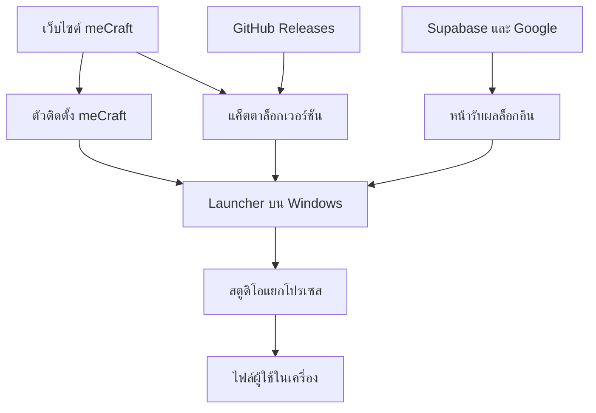

# meCraft Blueprint

แผนหลักสำหรับเว็บไซต์ Launcher ระบบบัญชี ระบบออกเวอร์ชัน และสตูดิโอทั้ง 38 รายการ รวม Launcher รายชื่อเป็นขอบเขตผลิตภัณฑ์ แต่ละรายการขึ้นสถานะพร้อมใช้จากผลทดสอบของรุ่นที่จะเผยแพร่

## ภาพรวมระบบ

ซอร์ส Launcher และสตูดิโออยู่ใน `apps/` ของ monorepo ใช้ `packages/core-bridge` สำหรับรอยต่อเดสก์ท็อปและบริการที่มีอยู่ ใช้ `packages/ui-tokens` สำหรับหน้าตาร่วม และ `packages/studio-shell` เฉพาะแอปที่ใช้ shell เดียวกัน ใช้ `packages/photo-core` สำหรับงานปรับภาพในเครื่องตามความเหมาะสม สตูดิโอที่ฟอร์กด้วยเทคโนโลยีอื่น build และติดตั้งเป็นแพ็กเกจของตัวเอง ภายใต้สัญญาการติดตั้งของ Launcher เว็บไซต์ที่ build แล้วส่งเข้ารีโพ meCrafts-web เพื่อ deploy

## ผังเว็บไซต์และสิ่งที่แสดง

| หน้า | เนื้อหาและการใช้งาน |
|---|---|
| `/` หน้าแรก | อธิบายว่า meCraft ใช้ติดตั้งและเปิดโปรแกรมอะไรได้บ้าง ปุ่มหลักดาวน์โหลดสำหรับ Windows รายการสตูดิโอที่พร้อมจริง และทางไปคู่มือ |
| `/studios/` คลังบนเว็บ | ค้นหาและกรองตามงาน การ์ดแสดงชื่อ งานหลัก แพลตฟอร์ม และสถานะ พร้อมใช้/ทดลอง/วางแผน ลิงก์ไปหน้ารายแอป |
| `/studios/<app-id>/` รายละเอียด | ภาพหน้าจอจริง ฟีเจอร์และชนิดไฟล์ที่ทดสอบแล้ว ข้อจำกัด รุ่นล่าสุด ตัวเลือกเปิดบนเว็บเฉพาะที่ทดสอบแล้ว และปุ่มรับผ่าน meCraft สำหรับแอปพร้อมใช้ |
| `/downloads/` ดาวน์โหลด | แสดงตัวติดตั้ง meCraft รุ่นที่เลือก แพลตฟอร์ม ขนาด ลายเซ็นหรือ SHA-256 คู่มือติดตั้งและลิงก์รุ่นก่อน แยกป้ายรุ่นทดสอบชัดเจน ปุ่มติดตั้งโปรแกรมย่อยอยู่ใน Launcher |
| `/help/` ช่วยเหลือ | คู่มือครั้งแรก วิธีแก้ล็อกอินและดาวน์โหลด ข้อจำกัด ความเป็นส่วนตัว เครดิตโอเพนซอร์ส และทางแจ้งปัญหา |
| `/auth` รับผลเข้าระบบ | แสดงกำลังส่งกลับแอป สำเร็จ หมดเวลา หรือให้ลองใหม่ รับสถานะสำเร็จจากแอปจริง |
| `/catalog/v1.json` ข้อมูลสำหรับ Launcher | สร้างจากไฟล์ที่พร้อมปล่อยและเผยแพร่หลังแพ็กเกจเข้าถึงได้ หน้าคลังและ Launcher ใช้รหัสแอปและสถานะชุดเดียวกัน |

เส้นทางในตารางเป็นสเปกเป้าหมาย ตรวจหน้าเดิมและ URL ที่ใช้งานอยู่ก่อนเปลี่ยนเส้นทาง ให้หน้าเว็บอ่านง่ายทั้งมือถือและเดสก์ท็อป มีปุ่มที่ใช้งานด้วยคีย์บอร์ดได้และข้อความเมื่อโหลดไม่ได้ ข้อมูลจากแอป เช่น ไฟล์ผู้ใช้และสถานะติดตั้งในเครื่อง ไม่ต้องส่งให้เว็บไซต์เพื่อแสดงรายการ

## ลำดับแก้รุ่นทดสอบ

| งาน | การเปลี่ยนแปลง | เกณฑ์ผ่าน |
|---|---|---|
| Google Sign-In บน Windows | อนุญาต Supabase เฉพาะโดเมนที่ตั้งค่า ตรวจ redirect ที่ลงทะเบียนและเส้นทางจากเว็บกลับแอป ใช้ตัวรับ loopback อายุสั้นและตรวจสถานะต่อคำขอ ให้เว็บแสดงผลตามการตอบรับจากแอป | เลือกบัญชีแล้วกลับเข้าคลัง แอปลงชื่อออกได้ ลองใหม่ได้หลังยกเลิกหรือหมดเวลา ไม่มีข้อมูลเซสชันใน URL ที่บันทึกหรือในล็อก |
| คลัง meDoc | สร้างแค็ตตาล็อกสาธารณะจากขั้นตอนปล่อยรุ่นผ่านเว็บของโครงการ เก็บฉบับตรวจสอบแล้วสำหรับแสดงสถานะออฟไลน์ และใช้ GitHub Releases เป็นที่เก็บแพ็กเกจ | ทดสอบเมื่อ GitHub จำกัดคำขอ เน็ตหลุด ไม่เคยเปิดแอปมาก่อน และมีแอปติดตั้งแล้ว เปิดแอปที่มีอยู่ได้ในเครื่อง |
| การติดตั้งและอัปเดต | ตรวจรหัสแอป รุ่น สถาปัตยกรรม ขนาด SHA-256 และแหล่งดาวน์โหลด แยกตัวโปรแกรมจากไฟล์ผู้ใช้ เปลี่ยนรุ่นหลังแพ็กเกจผ่านการตรวจ | ติดตั้ง อัปเดต และถอน meDoc จาก Windows เครื่องสะอาดได้ เมื่ออัปเดตเสีย แอปรุ่นเดิมและเอกสารยังเปิดได้ |

ผลตรวจจากคลิปแสดงว่าเว็บล็อกอินแล้ว แอปยังค้างที่ Sign in พบข้อจำกัดการเชื่อมต่อในแอป และพบการจำกัดคำขอ GitHub แยกกัน ยังต้องยืนยันรอยต่อ OAuth ด้วยการทดสอบจริง

## ขอบเขตส่วนกลางและรายสตูดิโอ

- เว็บไซต์แจก Launcher และแค็ตตาล็อกมีสคีมาแบบระบุเวอร์ชัน ข้อมูลรายแพ็กเกจประกอบด้วยรหัสแอป ช่องทาง รุ่น แพลตฟอร์ม URL ขนาด และ SHA-256
- Launcher จัดการแพ็กเกจ สถานะติดตั้ง และเปิดแอปด้วยสิทธิ์ผู้ใช้ทั่วไป คลังและแอปที่ติดตั้งแล้วรองรับการใช้เป็นผู้เยี่ยมชม บัญชีใช้สำหรับฟีเจอร์ที่ต้องซิงก์จริง
- แต่ละสตูดิโอมีรหัสคงที่ รูปแบบไฟล์ที่รองรับ ฐานโค้ดต้นทางและ revision คำสั่ง build ข้อจำกัดออนไลน์ เส้นทางเก็บและย้ายข้อมูล และตัวอย่างไฟล์สำหรับทดสอบก่อนปล่อย
- เริ่มที่ meCraft และ meDoc จากนั้น mePDF/mePhoto, meSheet/meDeck แล้วจึงเพิ่มแอปสร้างสรรค์และวิศวกรรมตามผลจริง แอปที่ยังมีเพียงตัวอย่างแสดงสถานะทดลอง

## เกณฑ์เปลี่ยนฐานและถอดโปรแกรมเดิม

- **meDoc** ใช้เอกสารไทยชุดเดียวกันเทียบ WriterApp เดิม, WordCraft และ Everything Documents วัดการพิมพ์และการจัดหน้า Sarabun, Markdown เดิม, DOCX เปิดซ้ำ และ PDF ไทยที่อ่านและเลือกข้อความได้ สถานะปัจจุบัน PDF เดิมแทนอักขระไทยด้วยเครื่องหมายคำถาม
- **mePDF** อนุญาตให้เปลี่ยนโปรแกรมทั้งตัว ถ้า PdfCraft หรือตัวเลือกอื่นผ่านงานจริงดีกว่า ทดสอบเปิดเอกสารเก่า รวมและแยกหน้า เข้ารหัส OCR ไทย การแก้ภาพสแกนจาก mePhoto และการทำงานออฟไลน์ ข้อมูลและไฟล์ผู้ใช้ต้องอยู่ครบหลังย้าย เก็บรุ่นเดิมให้ย้อนกลับได้จนตรวจรุ่นใหม่ผ่าน แล้วจึงถอดตัวเก่าจากคลังและซอร์สที่ใช้งาน
- **ทุกแอป** ใช้เกณฑ์เดียวกันในการตัดสิน เก็บเดิม ใช้เฉพาะเอนจิน ฟอร์กทั้งตัว หรือเชื่อมแอปแยก ทะเบียนด้านล่างกำหนดงานประเมินรายตัว การอนุมัติใช้จริงเกิดจากผลทดสอบ ความเข้ากันได้ของไฟล์ เงื่อนไขไลเซนส์ และภาระดูแล

## ด่านก่อนเปิดให้คนทั่วไปใช้

1. แก้ Google Sign-In และการอ่านแพ็กเกจของ Launcher ตามแผนด้านบน
2. ติดตั้ง meCraft บน Windows เครื่องสะอาด แล้วทดสอบติดตั้ง เปิด อัปเดต และถอน meDoc จากคลัง ทดสอบเน็ตขาด แพ็กเกจเสีย และการเปิดงานเดิมหลังอัปเดต
3. ทดสอบเอกสารไทยจริงผ่านฐาน meDoc ที่เลือก ให้อาสาสมัครลองด้วยตัวติดตั้งเดียวกับที่จะเผยแพร่ ก่อนอัปเดตสถานะบนเว็บ
4. เพิ่มสตูดิโอเป็นรอบตามทะเบียน เริ่มจากงานเอกสารและภาพ ตรวจ build ตัวติดตั้ง คู่มือ และผลทดสอบของแต่ละแอปก่อนแสดงปุ่มดาวน์โหลด

### การเตรียมเบต้า Launcher รุ่น 1.0.6

- Launcher ใช้ Supabase PKCE สำหรับ Google บน Windows เว็บส่งรหัสครั้งเดียวจาก `/desktop-auth/` กลับทาง loopback แล้วแสดงผลตามการตอบกลับของ Launcher ลงทะเบียน URL ของหน้านี้ใน Supabase Redirect URLs และตรวจด้วยบัญชีจริงก่อนเปิดเบต้า
- แอปอ่าน `/catalog/v1.json` จากเว็บไซต์และเก็บสำเนาที่ผ่านการตรวจในเครื่อง หลังเผยแพร่แพ็กเกจ งาน release สร้าง artifact `mecraft-package-catalog` จากข้อมูลบน GitHub เผยแพร่ไฟล์นั้นที่ path เดิมในรีโพเว็บไซต์หลังตรวจแพ็กเกจ พร้อมทดสอบ HTTP และ CORS จาก WebView
- สร้างตัวติดตั้งจากสาขาทดสอบและทดสอบด้วย Windows เครื่องสะอาด เบต้าสาธารณะเผยแพร่เป็น GitHub prerelease ในกลุ่ม tag `preview-launcher-*` หลังตรวจลายเซ็น Authenticode และ publisher ของไฟล์เดียวกัน หากยังไม่มีผู้ลงนาม เก็บไฟล์เป็นตัวทดสอบส่วนตัว

## การคัดเลือกโอเพนซอร์ส

ทุกตัวเลือกเริ่มจากรีโพต้นทางและ revision ที่ตรวจสอบได้ ตรวจไลเซนส์ระดับแอปและ dependency แยกจากไลเซนส์ของรีโพรวม จากนั้นทดสอบงานจริงแบบออฟไลน์ การนำเข้าและเปิดไฟล์เดิม และเวลาในการผสาน เลือกใช้ได้ตั้งแต่ศึกษาวิธีทำ ใช้เฉพาะเอนจิน ไปจนถึงฟอร์กหรือเชื่อมแอปแยก บันทึกเครดิตและขอบเขตการเปลี่ยนแปลงก่อนแจก

## ผลตรวจ The Everything Project

ตรวจพบ 51 โฟลเดอร์ระดับแรกใน `src` ของ revision ที่ตรวจ รวมโฟลเดอร์ทรัพยากรด้วย ตัวเลขจึงบอกขนาดรีโพ ส่วนความพร้อมวัดจาก build และงานรายแอป รีโพหลักระบุ MIT ขณะที่หลายแอปมี LICENSE แบบ AGPL-3.0 ของตัวเอง ผลด้านล่างมาจากซอร์ส เอกสาร และไฟล์ไลเซนส์ต้นทาง ยังไม่ได้ build หรือรันแอป upstream

| เป้าหมาย meCraft | ส่วนที่ควรนำมาทดลอง | ข้อจำกัดและเกณฑ์เลือก |
|---|---|---|
| meDoc | Documents มีเอนจิน canvas, DOCX และ playground แบบ local เป็นตัวเทียบกับ WordCraft และ WriterApp เดิม | README ระบุ MIT ตามไลเซนส์หลัก เว้นส่วนที่ระบุเป็นอย่างอื่น ทดสอบ Sarabun การวางวรรณยุกต์ แบ่งหน้า DOCX เปิดซ้ำ และ PDF ไทย ก่อนเลือกว่าจะใช้เอนจินหรือฟอร์ก [Documents](https://github.com/HeyPuter/everything/tree/d8247a3eeeeb61ad6210e8be7e9ccaeaecfd310c/src/documents) |
| meSheet | Spreadsheet มีโฟลว์เปิดและบันทึก XLSX กับสูตรวันที่และวันทำงาน ใช้เป็นกรณีเทียบกับ GridCraft | AGPL-3.0 และการบันทึกหลักผูก Puter cloud เช็กสูตรไทย วันที่ และนำเข้า–ส่งออก XLSX โดยไม่ใช้บัญชี [Spreadsheet](https://github.com/HeyPuter/everything/tree/d8247a3eeeeb61ad6210e8be7e9ccaeaecfd310c/src/spreadsheet) |
| meDeck | Presentation มีเส้นทางแก้ นำเสนอ และส่งออก PPTX พร้อมพื้นที่ทดสอบ ให้เทียบกับ DeckCraft | AGPL-3.0 ทดสอบฟอนต์ไทย แม่แบบ ภาพ และความคงเดิมหลังเปิดไฟล์กลับ [Presentation](https://github.com/HeyPuter/everything/tree/d8247a3eeeeb61ad6210e8be7e9ccaeaecfd310c/src/presentation) |
| mePDF | ใช้เป็นตัวเทียบเรื่อง local download, rendering และ OCR ชุดเครื่องมือทับกับของเดิมหลายส่วน เช่น pdf-lib, PDF.js | AGPL-3.0 พบ dependency ข้อมูล OCR ภาษาอังกฤษ ทดสอบโมเดลไทยแยก ลองเพิ่มเฉพาะส่วนที่ผลดีกว่า [PDF](https://github.com/HeyPuter/everything/tree/d8247a3eeeeb61ad6210e8be7e9ccaeaecfd310c/src/pdf) |
| meCAD | CAD มีแนวทาง drafting 2D, WebGL2, มิติ และไฟล์ DXF/DWG ใช้เป็นตัวเทียบกับ CADCraft | AGPL-3.0 และใช้ Puter.js สำหรับ backend ทดสอบหน่วย พิกัด และการเปิดซ้ำ โดยเริ่ม DXF เป็นไฟล์อ้างอิง [CAD](https://github.com/HeyPuter/everything/tree/d8247a3eeeeb61ad6210e8be7e9ccaeaecfd310c/src/cad) |
| mePhoto, meVector | Photo Studio มี WebGPU และ WebGL2 fallback, PSD, layers และ masks ส่วน Vector Studio มีคลังกราฟิกและการเก็บการแก้ไขออฟไลน์ | ทั้งคู่ AGPL-3.0 ใช้เทียบความเร็วและคุณภาพ PSD/SVG รวมความเข้ากันได้กับเครื่องที่ไม่มี WebGPU [Photo Studio](https://github.com/HeyPuter/everything/tree/d8247a3eeeeb61ad6210e8be7e9ccaeaecfd310c/src/photo-studio) · [Vector Studio](https://github.com/HeyPuter/everything/tree/d8247a3eeeeb61ad6210e8be7e9ccaeaecfd310c/src/vector-studio) |
| meAudio, meFilm | Audio Studio ใช้ AudioWorklet และแชร์แกนผสมเสียงกับออฟไลน์เรนเดอร์ ใช้เทียบกับ SoundCraft ส่วน Video Studio ใช้เป็นตัวเทียบ workflow กับ FilmCraft | ทั้งคู่ AGPL-3.0 วัดเสียงหลายแทร็ก การตรงกันของภาพและเสียง และเวลาส่งออก [Audio Studio](https://github.com/HeyPuter/everything/tree/d8247a3eeeeb61ad6210e8be7e9ccaeaecfd310c/src/audio-studio) · [Video Studio](https://github.com/HeyPuter/everything/tree/d8247a3eeeeb61ad6210e8be7e9ccaeaecfd310c/src/video-studio) |
| meWhiteboard, me3D | Whiteboard มีการแก้พร้อมกันและกู้การแก้แบบออฟไลน์ ส่วน 3D มีพื้นที่ให้เทียบงาน viewer และแก้โมเดล | ทั้งคู่ AGPL-3.0 ทดสอบงาน local ของเราแยกจาก cloud และตรวจ telemetry ของ Whiteboard ก่อนนำมาพิจารณา [Whiteboard](https://github.com/HeyPuter/everything/tree/d8247a3eeeeb61ad6210e8be7e9ccaeaecfd310c/src/whiteboard) · [3D](https://github.com/HeyPuter/everything/tree/d8247a3eeeeb61ad6210e8be7e9ccaeaecfd310c/src/3d) |
| meForm | Surveys มีการสร้างแบบสอบถาม แชร์ลิงก์ และรวบรวมคำตอบ เทียบกับ Formbricks | ใช้ Puter สำหรับข้อมูลแบบสอบถาม นำมาเทียบใน meForm ส่วน meSurv เป็น GIS/สำรวจพิกัดคนละงาน [Surveys](https://github.com/HeyPuter/everything/tree/d8247a3eeeeb61ad6210e8be7e9ccaeaecfd310c/src/survey) |
| meIDE | API Client เป็นผู้สมัครสำหรับเครื่องมือสร้างและทดสอบคำขอ API ทั่วไป มีชุด unit และ browser test และ README ระบุ cloud sync เป็นทางเลือก | README อ้าง MIT ของรีโพรวมตามเงื่อนไข ตรวจ dependency และทดสอบ local workflow ก่อนย้ายเป็นเครื่องมือใน meIDE ให้เก็บ credential ในเครื่อง [API Client](https://github.com/HeyPuter/everything/tree/d8247a3eeeeb61ad6210e8be7e9ccaeaecfd310c/src/api-client) |

ให้ทดลอง **Documents** และ **API Client** ก่อนหากทดสอบออฟไลน์และเงื่อนไขแจกจ่ายผ่าน ส่วนแอป AGPL ใช้เป็นตัวเทียบความสามารถในรอบนี้ การเลือกฟอร์กเพื่อแจกต้องประเมินข้อกำหนดของรุ่นที่เลือกและต้นทุนเปลี่ยน Puter cloud เป็นระบบของ meCraft สำหรับกลุ่ม email/calendar/teamchat/projects และเครื่องมือธุรกิจ ให้เก็บไว้เป็นผู้สมัครระยะถัดไปตามความต้องการจริง [รีโพต้นทาง](https://github.com/HeyPuter/everything) · [คำอธิบายสัญญาอนุญาต GNU](https://www.gnu.org/licenses/gpl-faq.html)

## ทะเบียนรายโปรแกรม

### ศูนย์กลาง

| โปรแกรม | ที่พบ | แนวทางแรก | ต้นทางที่ควรเทียบ | ตัวอย่างงานที่ต้องผ่าน |
|---|---|---|---|---|
| meCraft (`mecraft-launcher`) | ซอร์ส | ใช้ Launcher เดิม | ระบบแพ็กเกจ Windows ที่มีใน repo | ติดตั้ง/อัปเดต/ถอน meDoc จากเครื่องสะอาดได้ |

### เอกสารและเครื่องมือเขียน

| โปรแกรม | ที่พบ | แนวทางแรก | ต้นทางที่ควรเทียบ | ตัวอย่างงานที่ต้องผ่าน |
|---|---|---|---|---|
| meDoc | ซอร์ส | ทดลองฟอร์กเทียบกับใช้เอนจิน | [WordCraft](https://github.com/storytold/wordcraft#license-and-credits) · [LibreOffice](https://github.com/LibreOffice/core) | บันทึกข้อความไทย, DOCX เปิดซ้ำ, PDF ไทยเลือกข้อความได้ |
| mePDF | ซอร์ส | เก็บของเดิมและเทียบเอนจิน | [PdfCraft](https://github.com/storytold/pdfcraft#license-and-credits) · [qpdf](https://github.com/qpdf/qpdf) | รวม/แยก/เข้ารหัส, OCR ไทย, เปิด PDF ที่แก้แล้วได้ |
| meSheet | ซอร์ส | ทดลองฟอร์ก | [GridCraft](https://github.com/storytold/gridcraft#license-and-credits) · [ONLYOFFICE](https://github.com/ONLYOFFICE/DesktopEditors) | สูตรและ XLSX เปิดซ้ำ, วันเดือนปีไทย, BAHTTEXT |
| meDeck | ซอร์ส | ทดลองฟอร์ก | [DeckCraft](https://github.com/storytold/deckcraft#license-and-credits) · [LibreOffice](https://github.com/LibreOffice/core) | PPTX เปิดซ้ำ, ฟอนต์ไทย, ภาพและ PDF |
| meNote | บลูพริ้นท์ | เชื่อมแอปหรือทดลองฟอร์ก | [Joplin](https://github.com/laurent22/joplin) | สร้างโน้ต/แนบไฟล์/ค้นภาษาไทยแบบออฟไลน์และย้ายสมุดได้ |
| meForm | บลูพริ้นท์ | เชื่อมบริการ | [Formbricks](https://github.com/formbricks/formbricks) | สร้างฟอร์ม แชร์ เก็บคำตอบ และส่งออก ตั้งขอบเขตข้อมูลและโฮสติ้ง |
| meIDE | ซอร์ส | เก็บตัวแอป ใช้ editor เป็นส่วนประกอบ | [Monaco](https://github.com/microsoft/monaco-editor) | เปิดโฟลเดอร์ แก้หลายไฟล์ บันทึก UTF-8 และกู้ไฟล์หลังปิดผิดปกติ |

### ภาพ ออกแบบ และสามมิติ

| โปรแกรม | ที่พบ | แนวทางแรก | ต้นทางที่ควรเทียบ | ตัวอย่างงานที่ต้องผ่าน |
|---|---|---|---|---|
| mePhoto | ซอร์ส | เก็บสแกนเดิมและทดลองฐานแต่งภาพ | [PhotoCraft](https://github.com/storytold/photocraft#license-and-credits) · [libvips](https://github.com/libvips/libvips) | แต่งภาพแบบเลเยอร์ และคงปรับเอกสารสี่มุม/ส่งเข้า mePDF |
| meLight | ซอร์ส | ทดลองฟอร์ก | [LightCraft](https://github.com/storytold/lightcraft#license-and-credits) · [darktable](https://github.com/darktable-org/darktable) | เปิด RAW จริง ปรับแบบย้อนกลับได้ ส่ง JPEG/TIFF |
| meVector | ซอร์ส | ทดลองฟอร์ก | [VectorCraft](https://github.com/storytold/vectorcraft#license-and-credits) · [Inkscape](https://gitlab.com/inkscape/inkscape) | แก้ Bézier, SVG เปิดซ้ำ, ส่ง PDF |
| meDesign | ซอร์ส | ประเมินใช้ฐานเดียวกับ meCanvas | [FigCraft](https://github.com/storytold/figcraft#license-and-credits) · [Penpot](https://github.com/penpot/penpot) | สร้าง artboard, component, prototype และทดสอบแก้ไฟล์เดิม |
| meCanvas | บลูพริ้นท์ | ใช้ฐานเดียวกับ meDesign หากงานหลักซ้ำกัน | [FigCraft](https://github.com/storytold/figcraft#license-and-credits) · [Penpot](https://github.com/penpot/penpot) | กำหนดว่าคือ canvas/prototype ใน meDesign หรือมี workflow แยกจริง |
| meWhiteboard | บลูพริ้นท์ | ใช้เอนจินหรือทดลองฟอร์ก | [Excalidraw](https://github.com/excalidraw/excalidraw) · [tldraw](https://github.com/tldraw/tldraw) | กระดานออฟไลน์ เปิดบันทึกเดิมและส่ง SVG ตรวจสัญญา SDK รุ่นที่ใช้ |
| meLayout | บลูพริ้นท์ | ทดลองฟอร์ก | [DesignCraft](https://github.com/storytold/designcraft#license-and-credits) · [Scribus](https://github.com/scribusproject/scribus) | จัดหนังสือหลายหน้า วางไทย และส่ง PDF พิมพ์จริง |
| mePaint | บลูพริ้นท์ | เชื่อมแอปก่อน ทดลองฟอร์กตามความต่าง | [Krita](https://github.com/KDE/krita) | แรงกดปากกา, แปรงและเลเยอร์, เปิดและแก้ไฟล์ซ้ำ |
| meFont | บลูพริ้นท์ | เชื่อมแอปหรือใช้เครื่องมือเฉพาะ | [FontForge](https://github.com/fontforge/fontforge) | แก้ glyph ไทยและส่ง TTF/OTF ทดสอบสระและวรรณยุกต์ |
| meColor | บลูพริ้นท์ | ใช้ไลบรารีในสตูดิโอที่ต้องการ | [TinyColor](https://github.com/bgrins/TinyColor) | หยิบสี สร้างพาเลต ส่งต่อไปยังแอปภาพและออกแบบ |
| me3D | ซอร์ส | ใช้ไลบรารีเดิมหรือเชื่อมโปรแกรมสร้างโมเดล | [Three.js](https://github.com/mrdoob/three.js) · [Blender](https://github.com/blender/blender) | ดู glTF/OBJ/STL และวัดความต่างระหว่าง viewer กับงานสร้างโมเดล |
| meTexture | แค็ตตาล็อกเว็บ | เชื่อมแอปหรือทดลองฟอร์ก | [ArmorPaint](https://github.com/armory3d/armorpaint) · [Blender](https://github.com/blender/blender) | ลงสีบน mesh ส่ง PBR textures และนำเข้าโปรแกรมอื่นได้ |
| meMaterial | แค็ตตาล็อกเว็บ | ทดลองฟอร์กหรือใช้มาตรฐานแลกไฟล์ | [Material Maker](https://github.com/RodZill4/material-maker) · [MaterialX](https://github.com/AcademySoftwareFoundation/MaterialX) | สร้าง node graph, ส่ง material maps และเปิดผลในแอป 3D |
| meVision | แค็ตตาล็อก | ใช้เอนจินและโมเดลที่แจกได้ | [ONNX Runtime](https://onnxruntime.ai/) · [Tesseract](https://github.com/tesseract-ocr/tesseract) | OCR และถามตอบเอกสารไทยออฟไลน์ มีเลขหน้าอ้างอิง ตรวจไลเซนส์น้ำหนักโมเดล |

### วิดีโอ เสียง และแอนิเมชัน

| โปรแกรม | ที่พบ | แนวทางแรก | ต้นทางที่ควรเทียบ | ตัวอย่างงานที่ต้องผ่าน |
|---|---|---|---|---|
| meFilm | ซอร์ส | ทดลองฟอร์ก | [FilmCraft](https://github.com/storytold/filmcraft#license-and-credits) · [Kdenlive](https://github.com/KDE/kdenlive) | ตัดคลิปหลายแทร็ก เปิดโปรเจกต์ซ้ำ ส่งไฟล์วิดีโอและเสียงตรงกัน |
| meAudio (meSound ในเอกสารเดิม) | ซอร์ส | ทดลองฟอร์ก | [SoundCraft](https://github.com/storytold/soundcraft#license-and-credits) · [Audacity](https://github.com/audacity/audacity) | อัด/แก้ WAV หลายแทร็ก ทดสอบ export และปลั๊กอินที่เลือก |
| meMotion | ซอร์ส | ทดลองฟอร์ก | [EffectCraft](https://github.com/storytold/effectcraft#license-and-credits) · [Natron](https://github.com/NatronGitHub/Natron) | คีย์เฟรม คอมโพสิต และส่งภาพ/วิดีโอแบบ alpha |
| meClip | บลูพริ้นท์ | แชร์ฐาน meFilm ก่อนตัดสินใจแยก | [FilmCraft](https://github.com/storytold/filmcraft) · [OpenShot](https://github.com/OpenShot/openshot-qt) | ตัดคลิปเร็ว ใส่คำบรรยาย ส่งแนวตั้งใน workflow เดียว |
| meAni | แค็ตตาล็อกเว็บ | เชื่อมแอปหรือทดลองฟอร์ก | [Synfig](https://github.com/synfig/synfig) · [Glaxnimate](https://github.com/KDE/glaxnimate) | ทดสอบ rig/inverse kinematics และส่ง sprite หรือ Lottie ตามขอบเขตจริง |

### แปลงไฟล์และเครื่องมือทั่วไป

| โปรแกรม | ที่พบ | แนวทางแรก | ต้นทางที่ควรเทียบ | ตัวอย่างงานที่ต้องผ่าน |
|---|---|---|---|---|
| meDrop | ซอร์ส | เก็บ HUD เดิม ประเมินระบบส่งไฟล์เพิ่มเมื่อจำเป็น | [LocalSend](https://github.com/localsend/localsend) | ลากไฟล์แล้วเปิดแอป/แปลงได้ ส่วนส่งข้ามเครื่องทดสอบสิทธิ์และวง LAN แยก |
| meConverter | บลูพริ้นท์ | ใช้เอนจินร่วมกับ meDrop/mePDF | [FFmpeg](https://github.com/FFmpeg/FFmpeg) · [ImageMagick](https://github.com/ImageMagick/ImageMagick) · [Stirling-PDF](https://github.com/Stirling-Tools/Stirling-PDF) | แปลงไฟล์จริงทีละชุด ทำงานออฟไลน์ และตรวจ build option/codec ที่แจก |
| meCompress | บลูพริ้นท์ | ใช้ไลบรารีหรือเชื่อม CLI | [libarchive](https://github.com/libarchive/libarchive) · [7-Zip](https://github.com/ip7z/7zip) | สร้างและแตก ZIP/7z ตามที่รองรับ จัดการ Unicode และจำกัดเส้นทางแตกไฟล์ |
| meSign | บลูพริ้นท์ | แยกการเซ็นไฟล์ในเครื่องกับบริการขอลายเซ็น | [OpenSign](https://github.com/OpenSignLabs/OpenSign) | กำหนดชนิดลายเซ็นที่รองรับ ตรวจเอกสารหลังเซ็นและบันทึกเหตุการณ์ |
| meScan | บลูพริ้นท์ | เชื่อมตัวสแกน ทำงานร่วมกับ mePhoto | [NAPS2](https://github.com/cyanfish/naps2) · [Tesseract](https://github.com/tesseract-ocr/tesseract) | สแกนหลายหน้า หมุน แก้เอียง ส่ง PDF ค้นข้อความได้ |

### วิศวกรรม วิเคราะห์ และผลิตภัณฑ์แยก

| โปรแกรม | ที่พบ | แนวทางแรก | ต้นทางที่ควรเทียบ | ตัวอย่างงานที่ต้องผ่าน |
|---|---|---|---|---|
| meCAD | บลูพริ้นท์และเว็บ | ทดลองฟอร์ก | [CADCraft](https://github.com/storytold/cadcraft#license-and-credits) · [FreeCAD](https://github.com/FreeCAD/FreeCAD) | ทดสอบ DXF หน่วยและสเกล งาน 2D แยกจาก parametric 3D และ DWG |
| meSurv | ผลิตภัณฑ์แยก | เชื่อม QGIS/PROJ หรือใช้เป็นเครื่องมือประกอบ | [QGIS](https://github.com/qgis/QGIS) · [PROJ](https://github.com/OSGeo/PROJ) | นำเข้าข้อมูลสำรวจ แปลง CRS และทวนค่าพิกัดด้วยชุดอ้างอิงไทย |
| meREA | แค็ตตาล็อกเว็บ | เชื่อมเครื่องมือวิเคราะห์ไฟล์แบบสถิต | [Ghidra](https://github.com/NationalSecurityAgency/ghidra) | อ่าน metadata และอธิบายโครงสร้างของตัวอย่างที่อนุญาต |
| meBoard | ผลิตภัณฑ์แยก | ใช้ connector และไลบรารีกราฟ | [OpenBB](https://github.com/OpenBB-finance/OpenBB) · [Apache ECharts](https://github.com/apache/echarts) | ตรวจสิทธิ์แหล่งข้อมูล เวลา ราคา และการทำซ้ำของรายงาน |
| huayork | ผลิตภัณฑ์แยก | คงผลิตภัณฑ์เดิม ใช้ไลบรารีกราฟเมื่อเหมาะ | [Apache ECharts](https://github.com/apache/echarts) | ข้อมูลย้อนหลังและสถิติตรวจย้อนกลับได้ |
| meGameHub | ผลิตภัณฑ์แยก | คง Launcher เกม ใช้เอนจินสำหรับเกมต้นฉบับ | [Godot](https://github.com/godotengine/godot) | ติดตั้งและเปิดเกมที่มีสิทธิ์แจกจริง แยกเครดิตและข้อมูลเซฟรายเกม |

## ช่องว่างที่ควรเพิ่มในแผนระยะยาว

เทียบงานจาก [Adobe Creative Cloud](https://www.adobe.com/creativecloud.html), [แค็ตตาล็อก Adobe](https://www.adobe.com/products/catalog.html), [Microsoft 365](https://www.microsoft.com/en-us/microsoft-365/products-apps-services) และ [ArtCraft](https://getartcraft.com/apps) ใช้เป็นแผนความครอบคลุมของงาน ให้ทีมออกแบบหน้าตาและทรัพยากรของ meCraft เอง

| งานที่ยังไม่มีรายการชัดเจน | แนวทาง | ตัวเลือกต้นทาง |
|---|---|---|
| จัดการอีเมล ปฏิทิน และรายชื่อแบบ Outlook | เชื่อมแอปอีเมลเดสก์ท็อป | [Thunderbird](https://github.com/thunderbird/thunderbird-desktop) |
| ฐานข้อมูลพร้อมฟอร์มแบบ Access | ประเมินเครื่องมือฐานข้อมูลเดสก์ท็อป | [Kexi](https://github.com/KDE/kexi) |
| ผังงานและสถาปัตยกรรมแบบ Visio | ใช้ร่วมกับ meWhiteboard/แอปออกแบบ ผ่านไฟล์มาตรฐาน | [draw.io](https://github.com/jgraph/drawio) |
| งานโครงการแบบ Project/Planner | เชื่อมบริการและรองรับการนำเข้า/ส่งออก | [OpenProject](https://www.openproject.org/open-source/) |
| ซิงก์ แชร์ และทำงานร่วมกันแบบ OneDrive/SharePoint | ประเมินบริการเก็บไฟล์แยกจากแอปออฟไลน์ | [Nextcloud](https://github.com/nextcloud/server) · [Syncthing](https://github.com/syncthing/syncthing) |
| ประชุมและสื่อสารแบบ Teams | ประเมินบริการประชุมพร้อมตัวเลือกโฮสติ้ง | [LiveKit](https://github.com/livekit/livekit) |
| แดชบอร์ดธุรกิจแบบ Power BI | สำรวจบริการที่นำเข้าข้อมูลและแชร์รายงานได้ | [Apache Superset](https://github.com/apache/superset) |
| คิวแปลงสื่อแบบ Media Encoder | เพิ่มใน meConverter ใช้เอนจินร่วมกับ meFilm | [FFmpeg](https://github.com/FFmpeg/FFmpeg) · [HandBrake](https://github.com/HandBrake/HandBrake) |
| คลังรูป สื่อ และ metadata แบบ Bridge | ทดลองเป็นส่วนของ meLight/mePhoto | [darktable](https://github.com/darktable-org/darktable) |
| เขียนและส่งบทความให้ทีมจัดหน้าแบบ InCopy | วางเส้นทาง meDoc → meLayout ก่อนแยกผลิตภัณฑ์ | [WordCraft](https://github.com/storytold/wordcraft) · [DesignCraft](https://github.com/storytold/designcraft) |
| แก้และดูตัวอย่างเว็บแบบ Dreamweaver | เริ่มเป็น workflow ใน meIDE | [Monaco](https://github.com/microsoft/monaco-editor) |
| แอนิเมชันตัวละครและงานสามมิติแบบ Adobe Animate/Character Animator/Substance | เริ่มใน meAni, me3D, meTexture และ meMaterial แยกตามงาน | [Blender](https://github.com/blender/blender) · [Glaxnimate](https://github.com/KDE/glaxnimate) · [Material Maker](https://github.com/RodZill4/material-maker) |
